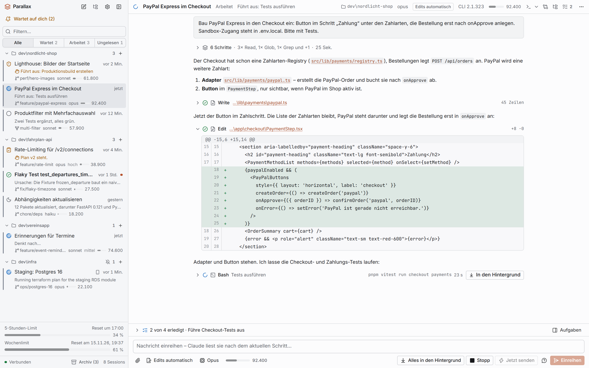
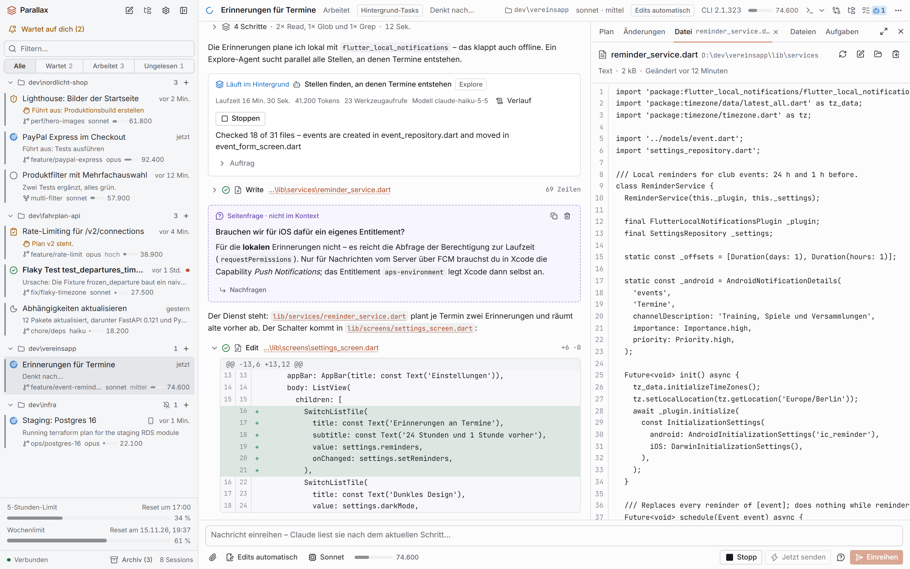

# Parallax

Lokale Mission-Control-App für viele parallele Claude-Code-Sessions unter Windows und Ubuntu
([Ubuntu](#ubuntu): mit Desktop oder als Server ohne Desktop): ein Node-Server
auf `127.0.0.1` steuert je Session das installierte `claude` über das Claude Agent SDK, die Web-UI
läuft als Chrome-App-Fenster. Auf Wunsch steuert ein Parallax auch die Sessions eines anderen Rechners im
selben Netz ([Mehrere Rechner](#mehrere-rechner)). Status: stabile Releases auf GitHub (siehe
[Installieren](#installieren)); Änderungen stehen in `CHANGELOG.md`, der Stand der Arbeitspakete in
`docs/progress.md`.

## So sieht Parallax aus

<picture>
  <source media="(prefers-color-scheme: dark)" srcset="docs/screenshots/overview-dark.png">
  
</picture>

**Viele Sessions auf einen Blick.** Die Seitenleiste zeigt je Projekt, welche Session arbeitet, welche
auf dich wartet (Freigabe, Plan), was fertig und neu ist, dazu Remote Control und die Abo-Limits.
Sie lässt sich in der Breite ziehen und mit Alt+B zu einer schmalen Leiste einklappen, die weiter alle
Sessions zeigt.
Rechts das Transkript der ausgewählten Session: kompakte Schrittgruppen, eine neue Datei, ein Diff und
ein laufender Testlauf, der sich in den Hintergrund schicken lässt; über dem Eingabefeld die To-dos.

<picture>
  <source media="(prefers-color-scheme: dark)" srcset="docs/screenshots/plan-dark.png">
  
</picture>

**Pläne prüfen, ohne den Faden zu verlieren.** Plan v2 wartet nicht modal in der Leiste über dem
Eingabefeld (umsetzen, weiter planen, Feedback geben). Das Seitenpanel zeigt den Plan mit allen
Versionen und den Änderungen zu v1; im Transkript steht v1 mit dem Feedback, das zu v2 geführt hat.

<picture>
  <source media="(prefers-color-scheme: dark)" srcset="docs/screenshots/files-dark.png">
  
</picture>

**Dateien, Seitenfragen, Hintergrund-Agenten.** Dateiverweise im Transkript öffnen die Datei im
Seitenpanel (Syntax-Highlighting, Editor, Explorer). Dazu ein Explore-Agent, der im Hintergrund
weiterläuft und seinen Fortschritt meldet, eine Seitenfrage, die nicht im Kontext landet, und der Diff
der letzten Änderung.

<sub>Projekte und Daten sind erfunden (Showcase im Playground).</sub>

## Installieren
Für die Nutzung: ein Release von GitHub, ohne Klon, pnpm oder Build.

- **Voraussetzungen:** **Node.js 26.9 oder neuer** (der Server liest damit Prozesse selbst, ohne PowerShell,
  und „Mehrere Rechner“ nutzt den Windows-Schlüsselspeicher), das installierte **`claude`**-CLI mit Login,
  Google Chrome.
- **Schritte:** `parallax-<version>-win.zip` von der Release-Seite laden
  (`https://github.com/DerXHelp/parallax/releases`), entpacken und `install.cmd` doppelklicken. Sperren
  SmartScreen oder AppLocker die `.cmd`, ist `node dist\install.js` im entpackten Ordner gleichwertig.
- **Was passiert:** Der Installer prüft die Signatur von `release.json` und jede Datei des Pakets,
  kopiert es nach `%LOCALAPPDATA%\Programs\Parallax\versions\<version>` (anderer Ordner: `--dir <ordner>`)
  und holt das Claude Agent SDK aus der npm-Registry. Es ist nicht im Paket, weil es nicht weitergegeben
  werden darf. Geprüft wird es gegen den Hash aus `release.json`. Eine Firmen-Registry aus `~/.npmrc`
  gilt auch hier (npm neben Node, sonst eigener Download). Ohne erreichbare Registry: `--registry <url>`
  oder den Tarball selbst laden und `--sdk-tarball <datei>` angeben. Dazu kommt der Startmenü-Eintrag
  „Parallax“.
- **Starten:** über das Startmenü oder `%LOCALAPPDATA%\Programs\Parallax\parallax.cmd`, mit denselben
  Optionen wie unter „Starten“. Die Daten liegen getrennt vom Programm in `%LOCALAPPDATA%\Parallax`.
- **Deinstallieren:** `%LOCALAPPDATA%\Programs\Parallax\parallax.cmd --uninstall` entfernt den
  Programmordner, den Startmenü-Eintrag, den Autostart und den `parallax:`-Eintrag. Die Daten bleiben;
  die Meldung nennt ihren Ordner. Bei laufendem Parallax verweigert der Installer das, also vorher
  „Server beenden“.
- `install.cmd --help` zeigt alle Optionen.

### Aktualisieren
- **In der App (ab 1.0.0):** Parallax sucht etwa eine Minute nach dem Start und dann alle 12 Stunden nach
  einer neuen Vollversion auf GitHub (Einstellungen → „Updates“, abschaltbar). Pre-releases werden nie
  angeboten. Ein Hinweis erscheint oben in der Sidebar. „Jetzt aktualisieren“ lädt das Zip im Hintergrund,
  prüft Signatur und Dateien und holt das Agent SDK; die Sessions laufen dabei weiter. Das SDK kommt aus der
  npm-Konfiguration (`~/.npmrc`, `NPM_CONFIG_REGISTRY`) oder aus der Registry, die unter Einstellungen →
  „Updates“ → „npm-Registry für das Agent SDK“ steht (z. B. ein Firmen-Mirror; Anmeldedaten bleiben in
  `~/.npmrc`). Für die erste Installation gilt dafür `install.cmd --registry <url>`. „Neu starten“ beendet
  die Sessions wie „Server beenden…“, wechselt die Version und startet sie; das Fenster verbindet sich von
  selbst wieder und zeigt „Aktualisiert auf <version>“ mit „Was ist neu“. Startet die neue Version nicht,
  kehrt Parallax mit den gesicherten Daten zur alten zurück und meldet das mit dem Pfad zum Protokoll
  (`%LOCALAPPDATA%\Parallax\logs\update-<zeit>.log`).
- **Node.js:** Braucht eine neue Version ein neueres Node.js (die Version nach 1.0.1 braucht 26.9), lehnt
  Parallax das Update ab und nennt die nötige und die installierte Version; die laufende Version bleibt
  unberührt. Ab der Version nach 1.0.1 geschieht das, bevor das Paket geladen wird; 1.0.1 lädt es noch und
  lehnt es nach der Prüfung ab. Node.js aktualisieren, dann erneut „Jetzt aktualisieren“.
- **Aus Datei:** Einstellungen → „Updates“ → „Aus Datei installieren…“ nimmt ein geladenes
  `parallax-<version>-win.zip` an (z. B. ohne Zugang zu GitHub). Geprüft wird es mit dem Code und den
  Schlüsseln der laufenden Version.
- **Ohne die App:** das neue Zip laden, entpacken und `install.cmd` starten. Die **installierte** Version
  prüft das neue Paket mit ihrem eigenen Code und Schlüssel und installiert es neben der alten. Nur die
  allererste Installation vertraut dem geladenen Installer.
- **Läuft Parallax,** installiert `install.cmd` trotzdem. Die neue Version gilt nach Zahnrad → „Server
  beenden…“ und einem neuen Start. Die laufende Version bleibt so lange unberührt.
- **Sicherung:** Beim ersten Start einer neuen Version sichert der Launcher die Daten nach
  `%LOCALAPPDATA%\Parallax\backups\<alt>-zu-<neu>-<zeit>\`. Gesichert werden Einstellungen, Sessions und
  Entscheidungen; von den Transkripten nur die Länge. Die drei jüngsten Sicherungen bleiben. Das gilt
  auch für einen Klon mit `parallax.cmd`.
- **Zurück:** Die vorige Version bleibt installiert. In der App: Einstellungen → „Updates“ → „Zurück zu
  <version>“. Speichert die ältere Version Daten anders, spielt Parallax die Sicherung vom Wechsel ein und
  fragt vorher (Änderungen seit dem Wechsel liegen dann im neuen Sicherungsordner). Ohne die App:
  `parallax.cmd --use <version>`; hat die neue Version die Daten schon migriert, startet die ältere so nicht
  (Exit-Code 3).
- **Umstieg vom Klon (einmal je Rechner):** installieren, im alten Fenster „Server beenden…“, dann
  Parallax über das Startmenü starten. Sind Autostart und „Klick öffnet die Session“ eingeschaltet, zeigen
  sie danach auf die Installation. Den Klon danach löschen oder nicht mehr starten. Ein aktueller Klon
  lässt die Einträge einer Installation in Ruhe; ein alter Klon ohne `git pull` hält sie für fremd und
  warnt nur.

## Ubuntu
Ubuntu 24.04 LTS und 26.04 LTS (x64) werden unterstützt, mit Desktop oder als Server ohne Desktop, den ein anderer
Rechner über [Mehrere Rechner](#mehrere-rechner) steuert. Andere Distributionen sollten gehen, ohne Zusage. WSL ist
kein eigenes Ziel.

- **Voraussetzungen:**
  - **Node.js 26.9 oder neuer als offizieller Build** von nodejs.org oder über fnm/nvm. Das Node aus den
    Ubuntu-Paketquellen ist zu alt. Ein minimales Ubuntu braucht dazu `libatomic1` (`sudo apt install libatomic1`).
  - **`claude`** über den nativen Installer mit Login. Parallax nimmt `~/.local/bin/claude` oder ein `claude` auf
    dem `PATH`; die npm-Variante (`cli.js`) wird abgelehnt.
  - Mit Desktop zusätzlich **Google Chrome oder Chromium**. Snap-Chromium geht auch und bekommt ein eigenes Profil.
- **Installieren:** `parallax-<version>-linux-x64.tar.gz` von der Release-Seite laden, entpacken
  (`tar -xzf parallax-<version>-linux-x64.tar.gz`) und im entpackten Ordner `sh install.sh` ausführen. Kein
  `sudo`: das Programm liegt in `~/.local/lib/parallax/versions/<version>`, der Befehl `parallax` in
  `~/.local/bin`, die Daten getrennt davon in `~/.local/share/parallax` (bzw. `$XDG_DATA_HOME/parallax`). Signatur,
  Dateiprüfung, Agent SDK und Registry wie unter [Installieren](#installieren); `sh install.sh --help` zeigt alle
  Optionen. Liegt `~/.local/bin` nicht im `PATH`, sagt der Installer das.
- **Mit Desktop:** `parallax` öffnet das App-Fenster wie unter Windows. Programmmenü-Eintrag, Autostart (`.desktop`
  in `~/.config/autostart`) und „Klick öffnet die Session“ (`parallax:`-Links über `xdg-mime`) richten die
  Einstellungen ein. Benachrichtigungen kommen vom Desktop (`notify-send`). „In externer Konsole öffnen“ und „Shell
  im Ordner öffnen“ nutzen einen Terminal-Emulator: den aus Einstellungen → „Konsole“, sonst
  `xdg-terminal-exec`, `x-terminal-emulator` oder einen bekannten (GNOME Terminal, Ptyxis, Konsole, kitty …). Editor
  und „Im Dateimanager zeigen“ gehen über `xdg-open` und den Dateimanager des Desktops; Notepad++ gibt es unter
  Linux nicht, die Vorgabe öffnet dann das Standardprogramm.
- **Terminal:** Das eingebettete Terminal startet die Login-Shell oder bash, zsh, fish, pwsh, soweit installiert.
  „Im Terminal fortsetzen“ übergibt eine Session an `claude --resume` in diesem Terminal; Parallax holt sie zurück,
  sobald `claude` dort endet.
- **Server-Modus ohne Desktop:** `parallax --server` startet den Server im Vordergrund ohne Fenster und ohne
  Desktop-Aktionen (Konsolenfenster, Editor, Benachrichtigungen). Als Dienst beim Systemstart:
  `parallax service install` (systemd-Benutzerdienst, Status mit `parallax service status`, entfernen mit
  `parallax service uninstall`). Damit er ohne Anmeldung läuft, einmal `sudo loginctl enable-linger <benutzer>`.
  Läuft für den Datenordner schon ein Server, übernimmt `parallax --server` ihn, statt einen zweiten zu starten; ein
  Update in der App wechselt die Version, ohne dass der Dienst endet.
- **Vom anderen Rechner steuern:** auf dem Server `parallax remote enable` (Freigeben), dann
  `parallax remote pair --level manage`. Der Kopplungscode erscheint nur in diesem Terminal. Auf dem steuernden
  Rechner unter „Andere steuern“ → „Rechner hinzufügen…“ Adresse, Port (Standard 4713) und Code eintragen. Die
  Stufe **„Verwalten“** erlaubt dem steuernden Rechner zusätzlich Einstellungen und Server dieses Rechners; die
  Stufe **„Steuern“** nur die Sessions. Hinauf geht die Stufe nur vor Ort (`parallax remote level manage`).
  Das Terminal eines gekoppelten Rechners läuft über die Kopplung. Weitere Befehle: `parallax remote status`,
  `disable`, `cancel`, `unpair`. Eine Firewall (`ufw`) muss den Port im lokalen Netz zulassen; Parallax ändert sie
  nicht.
- **Schlüssel für „Mehrere Rechner“:** mit Desktop im Schlüsselbund (GNOME Keyring über Secret Service), ohne
  Desktop ab Ubuntu 26.04 über `systemd-creds --user`. Unter 24.04 ohne Desktop gibt es keinen geschützten Speicher;
  dort legt Parallax die Schlüssel nur mit `parallax --server --key-store=file` in einer Datei ab, die nur der eigene
  Benutzer lesen kann. Wer den Datenordner kopiert, hat dann auch die Schlüssel, deshalb warnt Parallax dabei.
- **Ohne Kopplung, per SSH-Tunnel:** `ssh -L 4711:127.0.0.1:4711 <server>` und auf dem Server
  `parallax --server --print-url`; die ausgegebene Adresse innerhalb von 60 Sekunden lokal in Chrome öffnen. Der
  lokale Port muss dem des Servers gleichen, weil Parallax den `Host`-Header prüft.
- **Aktualisieren und Deinstallieren** wie unter Windows: in der App unter „Updates“ oder mit einer neuen
  `install.sh`; `parallax --uninstall` entfernt Programm, Befehl, `.desktop`-Einträge, `parallax:`-Eintrag und den
  Benutzerdienst dieser Installation. Die Daten bleiben.

## Voraussetzungen
Für die Entwicklung (Klon, Build, Tests):
- **Node.js 26.9 oder neuer** (`engines.node`; die Release-Prüfung läuft mit 26.9.0 und dem neuesten 26).
  `.node-version` enthält `26` für fnm, nvm-windows oder Volta – ein schon installiertes älteres 26.x vorher
  aktualisieren.
- **pnpm 12.17.0**: einmalig `npm i -g pnpm@12.17.0`. `packageManager` und der Lockfile pinnen die
  Version; ein pnpm ≥ 10 lädt sie bei Abweichung selbst nach (`managePackageManagerVersions`; geprüft
  13.11.2026 mit pnpm 12.8.2 → 12.17.0). Ein zu altes pnpm scheitert an `engines.pnpm: ">=12.8"`.
- Das installierte **`claude`**-CLI mit Login (Parallax liefert kein Claude-Binary mit).
- **Google Chrome** (für das App-Fenster und die E2E-Tests; Playwright lädt keine Browser). Parallax
  nutzt nur Chrome – ohne Chrome öffnet der Launcher kein Fenster (Ausweg `--print-url`, ADR-136).

## Installation und Start
```powershell
pnpm install          # bzw. pnpm install --frozen-lockfile
pnpm dev              # Server (FakeBackend, Port 4712) + Vite: http://127.0.0.1:5173
pnpm check            # typecheck + lint + test
pnpm build            # dist/web + dist/server.js
pnpm start            # Launcher: baut bei Bedarf, startet den Server unsichtbar, öffnet Chrome
```
`pnpm dev` verbraucht keine Tokens (FakeBackend) und nutzt `.parallax-dev/` statt
`%LOCALAPPDATA%\Parallax`. Die Anmelde-Adresse `http://127.0.0.1:5173/#code=…` (10 min gültig)
steht beim Start im Server-Log; Vite leitet `/api` (auch den WebSocket) an Port 4712 weiter.
`tsx watch` startet den Server bei jeder Änderung neu (Sessions des FakeBackends enden dabei).
„Server beenden“ beendet im Dev-Modus nur den Server – `tsx watch` und Vite laufen weiter, bis
`Ctrl+C` oder die nächste Dateiänderung kommt. `pnpm dev:live` nutzt das echte `claude`; der
Vite-Dev-Server liefert die Seite ohne CSP aus und das Dev-Cookie gilt für jede Seite auf
`127.0.0.1:5173` – `dev:live` daher nur in einem eigenen Chrome-Profil öffnen (z. B. per Win+R
`chrome --user-data-dir=%TEMP%\px-dev-chrome --disable-sync http://127.0.0.1:5173/#code=…`, R3-14).

Die SDK-Plattform-Binaries (~270 MB) werden per `ignoredOptionalDependencies` in
`pnpm-workspace.yaml` nicht installiert. Install-Skripte darf nur `esbuild` ausführen
(`allowBuilds`); die pnpm-Defaults `strictDepBuilds`, `minimumReleaseAge` (1 Tag) und
`blockExoticSubdeps` bleiben aktiv.

## Starten
Parallax läuft als unsichtbarer Hintergrund-Server mit Chrome-App-Fenstern (ohne Installation):

```powershell
.\parallax.cmd                 # Doppelklick genügt; alternativ .\parallax.ps1 oder pnpm start
.\parallax.cmd --port=4800     # anderer Port (auch PARALLAX_PORT), Daten: --home=<dir> / PARALLAX_HOME
.\parallax.cmd --help          # alle Optionen
pnpm start --print-url         # Optionen direkt anhängen (pnpm reicht ein `--` wörtlich weiter)
```

- **Erster Start / nach `git pull`:** Der Launcher baut `dist/`, wenn es fehlt oder die Build-ID
  nicht zum Checkout passt (dauert beim ersten Mal etwa eine Minute), startet den Server
  unsichtbar im Hintergrund (`node dist/server.js`, Ausgabe in
  `%LOCALAPPDATA%\Parallax\logs\server.out.log`, Log `parallax.*.log`) und öffnet Chrome als
  App-Fenster mit eigenem Profil (`%LOCALAPPDATA%\Parallax\chrome`). Das Konsolenfenster schließt
  sich danach von selbst; bei einem Fehler bleibt es mit der Meldung offen.
- **Läuft Parallax schon,** öffnet ein weiterer Start nur ein zusätzliches Fenster (Erkennung über
  `server.lock.json` + Health-Ping; ein verwaistes Lockfile nach einem Absturz wird ignoriert).
  Ein Doppelklick startet trotzdem nur einen Server: der zweite Start wartet („… by another
  launcher - waiting for it“) und öffnet dann ein Fenster dieses Servers. Läuft der Server mit
  einem anderen Backend als angefordert (z. B. ein FakeBackend-Server, während `parallax.cmd`
  ohne Optionen das echte `claude` will), meldet der Launcher das als Fehler statt ein Fenster zu
  öffnen.
- **Neuer Build bei laufendem Server:** Ein laufender Server übernimmt einen neuen Build erst nach
  „Server beenden“ und erneutem Start. Er liefert die UI aus einer beim Start fixierten Kopie
  (`%LOCALAPPDATA%\Parallax\ui\<build>`); ein `pnpm build`/`pnpm e2e` im selben Checkout ändert
  also nichts an seinen Fenstern. Die Build-ID hängt nur an Build-Eingaben (Quellen, Configs,
  Lockfile) – ein reiner Doku-Commit erzwingt keinen Neubau. Launcher, `pnpm e2e` und
  `pnpm build` bauen einen Checkout nie gleichzeitig (der zweite wartet; auch auf einem
  Netzlaufwerk).
- **Fenster schließen beendet den Server nicht** – die Sessions laufen weiter. Beenden über das
  Zahnrad-Menü → „Server beenden…“: Die Rückfrage nennt die arbeitenden und wartenden Sessions.
  Jede Session bekommt bis zu 5 s für ein sauberes Ende (Transkript, SessionEnd-Hooks), erst
  danach wird ihr Prozessbaum beendet – „Server beenden“ dauert also gut 5 s, wenn eine Session
  noch arbeitet. Wartet eine Session auf eine Entscheidung und hat noch eine Nachricht in der
  Warteschlange, wird ihr Prozess sofort beendet (sonst würde `claude` die Nachricht noch
  bearbeiten); die Nachricht erscheint im Verlauf als „nicht zugestellt“.
- **Fehlermeldungen:** Port belegt → `--port=<n>` wählen; „written by a newer Parallax“ (Exit-Code
  3) → Parallax aktualisieren (neues Release installieren, im Klon `git pull` und `pnpm install`), die
  Daten bleiben unverändert; Server
  startet nicht → Pfad der Logdatei steht in der Meldung; „Google Chrome was not found“ → Chrome
  installieren (es gibt keinen Rückfall auf Edge) oder `--print-url` (Adresse mit Einmal-Code, 60 s
  gültig) in einem Chromium-Browser öffnen.
- Exit-Codes von `dist/server.js` (zeigt der Launcher an): 0 regulär beendet, 1 Fehler (auch
  ungültige Option), 3 Daten einer neueren Parallax-Version, 4 Port belegt, 5 für dieses
  Datenverzeichnis läuft schon ein Server.
- Weitere Optionen: `--backend=fake` bzw. `PARALLAX_BACKEND=fake` (FakeBackend, startet kein
  `claude` – zum Ausprobieren und für Smoke-/E2E-Tests des echten Startpfads; **nur mit eigenem
  `--home`/`PARALLAX_HOME`**, auf `%LOCALAPPDATA%\Parallax` verweigert der Server den Start),
  `--no-build` (kein Build-Check), `--validate=log|throw|off` (Prüfung ausgehender Daten gegen den
  Contract; Default `log`: ungültige Werte werden geloggt, gezählt und verworfen),
  `--toasts=native|off` (Windows-Toasts, siehe „Benachrichtigungen“). In `claude`-Sessions
  kommen von den `PARALLAX_*`-Variablen des Servers nur `PARALLAX=1` und `PARALLAX_ENTRY_ID` an –
  ein `pnpm test`/`pnpm start` in einer Parallax-Session greift nie auf dessen Datenordner zu. Für den
  produktiven Einsatz: siehe „Produktiv nutzen und weiterentwickeln“.
- Ausprobieren ohne die eigenen Daten anzufassen (PowerShell):
  `$env:PARALLAX_BACKEND='fake'; $env:PARALLAX_HOME="$env:TEMP\px-try"; pnpm start`.
- Startet ein Terminal den Launcher in einem Job-Objekt, das beim Schließen alle Prozesse beendet,
  endet auch der Server – im Zweifel `parallax.cmd` per Doppelklick starten.

### Produktiv nutzen und weiterentwickeln
- **Benutzt wird die Installation** aus einem Release (siehe „Installieren“ und „Aktualisieren“);
  entwickelt wird im Entwicklungs-Repo auf Feature-Branches. Releases entstehen aus `main`, dem stabilen,
  geprüften Stand (Branch-Regeln: `CLAUDE.md` „Git“). Autostart und „Klick öffnet die Session“ nur in der
  Installation einschalten: Verknüpfung und `parallax:`-Eintrag zeigen auf das Programm, aus dem der
  Server läuft.
- **Ohne Installation** geht es weiter mit einem eigenen Klon:
  `git clone https://github.com/DerXHelp/parallax.git <ordner>`, darin `pnpm install --frozen-lockfile`,
  dann `parallax.cmd` (der erste Start baut `dist/`). Aktualisieren: Zahnrad → „Server beenden…“, im Klon
  `git pull` und `pnpm install --frozen-lockfile`, dann `parallax.cmd` (baut selbst neu). Der Klon bleibt
  der Rückweg, falls die Installation hakt. Daten werden nur vorwärts migriert; eine ältere Version
  startet auf migrierten Daten nicht mehr (Exit-Code 3). Die Sicherung beim Versionswechsel gilt auch hier.
- **Getrennt:** Die produktive Instanz nutzt `%LOCALAPPDATA%\Parallax` (Sessions, Einstellungen, Logs,
  Chrome-Profil) und den Port aus den Einstellungen (Standard 4711). Die Entwicklung nutzt `pnpm dev` /
  `pnpm dev:live` mit `.parallax-dev` und den Ports 4712/5173, die Tests nutzen Temp-Ordner und freie
  Ports. Nur ein Server auf `%LOCALAPPDATA%\Parallax` richtet Autostart und Protokoll-Handler ein.
- **Regel im Entwicklungs-Repo:** nie `parallax.cmd`/`pnpm start` ohne eigenes `--home`/`PARALLAX_HOME`.
  Sonst baut der Launcher den Entwicklungsstand, migriert womöglich die echten Daten und biegt
  Autostart und Protokoll-Handler auf das Entwicklungs-Repo um. Zum Ausprobieren dort:
  `$env:PARALLAX_BACKEND='fake'; $env:PARALLAX_HOME="$env:TEMP\px-try"; pnpm start`.
- Claude-Sessions, die Parallax weiterentwickeln, dürfen in der produktiven Instanz laufen (Arbeitsordner
  = Entwicklungs-Repo); Entwicklungs-Neustarts betreffen sie nicht. Gemeinsam bleiben nur das
  installierte `claude` und `~/.claude` – ein CLI-Update betrifft beide (`docs/sdk-upgrade.md`).

### `claude`-Updates
- `claude` aktualisiert sich selbst, oft mehrmals pro Woche. Parallax kennt die zuletzt mit Parallax
  geprüfte Version (CLI-Profil `src/server/claude/cli-profile.json`). Ist die installierte Version
  neuer, zeigen die Kopfzeile und der Profilstatus beim Anlegen einer Session einen dezenten Hinweis
  („Claude Code <v> ist neuer als die mit Parallax geprüfte Version <t>“), `pnpm preflight` eine
  Warnung. Parallax läuft trotzdem normal weiter – der Hinweis heißt nur „noch nicht geprüft“.
- **Routine:** In einer Claude-Session im Entwicklungs-Repo `/claude-update` aufrufen (Projekt-Skill).
  Er führt `pnpm cli-check` aus (live, Haiku, Abo-Login, höchstens 0,05 USD, ≈ 2 min), vergleicht mit
  dem Profil und übernimmt es bei grünem Ergebnis nach `main`. Abweichungen, die mehr als kleine
  Anpassungen brauchen, legt er zur Entscheidung vor. Danach in der produktiven Instanz wie unter
  „Aktualisieren“ beschrieben das nächste Release installieren (ein Klon: `git pull`) – der Hinweis
  verschwindet nach dem Neustart.
- Protokoll der geprüften Versionen: `docs/cli-updates.md`; Ablauf und Stufe 2 (SDK-Upgrade):
  `docs/sdk-upgrade.md`.

### Chrome-Profil
Das App-Fenster nutzt ein eigenes Chrome-Profil (`<Datenordner>\chrome`), getrennt vom normalen
Chrome des Nutzers. Es meldet sich **nie** bei einem Google-Konto an und synchronisiert **nie**: Der
Launcher startet Chrome mit `--disable-sync` und `--allow-browser-signin=false` (schaltet „Anmeldung
in Chrome zulassen“ für dieses Profil aus – auch nach einem Google-Login auf einer aus Parallax
geöffneten Seite bietet Chrome keine Anmeldung an). Anders als Edge meldet Chrome ein frisches Profil
nicht implizit mit dem Windows-Konto an (gemessen mit Chrome 156; ADR-060, ADR-136). Es werden keine
Richtlinien, keine Registry-Einträge und keine Admin-Rechte gebraucht. Prüfen lässt es sich in einem
Fenster des Parallax-Profils unter `chrome://signin-internals` („Signin Status: Not Signed In“,
„Account Consistency: None“); das App-Fenster hat keine Adressleiste, Strg+T öffnet einen normalen
Tab desselben Profils.

- **Nur Chrome:** Parallax nutzt keinen anderen Browser und hat dafür keine Option. Links aus Parallax
  öffnen sich in einem normalen Chrome-Fenster des Parallax-Profils, nicht im eigenen Chrome-Profil.
- **Altes Edge-Profil:** Versionen vor ADR-136 legten `<Datenordner>\edge` an. Parallax nutzt es nicht
  mehr und löscht es nicht selbst; es kann entfernt werden (Parallax-Fenster schließen, Ordner `edge`
  löschen) – es enthält nur Daten der früheren Edge-App-Fenster.
- **Firmenrechner:** Chrome-Richtlinien (Gruppenrichtlinie/Intune, `HKLM`/`HKCU\SOFTWARE\Policies\
  Google\Chrome`, auch Chrome Browser Cloud Management) gehen Kommandozeilenschaltern und
  Profil-Einstellungen vor – z. B. `BrowserSignin=2` (Anmeldung erzwingen), `UserDataDir` (ersetzt das
  eigene Profil), `BrowserGuestModeEnforced`/`IncognitoModeAvailability=2`,
  `DefaultNotificationsSetting=2` bzw. `NotificationsBlockedForUrls` (keine Web Notifications →
  Windows-Toasts), `AutoplayAllowed=0` (Töne erst nach einem Klick) oder `URLBlocklist` mit
  `127.0.0.1`. `pnpm preflight` warnt bei solchen Richtlinien in der Registry (Prüfung „chrome
  policies“, ohne relevante Richtlinie `OK chrome policies none`); Cloud-Richtlinien stehen nicht in
  der Registry – nach dem ersten Start `chrome://policy` und `chrome://signin-internals` in einem
  Fenster des Parallax-Profils ansehen.

### Benachrichtigungen
- **Im App-Fenster:** Chrome kann die Berechtigungsanfrage dort nicht anzeigen (sie erscheint als
  Symbol in der Adressleiste, die das App-Fenster nicht hat). Der Launcher erlaubt deshalb vor
  jedem Fenster Benachrichtigungen für `http://127.0.0.1:<port>` **nur im eigenen Parallax-Profil**
  (`<Datenordner>\chrome\Default\Preferences`, keine Richtlinie; geht das nicht, meldet er es und
  Parallax nimmt den Windows-Toast). Chrome zeigt Web Notifications unter Windows voraussichtlich über
  das Windows-Benachrichtigungssystem (Absender „Google Chrome“, auch im Benachrichtigungscenter) statt
  wie Edge als eigenes Popup – **live zu prüfen** (ADR-136); ein Klick soll das Fenster und die
  Session nach vorn holen.
- **Ohne offenes Fenster** (oder wenn ein Fenster keine Benachrichtigungen zeigen darf) zeigt der
  Server einen **Windows-Toast** mit Absender „Parallax“ (PowerShell-Helfer, ohne Installation).
  Ist in den Einstellungen „Klick auf eine Windows-Benachrichtigung öffnet die Session“ an, öffnet ein
  Klick auf den Toast die Session in einem neuen App-Fenster (`parallax:`-Protokoll unter HKCU, nur auf
  dem produktiven Server, ADR-109/ADR-110); sonst schließt der Klick ihn nur. Abschalten: `--toasts=off` bzw. `PARALLAX_TOASTS=off`; in Tests ist er immer aus.
- **Was Parallax dafür unter HKCU einträgt** (nur der eigene Benutzer, keine Admin-Rechte): den
  Anzeigenamen „Parallax“ unter `HKCU\Software\Classes\AppUserModelId\Parallax.App` – die einzige
  Änderung, die Parallax selbst außerhalb des Datenordners macht. Der Helfer legt den Schlüssel bei
  jedem Toast an, falls er fehlt. Nach dem ersten Toast führt Windows den Absender zusätzlich
  selbst unter `HKCU\Software\Microsoft\Windows\CurrentVersion\Notifications\Settings\Parallax.App`.
  **Entfernen:** erst die Toasts abschalten (sonst legt der nächste Toast den Schlüssel neu an),
  dann
  ```powershell
  reg delete HKCU\Software\Classes\AppUserModelId\Parallax.App /f
  reg delete HKCU\Software\Microsoft\Windows\CurrentVersion\Notifications\Settings\Parallax.App /f
  ```
- **Windows-Einstellungen** (Einstellungen → System → Benachrichtigungen): Bei aktivem „Nicht
  stören“, deaktiviertem Absender „Parallax“ oder ausgeschaltetem Bildschirm erscheint kein
  Banner; Windows-Toasts liegen dann im Benachrichtigungscenter. Für die Benachrichtigungen des
  App-Fensters gilt (sofern Chrome sie wie erwartet über Windows zeigt, live zu prüfen) dasselbe mit
  dem Absender „Google Chrome“ – ist er in Windows deaktiviert, erscheinen sie nicht. Unter Constrained Language Mode/AppLocker
  (Firmenrechner) kann der Toast-Helfer gesperrt sein – Parallax schaltet ihn dann für den
  Serverlauf ab und bleibt bei Hinweisen im Fenster. Ein einzelner Fehler (z. B. Zeitüberschreitung
  unter Last) schaltet ihn nicht ab; erst nach drei Fehlern in Folge pausiert er (1 min, dann
  länger, höchstens 15 min) und versucht es danach erneut.

## Mehrere Rechner
Ein Parallax kann die Sessions anderer Rechner im selben Netz anzeigen und steuern, als liefen sie lokal:
Transkript, Entscheidungen, Pläne, Dateien, Anhänge und Entwürfe. Die Sessions laufen weiter auf ihrem
Rechner, mit dessen `claude`, Profilen und Ordnern. **Ab Werk ist das aus.**

- **Rollen** (Einstellungen → „Mehrere Rechner“): **Aus**, **Freigeben** oder **Andere steuern** – immer nur
  eine. Ein freigebender Rechner ist mit genau einem steuernden gekoppelt; ein steuernder bindet bis zu 16
  freigebende ein.
- **Voraussetzung:** Node.js 26.9 oder neuer auf allen beteiligten Rechnern (für den Schlüsselspeicher). Windows
  und Ubuntu lassen sich in beide Richtungen koppeln.
- **Freigeben:** Beim Einschalten prüft Parallax Port (Standard 4713), Schlüssel, den Schlüsselspeicher des
  Rechners, die Verschlüsselung und die Netzadressen und zeigt das Ergebnis im Abschnitt. Ubuntu ohne Desktop:
  `parallax remote …` ([Ubuntu](#ubuntu)).
- **Firewall:** Parallax prüft und ändert sie nicht; sie wird von Hand eingerichtet. Windows: eingehende
  Verbindungen für Node.js auf dem gewählten Port erlauben, nur in privaten Netzwerken; Windows fragt eventuell
  beim ersten Start des Fernzugangs nach. Ubuntu mit `ufw`: den Port nur für das lokale Netz freigeben.
- **Koppeln:** Auf dem freigebenden Rechner „Rechner koppeln“ wählen. Er zeigt Rechnername, Adressen, Port und
  einen einmaligen Kopplungscode, der 10 Minuten gilt und nach drei falschen Eingaben verfällt. Auf dem
  steuernden Rechner unter „Andere steuern“ → „Rechner hinzufügen…“ Adresse, Port, Code und einen Anzeigenamen
  eintragen. Eine neue Kopplung ersetzt die alte erst nach Rückfrage und erst, wenn sie geglückt ist.
- **Arbeiten:** Die Sessions des anderen Rechners stehen in der Seitenleiste mit einem farbigen Rechner-Badge;
  „Gruppieren nach“ ordnet nach Rechner und/oder Verzeichnis, beide Ebenen lassen sich einklappen. „Neue
  Session“ fragt zuerst nach dem Rechner und bietet dessen Profile und zuletzt verwendete Verzeichnisse an.
  Benachrichtigungen erscheinen dort, wo zuletzt gearbeitet wurde: im offenen Fenster oder als Windows-Hinweis
  auf dem steuernden Rechner – mit dessen „Nicht stören“ und Ereignis-Einstellungen; ein Klick öffnet die
  Session. Editor und Explorer öffnen nur Dateien eigener Sessions.
- **Trennen:** „Kopplung aufheben“ auf dem freigebenden Rechner trennt sofort; „Aus“ schließt den Port, die
  Kopplung bleibt. „Entfernen“ auf dem steuernden Rechner hebt die Kopplung auch drüben auf, wenn er ihn
  erreicht – sonst dort von Hand.
- **Verbindungsprotokoll:** Der freigebende Rechner führt jeden Verbindungsversuch mit IP-Adresse, auch
  abgelehnte; neue abgelehnte Versuche zeigt ein Hinweis in der Kopfzeile, bis das Protokoll angesehen ist.
- **Versionen:** Es arbeiten nur Rechner mit derselben Parallax-Version zusammen. Weicht sie ab, zeigt der
  steuernde Rechner einen Hinweis; aktualisiert wird jeder Rechner selbst, nie aus der Ferne.

**Sicherheit in Kürze:** nur TLS 1.3 mit hybridem, post-quanten-sicherem Schlüsseltausch (ML-KEM) und
ML-DSA-Schlüsseln; beide Seiten prüfen den öffentlichen Schlüssel der anderen (gepinnt bei der Kopplung), es gehen
weder Passwörter noch Tokens über die Leitung. Der Kopplungscode (128 Bit) ist an die konkrete Verbindung
gebunden. Private Schlüssel liegen nur vom Schlüsselspeicher des Rechners verschlüsselt im Datenordner: Windows DPAPI
(eigenes Benutzerkonto), Ubuntu Secret Service oder `systemd-creds`; nur mit `--key-store=file` (Ubuntu 24.04 ohne
Desktop) in einer Datei, die nur der eigene Benutzer lesen kann. Der Fernzugang liefert keine Weboberfläche und nimmt keine Anfragen aus Browsern an; das Fenster auf
dem steuernden Rechner spricht weiter nur mit `127.0.0.1`. Details: `docs/wp/WP-76.md`.

## Andere Registry / Firmen-Nexus
Im Projekt ist **keine Registry** eingetragen; der Lockfile enthält keine Tarball-URLs und
funktioniert mit npmjs und einem Nexus-Mirror gleichermaßen.

- **Dauerhaft** in `~/.npmrc` (pnpm 11+ liest daraus nur Registry- und Auth-Einstellungen):
  ```ini
  registry=https://nexus.example.com/repository/npm-all/
  //nexus.example.com/repository/npm-all/:_authToken=<token>
  cafile=C:\Pfad\zum\firmen-ca.pem
  https-proxy=http://proxy.example.com:8080
  ```
  Hinweis: `_auth` (Basic-Auth) wird von pnpm 11+ in `~/.npmrc` eventuell ignoriert; dann im
  globalen pnpm-`config.yaml` setzen oder per Umgebungsvariable `pnpm_config__auth`.
- **Ad hoc:** `pnpm install --registry https://nexus.example.com/repository/npm-all/`
- **Per Umgebung:** `$env:pnpm_config_registry = 'https://nexus.example.com/…'`
  (`npm_config_*` wird von pnpm 11+ nicht mehr gelesen).
- Kontrolle: `pnpm config get registry` (zeigt später auch `pnpm preflight`).
- Liefert der Nexus kein `time`-Feld, greift `minimumReleaseAge` eventuell nicht.
- Das Nachladen der gepinnten pnpm-Version holt `pnpm`/`@pnpm/exe.*` aus derselben Registry.
  Blockiert AppLocker/WDAC die native `pnpm.exe`, ist pnpm 11.28 der Fallback.
- **In den Claude-Sessions:** Parallax entfernt `npm_*`/`PNPM_*`/`NODE_OPTIONS` aus der Umgebung
  gestarteter `claude`-Prozesse (Laufzustand von `pnpm run`), behält sie aber, wenn sie **dauerhaft**
  als Benutzer- oder Systemvariable gesetzt sind (Registry `HKCU\Environment` bzw.
  `HKLM\…\Session Manager\Environment`, z. B. über „Umgebungsvariablen bearbeiten“) und denselben
  Wert haben – so erreicht eine Firmen-Registry wie `NPM_CONFIG_REGISTRY` auch `npm`/`pnpm` in den
  Sessions (ADR-021).

## Virenscanner mit Web-Traffic-Scan (z. B. Kaspersky)
Manche Virenscanner filtern auch lokalen HTTP-Verkehr auf `http://127.0.0.1`. Kasperskys
Web-Anti-Virus wurde dabei beobachtet, wie er ein eigenes Skript in die Parallax-Seite einschleust,
die Content-Security-Policy des Servers um seine Domain erweitert und die vollständige Seiten-URL
samt Einmal-Code (`#code=…`) an sein Skript übergibt (Befund V1-08). Das weicht das
Sicherheitsmodell auf (fremdes Skript im App-Fenster, Code für bis zu 60 s lesbar) und stört
außerdem Netzwerk-Prüfungen der Tests.

**Empfehlung:** `127.0.0.1` bzw. den Parallax-Port (Standard `4711`, Dev `4712`/`5173`) vom
Web-Traffic-Scan ausnehmen – bei Kaspersky als vertrauenswürdige Adresse in den Netzwerk- bzw.
Web-Anti-Virus-Einstellungen, oder dort „Skript in Datenverkehr einbetten“ abschalten
(Bezeichnungen je nach Version). Parallax fragt nicht ab, welche Sicherheitssoftware installiert ist –
das prüft jeder selbst.

## Rechtliches
Parallax steht unter der [MIT-Lizenz](LICENSE).

- Parallax ist ein unabhängiges Projekt und nicht mit Anthropic verbunden. „Claude“ und „Claude Code“
  sind Marken von Anthropic.
- Parallax steuert das vom Nutzer installierte, **unveränderte** Claude Code. Die Anmeldung erledigt
  Claude Code selbst; Parallax sieht, speichert und vermittelt keine Zugangsdaten.
- Für Claude Code und das Claude Agent SDK gelten die Bedingungen von Anthropic. Das SDK ist nicht Teil
  dieses Repos; `pnpm install` lädt es aus der npm-Registry.

## Dokumentation
- `CLAUDE.md` – Regeln, Befehle, Ordner-Ownership.
- `docs/plan.md` – abgestimmter Gesamtplan.
- `docs/progress.md`, `docs/decisions.md`, `docs/architecture.md`, `docs/wp/`.
- Die Bilder oben erzeugt `pnpm exec tsx --tsconfig tsconfig.tools.json scripts/screenshots.ts` neu
  (Showcase-Demos des Playgrounds in headless Chrome, Ausgabe `docs/screenshots/`; Details in
  `scripts/README.md`).
