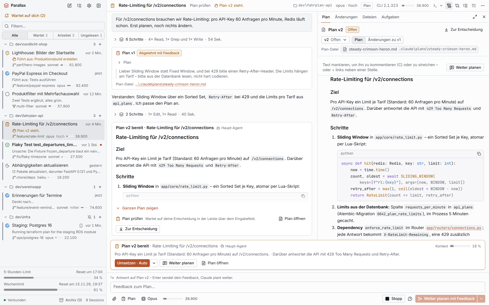
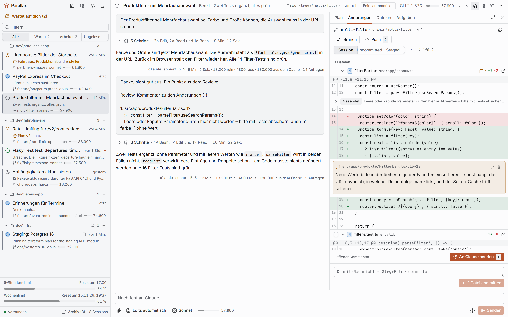
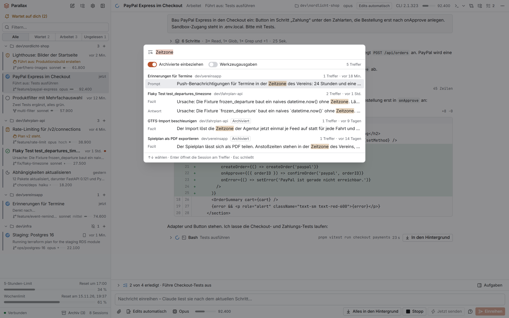

# Parallax

Mission Control für viele parallele Claude-Code-Sessions. Parallax läuft lokal unter Windows und Ubuntu: Ein kleiner
Server auf `127.0.0.1` steuert für jede Session das installierte Claude Code, die Oberfläche ist ein Chrome-Fenster.
Du siehst auf einen Blick, welche Session arbeitet, welche auf dich wartet und was fertig ist, gibst Freigaben und Pläne
frei, ohne den Faden zu verlieren, prüfst die Änderungen jeder Session und committest sie. Auf Wunsch steuert ein
Parallax auch die Sessions anderer Rechner im selben Netz.

[Installieren](#installieren) · [Was Parallax kann](#was-parallax-kann) · [Mehrere Rechner](#mehrere-rechner) ·
[Datenschutz und Sicherheit](#datenschutz-und-sicherheit) · [Fehlerbehebung](#fehlerbehebung)

## So sieht Parallax aus

<picture>
  <source media="(prefers-color-scheme: dark)" srcset="docs/screenshots/overview-dark.png">
  
</picture>

**Viele Sessions auf einen Blick.** Die Seitenleiste ordnet die Sessions nach Projekt und zeigt je Session, ob sie
arbeitet (mit dem aktuellen Schritt), auf eine Freigabe oder einen Plan wartet, fertig und noch ungelesen ist oder
schläft – dazu Branch, Modell, Kontext und die Abo-Limits. Der Filter darüber zeigt nur Wartende, Arbeitende oder
Ungelesene; eine Session im eigenen Worktree steht unter ihrem Repository. Rechts das Transkript: kompakte
Schrittgruppen, eine neue Datei, ein Diff und ein laufender Testlauf, der sich in den Hintergrund schicken lässt.

<picture>
  <source media="(prefers-color-scheme: dark)" srcset="docs/screenshots/plan-dark.png">
  
</picture>

**Pläne prüfen, ohne den Faden zu verlieren.** Plan v2 wartet in der Leiste über dem Eingabefeld (umsetzen, weiter
planen, Feedback geben) – kein Dialog, der alles andere blockiert. Das Seitenpanel zeigt den Plan mit allen Versionen
und dem Vergleich zur vorigen; Stellen lassen sich dort markieren und kommentieren. Im Transkript steht v1 mit dem
Feedback, das zu v2 geführt hat.

<picture>
  <source media="(prefers-color-scheme: dark)" srcset="docs/screenshots/review-dark.png">
  
</picture>

**Änderungen prüfen und committen.** Der Tab „Änderungen“ zeigt alles, was die Session seit ihrem Start geändert hat,
Datei für Datei. Zeilen lassen sich kommentieren; „An Claude senden“ legt alle offenen Kommentare als einen Block ins
Eingabefeld. Gesendete Kommentare klappen sich ein, die Antwort steht im Transkript. Die Git-Leiste committet, legt
Branches an und pusht. Diese Session arbeitet in einem eigenen Worktree und stört so keine andere.

<picture>
  <source media="(prefers-color-scheme: dark)" srcset="docs/screenshots/files-dark.png">
  
</picture>

**Dateien, Seitenfragen, Hintergrund-Agenten.** Dateiverweise im Transkript öffnen die Datei im Seitenpanel (mit
Syntax-Highlighting, auf Wunsch im Editor oder Explorer). Ein Explore-Agent läuft im Hintergrund weiter und meldet
seinen Fortschritt, eine Seitenfrage wird beantwortet, ohne im Kontext zu landen.

<picture>
  <source media="(prefers-color-scheme: dark)" srcset="docs/screenshots/search-dark.png">
  
</picture>

**Alles wiederfinden.** Strg+Umschalt+F durchsucht Prompts, Antworten, Titel, Fazits und Pläne aller Sessions – auch
der archivierten. Ein Treffer öffnet die Session an genau dieser Stelle.

<sub>Projekte und Daten in den Bildern sind erfunden.</sub>

## Was Parallax kann

### Sessions im Blick
- **Seitenleiste** nach Projekt gruppiert oder als flache Liste. Je Session: Zustand, was sie gerade tut („Führt aus:
  Tests ausführen“) oder das Fazit des letzten Turns, Branch, Modell und Kontext. Die Zahl wartender Sessions steht
  auch im Fenstertitel.
- **„Wartet auf dich“** führt zur nächsten Session, die eine Antwort braucht (Alt+N); Alt+1…9 wählt die Sessions der
  Reihe nach, Strg+K sucht eine Session nach Titel, Ordner oder Branch.
- **Filter** über der Liste: Text (Titel, Ordner, Branch) und „Alle“, „Wartet“, „Arbeitet“, „Ungelesen“ mit Zählern.
- **Ordnung halten:** anheften, archivieren (das Archiv bleibt durchsuchbar), „Als ungelesen markieren“ und je Projekt
  „Benachrichtigungen stummschalten“ (Rechtsklick auf den Projektkopf).
- **Schlafen legen:** Untätige Sessions schlafen nach einer einstellbaren Zeit ein und geben ihren Claude-Prozess frei;
  die nächste Nachricht setzt sie fort. Angeheftete Sessions und eine Session, die ein Fenster im Vordergrund zeigt,
  schlafen nie.
- **„Seit du zuletzt hier warst“** markiert, was neu ist, mit Sprung zur ersten neuen Nachricht.
- **Abo-Limits** (5-Stunden- und Wochenlimit) unten in der Seitenleiste. Ist ein Limit erreicht, setzt „Fortsetzen um
  …“ die Session nach dem Zurücksetzen von selbst fort.
- **Remote Control:** eine Session zusätzlich in der Claude-App (Handy oder claude.ai) verfolgen und beantworten.
- Die Seitenleiste lässt sich breiter ziehen und mit Alt+B zu einer schmalen Leiste einklappen; jede Session kann in
  einem eigenen Fenster laufen.

### Mit einer Session arbeiten
- **Transkript** kompakt (Schritte gruppiert) oder mit allen Schritten; Diffs jeder Änderung, Ausgaben von Befehlen,
  Karten für Subagenten mit Fortschritt, „Stoppen“ und ihrem Verlauf. Laufende Befehle und Subagenten schickt
  „In den Hintergrund“ (Strg+B) weg, damit Claude weiterarbeitet.
- **Eingabefeld:** Nachrichten einreihen, während Claude arbeitet („Einreihen“, „Jetzt senden“); Bilder, PDFs und
  Dateien anhängen oder hineinziehen; lange eingefügte Texte als Chips; `@` für Projektdateien, `/` für Befehle;
  Umschalt+Tab wechselt den Berechtigungsmodus; Modell, Aufwand und eine Kontextanzeige mit „Jetzt komprimieren“.
  Entwürfe bleiben je Session erhalten, auch in anderen Fenstern.
- **Seitenfragen** („Kurz fragen…“ in der Seitenleiste oder `/btw`): Claude antwortet aus der Unterhaltung, ohne dass
  die Frage im Kontext landet.
- **Frühere Unterhaltungen** einer Session wieder aufnehmen; **Session-Info** mit MCP-Servern (neu verbinden, an/aus),
  Berechtigungen, Skills, CLAUDE.md, Hooks, Status und Export. Titel vergibt Parallax selbst, F2 benennt um.
- **Profile** legen fest, wie Claude Code startet: Programm, Konfigurationsordner (`CLAUDE_CONFIG_DIR`, z. B. für ein
  zweites Konto), Umgebungsvariablen, Argumente und Vorgaben für Modell, Modus und Aufwand. „Profil testen“ zeigt
  Version, Anmeldung und Abo.

### Freigaben, Fragen und Pläne
- **Nicht-modal:** Freigaben, Fragen von Claude und Eingabe-Anfragen von MCP-Servern (Formular oder Link) warten in
  einer Leiste über dem Eingabefeld, die übrigen Sessions laufen weiter. Geantwortet wird per Klick oder Strg+Enter –
  „Einmal erlauben“, „Immer erlauben“, „Ablehnen“, auch mit Begründung.
- **Pläne:** Der Tab „Plan“ zeigt alle Versionen und vergleicht sie. Text markieren und kommentieren (Taste C) oder
  streichen; „Weiter planen“ schickt die Anmerkungen mit Stelle und Zitat an Claude. „Umsetzen“ geht auch „Mit frischem
  Kontext“.

### Änderungen prüfen und Git
- **Tab „Änderungen“:** alle Änderungen seit dem Start der Session (auch neue Dateien) oder nur die nicht committeten
  bzw. vorgemerkten, mit Diff je Datei. Ohne eigenen Worktree zeigt er nur die Dateien dieser Session, weil andere
  Sessions im selben Ordner mitschreiben können.
- **Zeilenkommentare:** „+“ am Rand oder Zeilen markieren und C drücken; „An Claude senden“ legt alle offenen
  Kommentare als einen Block ins Eingabefeld, wo du ergänzt und sendest. Verschiebt sich der Code, wandern die
  Kommentare mit.
- **Git-Leiste:** committen (alles oder ausgewählte Dateien), Branch anlegen oder wechseln, pushen mit der Zahl der
  offenen Commits. Fehlt Git eine Anmeldung, bietet Parallax „Im Terminal pushen“ an.

### Worktrees (optional)
- **„Neue Session“ → „In eigenem Worktree“:** neuer Branch von einer Basis oder ein vorhandener Worktree. Der Ordner
  liegt wie bei `claude --worktree` unter `<repo>\.claude\worktrees\`; Parallax trägt ihn nur lokal in
  `.git/info/exclude` ein und kopiert Dateien aus `.worktreeinclude` (z. B. `.env`) hinüber.
- In der Seitenleiste stehen Worktree-Sessions unter ihrem Repository, mit Worktree-Symbol am Branch.
- **Aufräumen:** Beim Archivieren oder Entfernen prüft Parallax ungesicherte Dateien und nicht gepushte Commits und
  fragt: „Worktree behalten“, „Worktree löschen, Branch behalten“ oder „Worktree und Branch löschen“.
- Je Projekt lassen sich ein Setup- und ein Teardown-Befehl und ein Portbereich einstellen
  ([Einstellungen](#einstellungen)). Ohne Einstellung legt Parallax nur dann einen Worktree an, wenn du „In eigenem
  Worktree“ wählst, und startet keine Befehle.

### Dateien, Terminal und Konsole
- **Dateiverweise** im Transkript öffnen die Datei im Seitenpanel: Code mit Syntax-Highlighting, Markdown gerendert,
  Bilder und PDFs; dazu „Im Editor öffnen“, „Im Explorer zeigen“, „Pfad kopieren“. Der Tab „Dateien“ listet alles, was
  die Session gelesen oder geändert hat, der Tab „Aufgaben“ To-dos, Hintergrund-Agenten und -Befehle.
- **Tab „Terminal“** (Alt+T): cmd, PowerShell oder Git Bash, unter Linux die Login-Shell, bash, zsh oder fish – bis zu
  vier je Session, im Ordner der Session. Die Shells laufen weiter, wenn das Panel schließt.
- **„Shell im Ordner öffnen“** (Alt+K) startet die Shell als eigenes Fenster.
- **„In externer Konsole öffnen“** übergibt eine Session an `claude` in einem Konsolenfenster, **„Im Terminal
  fortsetzen“** an den Terminal-Tab; Parallax holt sie zurück, sobald `claude` dort endet.

### Suche
- **Strg+Umschalt+F** durchsucht die Inhalte aller Sessions: Prompts, Antworten, Titel, Fazits und Pläne, auf Wunsch
  ohne Archiv oder mit Werkzeugausgaben. Enter öffnet die Session an der Fundstelle. Strg+K bietet „In Inhalten
  suchen“ für den eingegebenen Text an.

### Benachrichtigungen
- Je Ereignis („Braucht Freigabe“, „Frage“, „Plan prüfen“, „Fertig“, „Fehler“, „Limit erreicht“) eine Windows- bzw.
  Desktop-Benachrichtigung und ein Ton; dazu „Nicht stören“ und stumme Projekte. Ein Klick öffnet die Session, wenn
  „Klick auf eine Windows-Benachrichtigung öffnet die Session“ eingeschaltet ist.

### Mehrere Rechner, Updates
- **Mehrere Rechner:** Sessions anderer Rechner im selben Netz sehen und steuern, als liefen sie lokal (ab Werk aus,
  [Mehrere Rechner](#mehrere-rechner)).
- **Updates in der App:** Parallax findet neue Versionen, prüft Signatur und Dateien, wechselt mit einem Neustart und
  kann zur vorigen Version zurück ([Aktualisieren](#aktualisieren)).

### Tastenkürzel
`?` zeigt alle Tastenkürzel. Die wichtigsten:

| Taste | Wirkung |
|---|---|
| Alt+N | Nächste Session, die auf dich wartet |
| Alt+1 … Alt+9 | Session 1–9 der Seitenleiste |
| Strg+K | Session suchen und öffnen |
| Strg+Umschalt+F | In den Inhalten aller Sessions suchen |
| Strg+Enter | In der Entscheidungsleiste antworten |
| Umschalt+Tab | Nächster Berechtigungsmodus (im Nachrichtenfeld) |
| Strg+B | Laufende Befehle und Subagenten in den Hintergrund |
| Alt+T / Alt+K | Terminal im Seitenpanel / Shell im Ordner als Fenster |
| Alt+B | Seitenleiste ein- oder ausklappen |
| F2 | Session umbenennen |
| Strg+Plus / Strg+Minus / Strg+0 | Zoom |

## Voraussetzungen
- **Windows** oder **Ubuntu 24.04 / 26.04 LTS (x64)**, mit Desktop oder als Server ohne Desktop ([Ubuntu](#ubuntu)).
- **Node.js 26.9 oder neuer.**
- **Claude Code** (`claude`), installiert und angemeldet. Parallax bringt kein eigenes Claude mit und sieht deine
  Zugangsdaten nie.
- **Google Chrome** für das App-Fenster (unter Ubuntu auch Chromium). Parallax nutzt nur Chrome.

## Installieren
Fertige Pakete stehen auf der [Release-Seite](https://github.com/DerXHelp/parallax/releases); ein Klon, pnpm oder ein
Build sind nicht nötig.

### Windows
1. `parallax-<version>-win.zip` laden, entpacken und `install.cmd` doppelklicken. Sperren SmartScreen oder AppLocker die
   `.cmd`, ist `node dist\install.js` im entpackten Ordner gleichwertig.
2. Der Installer prüft die Signatur von `release.json` und jede Datei, kopiert das Paket nach
   `%LOCALAPPDATA%\Programs\Parallax\versions\<version>` (anderer Ordner: `--dir <ordner>`) und legt den
   Startmenü-Eintrag „Parallax“ an.
3. Das Claude Agent SDK lädt er aus der npm-Registry, weil es nicht weitergegeben werden darf, und prüft es gegen den
   Hash aus `release.json`. Eine Firmen-Registry aus `~/.npmrc` gilt auch hier; ohne erreichbare Registry helfen
   `--registry <url>` oder `--sdk-tarball <datei>` ([Firmen-Registry](#firmen-registry-npm-mirror)).
4. **Starten** über das Startmenü oder `%LOCALAPPDATA%\Programs\Parallax\parallax.cmd`. Die Daten liegen getrennt vom
   Programm in `%LOCALAPPDATA%\Parallax`.

`install.cmd --help` zeigt alle Optionen. **Deinstallieren:** Parallax über Zahnrad → „Server beenden…“ schließen,
dann `%LOCALAPPDATA%\Programs\Parallax\parallax.cmd --uninstall`. Das entfernt Programm, Startmenü-Eintrag, Autostart
und den `parallax:`-Eintrag; die Daten bleiben, die Meldung nennt ihren Ordner.

### Ubuntu
Unterstützt sind Ubuntu 24.04 LTS und 26.04 LTS (x64), mit Desktop oder als Server ohne Desktop, den ein anderer
Rechner über [Mehrere Rechner](#mehrere-rechner) steuert. Andere Distributionen sollten gehen, ohne Zusage; WSL ist
kein eigenes Ziel.

- **Voraussetzungen:**
  - **Node.js 26.9 oder neuer als offizieller Build** von nodejs.org oder über fnm/nvm; das Node aus den
    Ubuntu-Paketquellen ist zu alt. Ein minimales Ubuntu braucht dazu `libatomic1` (`sudo apt install libatomic1`).
  - **Claude Code** über den nativen Installer, angemeldet. Parallax nimmt `~/.local/bin/claude` oder ein `claude` auf
    dem `PATH`; die npm-Variante (`cli.js`) wird abgelehnt.
  - Mit Desktop zusätzlich **Google Chrome oder Chromium** (auch als Snap, mit eigenem Profil).
- **Installieren:** `parallax-<version>-linux-x64.tar.gz` laden, entpacken (`tar -xzf …`) und im Ordner
  `sh install.sh` ausführen – ohne `sudo`. Das Programm liegt danach in `~/.local/lib/parallax/versions/<version>`, der
  Befehl `parallax` in `~/.local/bin`, die Daten in `~/.local/share/parallax` (bzw. `$XDG_DATA_HOME/parallax`).
  Signatur, Dateiprüfung und Agent SDK wie unter Windows; `sh install.sh --help` zeigt alle Optionen. Liegt
  `~/.local/bin` nicht im `PATH`, sagt der Installer das.
- **Mit Desktop** öffnet `parallax` das App-Fenster wie unter Windows. Programmmenü, Autostart und „Klick öffnet die
  Session“ (`parallax:`-Links) richten die Einstellungen ein, Benachrichtigungen kommen vom Desktop. Konsolen- und
  Shell-Fenster öffnen im Terminal-Emulator aus Einstellungen → „Konsole“ (sonst `xdg-terminal-exec`,
  `x-terminal-emulator` oder ein bekannter wie GNOME Terminal, Ptyxis, Konsole, kitty). Editor und „Im Dateimanager
  zeigen“ gehen über `xdg-open`.
- **Deinstallieren:** `parallax --uninstall` entfernt Programm, Befehl, `.desktop`-Einträge, `parallax:`-Eintrag und
  den Benutzerdienst dieser Installation; die Daten bleiben.

#### Server-Modus ohne Desktop
- `parallax --server` startet den Server im Vordergrund, ohne Fenster und ohne Desktop-Aktionen. Als Dienst beim
  Systemstart: `parallax service install` (systemd-Benutzerdienst; `parallax service status`,
  `parallax service uninstall`). Damit er ohne Anmeldung läuft, einmal `sudo loginctl enable-linger <benutzer>`.
- Läuft für den Datenordner schon ein Server, übernimmt `parallax --server` ihn, statt einen zweiten zu starten. Ein
  Update in der App wechselt die Version, ohne dass der Dienst endet.
- **Vom anderen Rechner steuern:** auf dem Server `parallax remote enable`, dann `parallax remote pair --level manage`.
  Der Kopplungscode erscheint nur in diesem Terminal. Auf dem steuernden Rechner unter „Andere steuern“ → „Rechner
  hinzufügen…“ Adresse, Port (Standard 4713) und Code eintragen. Die Stufe **„Verwalten“** erlaubt zusätzlich
  Einstellungen und Server dieses Rechners, **„Steuern“** nur die Sessions; hinauf geht die Stufe nur vor Ort
  (`parallax remote level manage`). Weitere Befehle: `parallax remote status`, `disable`, `cancel`, `unpair`. Eine
  Firewall (`ufw`) muss den Port im lokalen Netz zulassen; Parallax ändert sie nicht.
- **Schlüssel für „Mehrere Rechner“:** mit Desktop im Schlüsselbund (Secret Service), ohne Desktop ab Ubuntu 26.04 über
  `systemd-creds --user`. Unter 24.04 ohne Desktop gibt es keinen geschützten Speicher; dort legt Parallax die
  Schlüssel nur mit `parallax --server --key-store=file` in einer Datei ab, die nur der eigene Benutzer lesen kann – wer
  den Datenordner kopiert, hat dann auch die Schlüssel.
- **Ohne Kopplung, per SSH-Tunnel:** `ssh -L 4711:127.0.0.1:4711 <server>` und auf dem Server
  `parallax --server --print-url`; die ausgegebene Adresse innerhalb von 60 Sekunden lokal in Chrome öffnen. Der lokale
  Port muss dem des Servers gleichen, weil Parallax den `Host`-Header prüft.

## Starten und beenden
- **Fenster schließen beendet Parallax nicht:** Der Server läuft unsichtbar weiter, die Sessions auch. Ein weiterer
  Start öffnet nur ein neues Fenster.
- **Beenden** über Zahnrad → „Server beenden…“. Die Rückfrage nennt arbeitende und wartende Sessions; jede bekommt bis
  zu 5 Sekunden für ein sauberes Ende. Eine Nachricht, die noch in der Warteschlange stand, erscheint danach als „nicht
  zugestellt“.
- **Optionen** von `parallax.cmd` bzw. `parallax`: `--port=<n>` (Standard 4711, auch Einstellungen → „Server“),
  `--print-url` (Adresse mit Einmal-Code statt Fenster), `--toasts=off`, `--help` für alle.
- **Autostart:** Einstellungen → „Server“ → „Parallax beim Anmelden an Windows starten“, auf Wunsch auch mit Fenster.

## Aktualisieren
- **In der App:** Parallax sucht kurz nach dem Start und dann alle 12 Stunden nach einer neuen Version (abschaltbar
  unter Einstellungen → „Updates“; Vorabversionen nie). Der Hinweis erscheint oben in der Seitenleiste. „Jetzt
  aktualisieren“ lädt das Paket im Hintergrund, prüft Signatur und Dateien und holt das Agent SDK; die Sessions laufen
  dabei weiter. „Neu starten“ beendet die Sessions wie „Server beenden…“, wechselt die Version, und das Fenster
  verbindet sich von selbst wieder – mit „Was ist neu“.
- **Startet die neue Version nicht,** kehrt Parallax mit den gesicherten Daten zur alten zurück und nennt das Protokoll
  (`%LOCALAPPDATA%\Parallax\logs\update-<zeit>.log`).
- **Node.js:** Braucht eine neue Version ein neueres Node.js, lehnt Parallax das Update ab und nennt die nötige und die
  installierte Version. Node.js aktualisieren, dann erneut „Jetzt aktualisieren“.
- **Agent SDK** über die npm-Konfiguration (`~/.npmrc`, `NPM_CONFIG_REGISTRY`) oder die Registry unter Einstellungen →
  „Updates“ → „npm-Registry für das Agent SDK“ (z. B. ein Firmen-Mirror; Anmeldedaten bleiben in `~/.npmrc`).
- **Aus Datei:** Einstellungen → „Updates“ → „Aus Datei installieren…“ nimmt ein geladenes Paket an, etwa ohne Zugang
  zu GitHub. Geprüft wird es mit dem Code und den Schlüsseln der laufenden Version.
- **Ohne die App:** das neue Paket laden und `install.cmd` bzw. `install.sh` starten. Die installierte Version prüft es
  mit ihrem eigenen Code und Schlüssel und installiert es neben der alten; ein laufendes Parallax wechselt nach „Server
  beenden…“ und einem neuen Start.
- **Sicherung:** Beim ersten Start einer neuen Version sichert Parallax Einstellungen, Sessions und Entscheidungen nach
  `%LOCALAPPDATA%\Parallax\backups\<alt>-zu-<neu>-<zeit>\`; die drei jüngsten Sicherungen bleiben.
- **Zurück:** Die vorige Version bleibt installiert: Einstellungen → „Updates“ → „Zurück zu <version>“. Speichert die
  ältere Version Daten anders, spielt Parallax nach Rückfrage die Sicherung vom Wechsel ein. Ohne die App:
  `parallax.cmd --use <version>`.

## Einstellungen
Zahnrad → „Einstellungen…“ öffnet die Einstellungen in diesen Bereichen:

- **Allgemein:** Sprache (Deutsch, Englisch), Design (hell, dunkel, System), Zoom, Transkript kompakt oder mit allen
  Schritten.
- **Benachrichtigungen:** Benachrichtigung und Ton je Ereignis, Lautstärke, „Nicht stören“, Mindestdauer für „Fertig“,
  Klick öffnet die Session.
- **Sessions:** „Untätige Sessions schlafen legen“, Prompt-Vorschläge, Remote Control für neue Sessions.
- **Dateien** (Editor für „Im Editor öffnen“), **Konsole** (Standard-Shell, Git Bash), **Profile**, **Server** (Port,
  Autostart), **Mehrere Rechner**, **Updates**.
- **Projekte** – alles optional, je Git-Repository und Rechner:
  - **Setup-Befehl** läuft in einem neuen Worktree direkt nach dem Anlegen (z. B. `pnpm install --frozen-lockfile`),
    sichtbar in einem Terminal-Tab der Session; die erste Nachricht wartet darauf. Schlägt er fehl, bietet Parallax
    „Ausgabe ansehen“ und „Trotzdem starten“ an.
  - **Teardown-Befehl** läuft, bevor Parallax den Worktree löscht (z. B. `docker compose down`).
  - **Portbereich:** Jeder neue Worktree bekommt 10 freie Ports ab 41000; der erste steht in `PARALLAX_WORKTREE_PORT`
    (in Claude Code, Setup, Teardown und den Terminals der Session). Das Projekt muss die Variable selbst nutzen, etwa
    als Port seines Dev-Servers.
  - **„Neue Sessions im eigenen Worktree starten“** schaltet „In eigenem Worktree“ für dieses Projekt vor.

  Die Befehle kommen nur aus diesen Einstellungen, nie aus dem Repository.

## Mehrere Rechner
Ein Parallax kann die Sessions anderer Rechner im selben Netz anzeigen und steuern, als liefen sie lokal: Transkript,
Entscheidungen, Pläne, Änderungen, Dateien, Terminal, Anhänge und Entwürfe. Die Sessions laufen weiter auf ihrem
Rechner, mit dessen Claude Code, Profilen und Ordnern. **Ab Werk ist das aus.**

- **Rollen** (Einstellungen → „Mehrere Rechner“): **Aus**, **Freigeben** oder **Andere steuern**. Ein freigebender
  Rechner ist mit genau einem steuernden gekoppelt; ein steuernder bindet bis zu 16 freigebende ein. Windows und Ubuntu
  lassen sich in beide Richtungen koppeln.
- **Freigeben:** Parallax prüft Port (Standard 4713), Schlüssel, Schlüsselspeicher, Verschlüsselung und Netzadressen und
  zeigt das Ergebnis. Die **Firewall** richtest du selbst ein: unter Windows eingehende Verbindungen für Node.js auf dem
  Port nur in privaten Netzwerken erlauben, unter Ubuntu den Port mit `ufw` nur für das lokale Netz.
- **Koppeln:** Auf dem freigebenden Rechner „Rechner koppeln“ wählen; er zeigt Name, Adressen, Port und einen
  einmaligen Kopplungscode (10 Minuten gültig, nach drei falschen Eingaben verfallen). Auf dem steuernden Rechner
  „Andere steuern“ → „Rechner hinzufügen…“ und Adresse, Port, Code und Anzeigenamen eintragen.
- **Arbeiten:** Die Sessions des anderen Rechners tragen ein farbiges Rechner-Badge; „Gruppieren nach“ ordnet nach
  Rechner und/oder Verzeichnis. „Neue Session“ fragt zuerst nach dem Rechner. Benachrichtigungen erscheinen dort, wo
  zuletzt gearbeitet wurde, ein Klick öffnet die Session. Editor und Explorer öffnen nur Dateien eigener Sessions.
- **Trennen:** „Kopplung aufheben“ auf dem freigebenden Rechner trennt sofort, „Aus“ schließt den Port. „Entfernen“ auf
  dem steuernden Rechner hebt die Kopplung auch drüben auf, wenn er ihn erreicht.
- **Verbindungsprotokoll:** Der freigebende Rechner führt jeden Verbindungsversuch mit IP-Adresse, auch abgelehnte;
  neue abgelehnte Versuche meldet ein Hinweis in der Kopfzeile.
- **Versionen:** Nur Rechner mit derselben Parallax-Version arbeiten zusammen; aktualisiert wird jeder Rechner selbst,
  nie aus der Ferne. Ubuntu ohne Desktop: [Server-Modus](#server-modus-ohne-desktop).

**Sicherheit in Kürze:** nur TLS 1.3 mit hybridem, post-quanten-sicherem Schlüsseltausch (ML-KEM) und ML-DSA-Schlüsseln;
beide Seiten prüfen den bei der Kopplung gepinnten Schlüssel der anderen, es gehen weder Passwörter noch Tokens über
die Leitung. Der Kopplungscode (128 Bit) ist an die konkrete Verbindung gebunden. Private Schlüssel liegen vom
Schlüsselspeicher des Rechners verschlüsselt im Datenordner (Windows DPAPI, Ubuntu Secret Service oder
`systemd-creds`). Der Fernzugang liefert keine Weboberfläche und nimmt keine Anfragen aus Browsern an; das Fenster auf
dem steuernden Rechner spricht weiter nur mit `127.0.0.1`.

## Datenschutz und Sicherheit
- **Lokal:** Der Server hört nur auf `127.0.0.1`; ins Fenster kommt man nur mit einem Einmal-Code des Launchers. Die
  Oberfläche lädt nichts aus dem Internet. Der Server selbst lädt nur Updates von GitHub (signiert) und das Agent SDK
  aus der npm-Registry (per Hash geprüft); die Sessions sprechen wie gewohnt über Claude Code mit Anthropic.
- **Keine Zugangsdaten:** Die Anmeldung erledigt Claude Code selbst; Parallax sieht, speichert und vermittelt keine
  Zugangsdaten.
- **Eigenes Chrome-Profil:** Das Fenster nutzt ein eigenes Profil (`<Datenordner>\chrome`), das sich nie bei einem
  Google-Konto anmeldet und nie synchronisiert. Es braucht keine Richtlinien, keine Registry-Einträge und keine
  Admin-Rechte.
- **Was Parallax außerhalb des Datenordners einträgt** (Windows, nur der eigene Benutzer): Startmenü-Eintrag, auf Wunsch
  Autostart und den Linktyp `parallax:`, dazu für Windows-Benachrichtigungen den Anzeigenamen „Parallax“ unter
  `HKCU\Software\Classes\AppUserModelId\Parallax.App`. Entfernen: erst die Benachrichtigungen abschalten
  (`--toasts=off`), dann
  ```powershell
  reg delete HKCU\Software\Classes\AppUserModelId\Parallax.App /f
  reg delete HKCU\Software\Microsoft\Windows\CurrentVersion\Notifications\Settings\Parallax.App /f
  ```

## Fehlerbehebung
- **Port belegt:** `--port=<n>` wählen oder den Port in Einstellungen → „Server“ ändern.
- **„written by a newer Parallax“** (Exit-Code 3): Die Daten stammen von einer neueren Version – Parallax aktualisieren;
  die Daten bleiben unverändert.
- **„Google Chrome was not found“:** Chrome installieren, oder `--print-url` nutzen und die Adresse (60 Sekunden gültig)
  in einem Chromium-Browser öffnen.
- **Server startet nicht:** Die Meldung nennt den Pfad der Logdatei (`%LOCALAPPDATA%\Parallax\logs`).
- **Keine Benachrichtigungen:** In Windows unter Einstellungen → System → Benachrichtigungen „Nicht stören“ und die
  Absender „Parallax“ (ohne offenes Fenster) und „Google Chrome“ (im offenen Fenster) prüfen. Unter AppLocker oder
  Constrained Language Mode kann der Helfer für Windows-Benachrichtigungen gesperrt sein; Parallax bleibt dann bei
  Hinweisen im Fenster.
- **Firmenrechner mit Chrome-Richtlinien:** Richtlinien (Gruppenrichtlinie, Intune, Chrome Browser Cloud Management)
  gehen vor, z. B. erzwungene Anmeldung (`BrowserSignin`), ein fremdes `UserDataDir`, gesperrte Benachrichtigungen oder
  eine `URLBlocklist` mit `127.0.0.1`. Welche gelten, zeigt `chrome://policy` in einem Fenster des Parallax-Profils
  (Strg+T öffnet dort einen normalen Tab).

### Firmen-Registry (npm-Mirror)
Installer und Updates laden das Agent SDK aus der npm-Registry. Eine Firmen-Registry (z. B. Nexus) trägst du dauerhaft in
`~/.npmrc` ein:
```ini
registry=https://nexus.example.com/repository/npm-all/
//nexus.example.com/repository/npm-all/:_authToken=<token>
cafile=C:\Pfad\zum\firmen-ca.pem
https-proxy=http://proxy.example.com:8080
```
Für die erste Installation geht auch `install.cmd --registry <url>`, für Updates die Registry unter Einstellungen →
„Updates“. In den Claude-Sessions bleiben dauerhaft gesetzte Variablen wie `NPM_CONFIG_REGISTRY` (Benutzer- oder
Systemvariable) erhalten, sodass `npm`/`pnpm` dort dieselbe Registry nutzen.

### Virenscanner mit Web-Traffic-Scan
Manche Virenscanner filtern auch lokalen Verkehr auf `http://127.0.0.1`. Bei Kasperskys Web-Anti-Virus wurde
beobachtet, dass er ein eigenes Skript in die Parallax-Seite einschleust, die Content-Security-Policy um seine Domain
erweitert und die Seiten-URL samt Einmal-Code an sein Skript übergibt. Das weicht das Sicherheitsmodell auf.
**Empfehlung:** `127.0.0.1` bzw. den Parallax-Port (Standard 4711) vom Web-Traffic-Scan ausnehmen – bei Kaspersky als
vertrauenswürdige Adresse oder durch Abschalten von „Skript in Datenverkehr einbetten“ (Bezeichnungen je nach
Version). Parallax fragt nicht ab, welche Sicherheitssoftware installiert ist.

## Mitentwickeln
Klon, pnpm, Dev-Server, Tests, Playground, die Routine für `claude`-Updates und die Regeln für die Arbeit neben einer
produktiven Instanz stehen in [docs/entwickeln.md](docs/entwickeln.md). Die Regeln für Beiträge stehen in `CLAUDE.md`.

## Rechtliches
Parallax steht unter der [MIT-Lizenz](LICENSE).

- Parallax ist ein unabhängiges Projekt und nicht mit Anthropic verbunden. „Claude“ und „Claude Code“ sind Marken von
  Anthropic.
- Parallax steuert das vom Nutzer installierte, **unveränderte** Claude Code. Die Anmeldung erledigt Claude Code selbst;
  Parallax sieht, speichert und vermittelt keine Zugangsdaten.
- Für Claude Code und das Claude Agent SDK gelten die Bedingungen von Anthropic. Das SDK ist nicht Teil dieses Repos;
  Installer und `pnpm install` laden es aus der npm-Registry.

## Dokumentation
- [`CHANGELOG.md`](CHANGELOG.md) – Änderungen je Version.
- [`docs/entwickeln.md`](docs/entwickeln.md) – Entwicklung, Befehle, Playground, Screenshots.
- [`docs/architecture.md`](docs/architecture.md) – Architektur, Datenfluss, Protokoll.
- `docs/decisions.md`, `docs/plan.md`, `docs/wp/` – Entscheidungen, Plan und Arbeitspakete.
