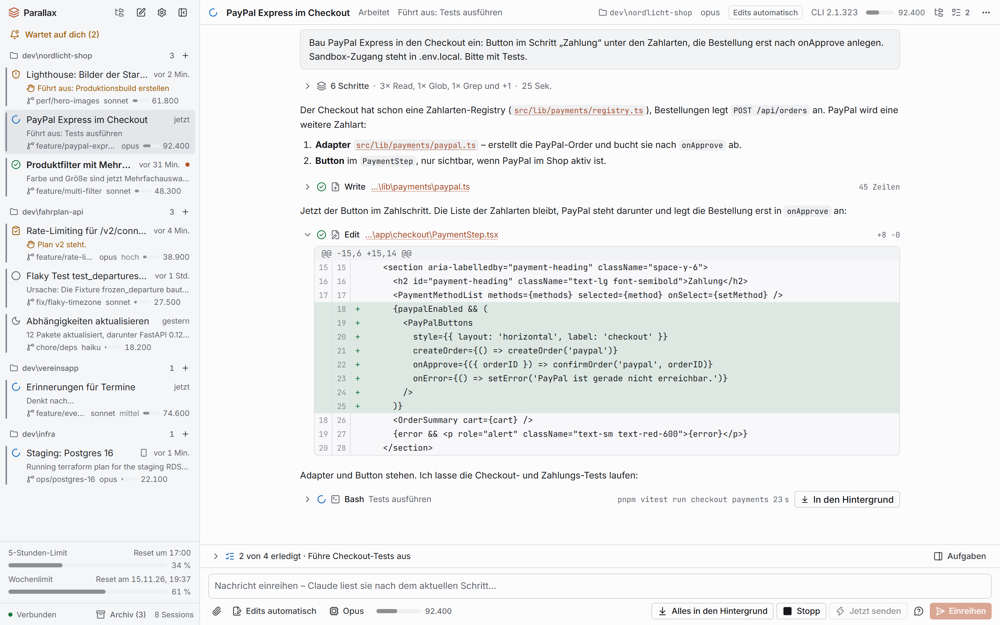
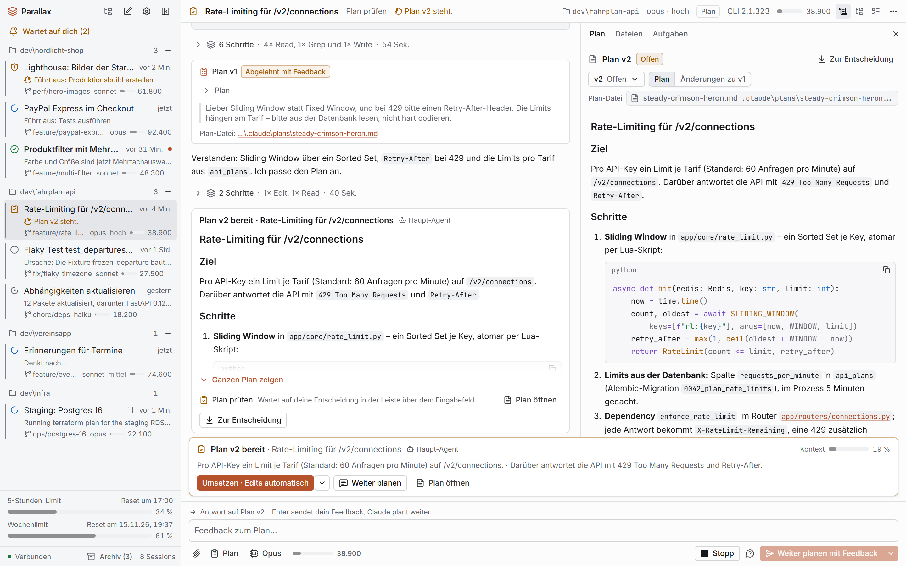
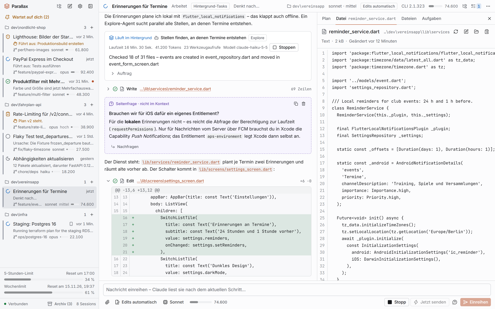

# Parallax

Lokale Mission-Control-App für viele parallele Claude-Code-Sessions unter Windows: ein Node-Server
auf `127.0.0.1` steuert je Session das installierte `claude` über das Claude Agent SDK, die Web-UI
läuft als Chrome-App-Fenster. Status: Phase 3 „Dateien und Plan-Komfort“ abgeschlossen (auf `main`;
siehe `docs/progress.md`).

## So sieht Parallax aus

<picture>
  <source media="(prefers-color-scheme: dark)" srcset="docs/screenshots/overview-dark.png">
  
</picture>

**Viele Sessions auf einen Blick.** Die Seitenleiste zeigt je Projekt, welche Session arbeitet, welche
auf dich wartet (Freigabe, Plan), was fertig und neu ist, dazu Remote Control und die Abo-Limits.
Rechts das Transkript der ausgewählten Session: kompakte Schrittgruppen, eine neue Datei, ein Diff und
ein laufender Testlauf, der sich in den Hintergrund schicken lässt; über dem Eingabefeld die To-dos.

<picture>
  <source media="(prefers-color-scheme: dark)" srcset="docs/screenshots/plan-dark.png">
  
</picture>

**Pläne prüfen, ohne den Faden zu verlieren.** Plan v2 wartet nicht modal in der Leiste über dem
Eingabefeld (umsetzen, weiter planen, Feedback geben). Das Seitenpanel zeigt den Plan mit allen
Versionen und den Änderungen zu v1; im Transkript steht v1 mit dem Feedback, das zu v2 geführt hat.

<picture>
  <source media="(prefers-color-scheme: dark)" srcset="docs/screenshots/files-dark.png">
  
</picture>

**Dateien, Seitenfragen, Hintergrund-Agenten.** Dateiverweise im Transkript öffnen die Datei im
Seitenpanel (Syntax-Highlighting, Editor, Explorer). Dazu ein Explore-Agent, der im Hintergrund
weiterläuft und seinen Fortschritt meldet, eine Seitenfrage, die nicht im Kontext landet, und der Diff
der letzten Änderung.

<sub>Projekte und Daten sind erfunden (Showcase im Playground).</sub>

## Voraussetzungen
- **Node.js 26** (Minimum 22). `.node-version` enthält `26` für fnm, nvm-windows oder Volta.
- **pnpm 12.17.0**: einmalig `npm i -g pnpm@12.17.0`. `packageManager` und der Lockfile pinnen die
  Version; ein pnpm ≥ 10 lädt sie bei Abweichung selbst nach (`managePackageManagerVersions`; geprüft
  13.11.2026 mit pnpm 12.8.2 → 12.17.0). Ein zu altes pnpm scheitert an `engines.pnpm: ">=12.8"`.
- Das installierte **`claude`**-CLI mit Login (Parallax liefert kein Claude-Binary mit).
- **Google Chrome** (für das App-Fenster und die E2E-Tests; Playwright lädt keine Browser). Parallax
  nutzt nur Chrome – ohne Chrome öffnet der Launcher kein Fenster (Ausweg `--print-url`, ADR-136).

## Installation und Start
```powershell
pnpm install          # bzw. pnpm install --frozen-lockfile
pnpm dev              # Server (FakeBackend, Port 4712) + Vite: http://127.0.0.1:5173
pnpm check            # typecheck + lint + test
pnpm build            # dist/web + dist/server.js
pnpm start            # Launcher: baut bei Bedarf, startet den Server unsichtbar, öffnet Chrome
```
`pnpm dev` verbraucht keine Tokens (FakeBackend) und nutzt `.parallax-dev/` statt
`%LOCALAPPDATA%\Parallax`. Die Anmelde-Adresse `http://127.0.0.1:5173/#code=…` (10 min gültig)
steht beim Start im Server-Log; Vite leitet `/api` (auch den WebSocket) an Port 4712 weiter.
`tsx watch` startet den Server bei jeder Änderung neu (Sessions des FakeBackends enden dabei).
„Server beenden“ beendet im Dev-Modus nur den Server – `tsx watch` und Vite laufen weiter, bis
`Ctrl+C` oder die nächste Dateiänderung kommt. `pnpm dev:live` nutzt das echte `claude`; der
Vite-Dev-Server liefert die Seite ohne CSP aus und das Dev-Cookie gilt für jede Seite auf
`127.0.0.1:5173` – `dev:live` daher nur in einem eigenen Chrome-Profil öffnen (z. B. per Win+R
`chrome --user-data-dir=%TEMP%\px-dev-chrome --disable-sync http://127.0.0.1:5173/#code=…`, R3-14).

Die SDK-Plattform-Binaries (~270 MB) werden per `ignoredOptionalDependencies` in
`pnpm-workspace.yaml` nicht installiert. Install-Skripte darf nur `esbuild` ausführen
(`allowBuilds`); die pnpm-Defaults `strictDepBuilds`, `minimumReleaseAge` (1 Tag) und
`blockExoticSubdeps` bleiben aktiv.

## Starten
Parallax läuft als unsichtbarer Hintergrund-Server mit Chrome-App-Fenstern (ohne Installation):

```powershell
.\parallax.cmd                 # Doppelklick genügt; alternativ .\parallax.ps1 oder pnpm start
.\parallax.cmd --port=4800     # anderer Port (auch PARALLAX_PORT), Daten: --home=<dir> / PARALLAX_HOME
.\parallax.cmd --help          # alle Optionen
pnpm start --print-url         # Optionen direkt anhängen (pnpm reicht ein `--` wörtlich weiter)
```

- **Erster Start / nach `git pull`:** Der Launcher baut `dist/`, wenn es fehlt oder die Build-ID
  nicht zum Checkout passt (dauert beim ersten Mal etwa eine Minute), startet den Server
  unsichtbar im Hintergrund (`node dist/server.js`, Ausgabe in
  `%LOCALAPPDATA%\Parallax\logs\server.out.log`, Log `parallax.*.log`) und öffnet Chrome als
  App-Fenster mit eigenem Profil (`%LOCALAPPDATA%\Parallax\chrome`). Das Konsolenfenster schließt
  sich danach von selbst; bei einem Fehler bleibt es mit der Meldung offen.
- **Läuft Parallax schon,** öffnet ein weiterer Start nur ein zusätzliches Fenster (Erkennung über
  `server.lock.json` + Health-Ping; ein verwaistes Lockfile nach einem Absturz wird ignoriert).
  Ein Doppelklick startet trotzdem nur einen Server: der zweite Start wartet („… by another
  launcher - waiting for it“) und öffnet dann ein Fenster dieses Servers. Läuft der Server mit
  einem anderen Backend als angefordert (z. B. ein FakeBackend-Server, während `parallax.cmd`
  ohne Optionen das echte `claude` will), meldet der Launcher das als Fehler statt ein Fenster zu
  öffnen.
- **Neuer Build bei laufendem Server:** Ein laufender Server übernimmt einen neuen Build erst nach
  „Server beenden“ und erneutem Start. Er liefert die UI aus einer beim Start fixierten Kopie
  (`%LOCALAPPDATA%\Parallax\ui\<build>`); ein `pnpm build`/`pnpm e2e` im selben Checkout ändert
  also nichts an seinen Fenstern. Die Build-ID hängt nur an Build-Eingaben (Quellen, Configs,
  Lockfile) – ein reiner Doku-Commit erzwingt keinen Neubau. Launcher, `pnpm e2e` und
  `pnpm build` bauen einen Checkout nie gleichzeitig (der zweite wartet; auch auf einem
  Netzlaufwerk).
- **Fenster schließen beendet den Server nicht** – die Sessions laufen weiter. Beenden über das
  Zahnrad-Menü → „Server beenden…“: Die Rückfrage nennt die arbeitenden und wartenden Sessions.
  Jede Session bekommt bis zu 5 s für ein sauberes Ende (Transkript, SessionEnd-Hooks), erst
  danach wird ihr Prozessbaum beendet – „Server beenden“ dauert also gut 5 s, wenn eine Session
  noch arbeitet. Wartet eine Session auf eine Entscheidung und hat noch eine Nachricht in der
  Warteschlange, wird ihr Prozess sofort beendet (sonst würde `claude` die Nachricht noch
  bearbeiten); die Nachricht erscheint im Verlauf als „nicht zugestellt“.
- **Fehlermeldungen:** Port belegt → `--port=<n>` wählen; „written by a newer Parallax“ (Exit-Code
  3) → Parallax aktualisieren (`git pull`, `pnpm install`), die Daten bleiben unverändert; Server
  startet nicht → Pfad der Logdatei steht in der Meldung; „Google Chrome was not found“ → Chrome
  installieren (es gibt keinen Rückfall auf Edge) oder `--print-url` (Adresse mit Einmal-Code, 60 s
  gültig) in einem Chromium-Browser öffnen.
- Exit-Codes von `dist/server.js` (zeigt der Launcher an): 0 regulär beendet, 1 Fehler (auch
  ungültige Option), 3 Daten einer neueren Parallax-Version, 4 Port belegt, 5 für dieses
  Datenverzeichnis läuft schon ein Server.
- Weitere Optionen: `--backend=fake` bzw. `PARALLAX_BACKEND=fake` (FakeBackend, startet kein
  `claude` – zum Ausprobieren und für Smoke-/E2E-Tests des echten Startpfads; **nur mit eigenem
  `--home`/`PARALLAX_HOME`**, auf `%LOCALAPPDATA%\Parallax` verweigert der Server den Start),
  `--no-build` (kein Build-Check), `--validate=log|throw|off` (Prüfung ausgehender Daten gegen den
  Contract; Default `log`: ungültige Werte werden geloggt, gezählt und verworfen),
  `--toasts=native|off` (Windows-Toasts, siehe „Benachrichtigungen“). In `claude`-Sessions
  kommen von den `PARALLAX_*`-Variablen des Servers nur `PARALLAX=1` und `PARALLAX_ENTRY_ID` an –
  ein `pnpm test`/`pnpm start` in einer Parallax-Session greift nie auf dessen Datenordner zu. Für den
  produktiven Einsatz: siehe „Produktiv nutzen und weiterentwickeln“.
- Ausprobieren ohne die eigenen Daten anzufassen (PowerShell):
  `$env:PARALLAX_BACKEND='fake'; $env:PARALLAX_HOME="$env:TEMP\px-try"; pnpm start`.
- Startet ein Terminal den Launcher in einem Job-Objekt, das beim Schließen alle Prozesse beendet,
  endet auch der Server – im Zweifel `parallax.cmd` per Doppelklick starten.

### Produktiv nutzen und weiterentwickeln
- **Zwei Checkouts:** Benutzt wird ein eigener Klon von `origin` auf `main`; entwickelt wird im
  Entwicklungs-Repo auf Feature-Branches. `main` ist immer der stabile, geprüfte Stand
  (Branch-Regeln: `CLAUDE.md` „Git“).
- **Einrichten:** `git clone https://github.com/DerXHelp/parallax.git <ordner>`, darin
  `pnpm install --frozen-lockfile`, dann `parallax.cmd` (der erste Start baut `dist/`). Autostart und
  „Klick öffnet die Session“ nur in dieser Instanz einschalten: Verknüpfung und `parallax:`-Eintrag
  zeigen auf den Klon, aus dem der Server läuft.
- **Aktualisieren:** Zahnrad → „Server beenden…“, im Klon `git pull` und
  `pnpm install --frozen-lockfile`, dann `parallax.cmd` (baut selbst neu). Daten werden nur vorwärts
  migriert: vor größeren Updates `%LOCALAPPDATA%\Parallax` sichern – eine ältere Version startet auf
  migrierten Daten nicht mehr (Exit-Code 3).
- **Getrennt:** Die produktive Instanz nutzt `%LOCALAPPDATA%\Parallax` (Sessions, Einstellungen, Logs,
  Chrome-Profil) und den Port aus den Einstellungen (Standard 4711). Die Entwicklung nutzt `pnpm dev` /
  `pnpm dev:live` mit `.parallax-dev` und den Ports 4712/5173, die Tests nutzen Temp-Ordner und freie
  Ports. Nur ein Server auf `%LOCALAPPDATA%\Parallax` richtet Autostart und Protokoll-Handler ein.
- **Regel im Entwicklungs-Repo:** nie `parallax.cmd`/`pnpm start` ohne eigenes `--home`/`PARALLAX_HOME`.
  Sonst baut der Launcher den Entwicklungsstand, migriert womöglich die echten Daten und biegt
  Autostart und Protokoll-Handler auf das Entwicklungs-Repo um. Zum Ausprobieren dort:
  `$env:PARALLAX_BACKEND='fake'; $env:PARALLAX_HOME="$env:TEMP\px-try"; pnpm start`.
- Claude-Sessions, die Parallax weiterentwickeln, dürfen in der produktiven Instanz laufen (Arbeitsordner
  = Entwicklungs-Repo); Entwicklungs-Neustarts betreffen sie nicht. Gemeinsam bleiben nur das
  installierte `claude` und `~/.claude` – ein CLI-Update betrifft beide (`docs/sdk-upgrade.md`).

### `claude`-Updates
- `claude` aktualisiert sich selbst, oft mehrmals pro Woche. Parallax kennt die zuletzt mit Parallax
  geprüfte Version (CLI-Profil `src/server/claude/cli-profile.json`). Ist die installierte Version
  neuer, zeigen die Kopfzeile und der Profilstatus beim Anlegen einer Session einen dezenten Hinweis
  („Claude Code <v> ist neuer als die mit Parallax geprüfte Version <t>“), `pnpm preflight` eine
  Warnung. Parallax läuft trotzdem normal weiter – der Hinweis heißt nur „noch nicht geprüft“.
- **Routine:** In einer Claude-Session im Entwicklungs-Repo `/claude-update` aufrufen (Projekt-Skill).
  Er führt `pnpm cli-check` aus (live, Haiku, Abo-Login, höchstens 0,05 USD, ≈ 2 min), vergleicht mit
  dem Profil und übernimmt es bei grünem Ergebnis nach `main`. Abweichungen, die mehr als kleine
  Anpassungen brauchen, legt er zur Entscheidung vor. Danach in der produktiven Instanz wie unter
  „Aktualisieren“ beschrieben `git pull` – der Hinweis verschwindet nach dem Neustart.
- Protokoll der geprüften Versionen: `docs/cli-updates.md`; Ablauf und Stufe 2 (SDK-Upgrade):
  `docs/sdk-upgrade.md`.

### Chrome-Profil
Das App-Fenster nutzt ein eigenes Chrome-Profil (`<Datenordner>\chrome`), getrennt vom normalen
Chrome des Nutzers. Es meldet sich **nie** bei einem Google-Konto an und synchronisiert **nie**: Der
Launcher startet Chrome mit `--disable-sync` und `--allow-browser-signin=false` (schaltet „Anmeldung
in Chrome zulassen“ für dieses Profil aus – auch nach einem Google-Login auf einer aus Parallax
geöffneten Seite bietet Chrome keine Anmeldung an). Anders als Edge meldet Chrome ein frisches Profil
nicht implizit mit dem Windows-Konto an (gemessen mit Chrome 156; ADR-060, ADR-136). Es werden keine
Richtlinien, keine Registry-Einträge und keine Admin-Rechte gebraucht. Prüfen lässt es sich in einem
Fenster des Parallax-Profils unter `chrome://signin-internals` („Signin Status: Not Signed In“,
„Account Consistency: None“); das App-Fenster hat keine Adressleiste, Strg+T öffnet einen normalen
Tab desselben Profils.

- **Nur Chrome:** Parallax nutzt keinen anderen Browser und hat dafür keine Option. Links aus Parallax
  öffnen sich in einem normalen Chrome-Fenster des Parallax-Profils, nicht im eigenen Chrome-Profil.
- **Altes Edge-Profil:** Versionen vor ADR-136 legten `<Datenordner>\edge` an. Parallax nutzt es nicht
  mehr und löscht es nicht selbst; es kann entfernt werden (Parallax-Fenster schließen, Ordner `edge`
  löschen) – es enthält nur Daten der früheren Edge-App-Fenster.
- **Firmenrechner:** Chrome-Richtlinien (Gruppenrichtlinie/Intune, `HKLM`/`HKCU\SOFTWARE\Policies\
  Google\Chrome`, auch Chrome Browser Cloud Management) gehen Kommandozeilenschaltern und
  Profil-Einstellungen vor – z. B. `BrowserSignin=2` (Anmeldung erzwingen), `UserDataDir` (ersetzt das
  eigene Profil), `BrowserGuestModeEnforced`/`IncognitoModeAvailability=2`,
  `DefaultNotificationsSetting=2` bzw. `NotificationsBlockedForUrls` (keine Web Notifications →
  Windows-Toasts), `AutoplayAllowed=0` (Töne erst nach einem Klick) oder `URLBlocklist` mit
  `127.0.0.1`. `pnpm preflight` warnt bei solchen Richtlinien in der Registry (Prüfung „chrome
  policies“, ohne relevante Richtlinie `OK chrome policies none`); Cloud-Richtlinien stehen nicht in
  der Registry – nach dem ersten Start `chrome://policy` und `chrome://signin-internals` in einem
  Fenster des Parallax-Profils ansehen.

### Benachrichtigungen
- **Im App-Fenster:** Chrome kann die Berechtigungsanfrage dort nicht anzeigen (sie erscheint als
  Symbol in der Adressleiste, die das App-Fenster nicht hat). Der Launcher erlaubt deshalb vor
  jedem Fenster Benachrichtigungen für `http://127.0.0.1:<port>` **nur im eigenen Parallax-Profil**
  (`<Datenordner>\chrome\Default\Preferences`, keine Richtlinie; geht das nicht, meldet er es und
  Parallax nimmt den Windows-Toast). Chrome zeigt Web Notifications unter Windows voraussichtlich über
  das Windows-Benachrichtigungssystem (Absender „Google Chrome“, auch im Benachrichtigungscenter) statt
  wie Edge als eigenes Popup – **live zu prüfen** (ADR-136); ein Klick soll das Fenster und die
  Session nach vorn holen.
- **Ohne offenes Fenster** (oder wenn ein Fenster keine Benachrichtigungen zeigen darf) zeigt der
  Server einen **Windows-Toast** mit Absender „Parallax“ (PowerShell-Helfer, ohne Installation).
  Ist in den Einstellungen „Klick auf eine Windows-Benachrichtigung öffnet die Session“ an, öffnet ein
  Klick auf den Toast die Session in einem neuen App-Fenster (`parallax:`-Protokoll unter HKCU, nur auf
  dem produktiven Server, ADR-109/ADR-110); sonst schließt der Klick ihn nur. Abschalten: `--toasts=off` bzw. `PARALLAX_TOASTS=off`; in Tests ist er immer aus.
- **Was Parallax dafür unter HKCU einträgt** (nur der eigene Benutzer, keine Admin-Rechte): den
  Anzeigenamen „Parallax“ unter `HKCU\Software\Classes\AppUserModelId\Parallax.App` – die einzige
  Änderung, die Parallax selbst außerhalb des Datenordners macht. Der Helfer legt den Schlüssel bei
  jedem Toast an, falls er fehlt. Nach dem ersten Toast führt Windows den Absender zusätzlich
  selbst unter `HKCU\Software\Microsoft\Windows\CurrentVersion\Notifications\Settings\Parallax.App`.
  **Entfernen:** erst die Toasts abschalten (sonst legt der nächste Toast den Schlüssel neu an),
  dann
  ```powershell
  reg delete HKCU\Software\Classes\AppUserModelId\Parallax.App /f
  reg delete HKCU\Software\Microsoft\Windows\CurrentVersion\Notifications\Settings\Parallax.App /f
  ```
- **Windows-Einstellungen** (Einstellungen → System → Benachrichtigungen): Bei aktivem „Nicht
  stören“, deaktiviertem Absender „Parallax“ oder ausgeschaltetem Bildschirm erscheint kein
  Banner; Windows-Toasts liegen dann im Benachrichtigungscenter. Für die Benachrichtigungen des
  App-Fensters gilt (sofern Chrome sie wie erwartet über Windows zeigt, live zu prüfen) dasselbe mit
  dem Absender „Google Chrome“ – ist er in Windows deaktiviert, erscheinen sie nicht. Unter Constrained Language Mode/AppLocker
  (Firmenrechner) kann der Toast-Helfer gesperrt sein – Parallax schaltet ihn dann für den
  Serverlauf ab und bleibt bei Hinweisen im Fenster. Ein einzelner Fehler (z. B. Zeitüberschreitung
  unter Last) schaltet ihn nicht ab; erst nach drei Fehlern in Folge pausiert er (1 min, dann
  länger, höchstens 15 min) und versucht es danach erneut.

## Andere Registry / Firmen-Nexus
Im Projekt ist **keine Registry** eingetragen; der Lockfile enthält keine Tarball-URLs und
funktioniert mit npmjs und einem Nexus-Mirror gleichermaßen.

- **Dauerhaft** in `~/.npmrc` (pnpm 11+ liest daraus nur Registry- und Auth-Einstellungen):
  ```ini
  registry=https://nexus.example.com/repository/npm-all/
  //nexus.example.com/repository/npm-all/:_authToken=<token>
  cafile=C:\Pfad\zum\firmen-ca.pem
  https-proxy=http://proxy.example.com:8080
  ```
  Hinweis: `_auth` (Basic-Auth) wird von pnpm 11+ in `~/.npmrc` eventuell ignoriert; dann im
  globalen pnpm-`config.yaml` setzen oder per Umgebungsvariable `pnpm_config__auth`.
- **Ad hoc:** `pnpm install --registry https://nexus.example.com/repository/npm-all/`
- **Per Umgebung:** `$env:pnpm_config_registry = 'https://nexus.example.com/…'`
  (`npm_config_*` wird von pnpm 11+ nicht mehr gelesen).
- Kontrolle: `pnpm config get registry` (zeigt später auch `pnpm preflight`).
- Liefert der Nexus kein `time`-Feld, greift `minimumReleaseAge` eventuell nicht.
- Das Nachladen der gepinnten pnpm-Version holt `pnpm`/`@pnpm/exe.*` aus derselben Registry.
  Blockiert AppLocker/WDAC die native `pnpm.exe`, ist pnpm 11.28 der Fallback.
- **In den Claude-Sessions:** Parallax entfernt `npm_*`/`PNPM_*`/`NODE_OPTIONS` aus der Umgebung
  gestarteter `claude`-Prozesse (Laufzustand von `pnpm run`), behält sie aber, wenn sie **dauerhaft**
  als Benutzer- oder Systemvariable gesetzt sind (Registry `HKCU\Environment` bzw.
  `HKLM\…\Session Manager\Environment`, z. B. über „Umgebungsvariablen bearbeiten“) und denselben
  Wert haben – so erreicht eine Firmen-Registry wie `NPM_CONFIG_REGISTRY` auch `npm`/`pnpm` in den
  Sessions (ADR-021).

## Virenscanner mit Web-Traffic-Scan (z. B. Kaspersky)
Manche Virenscanner filtern auch lokalen HTTP-Verkehr auf `http://127.0.0.1`. Kasperskys
Web-Anti-Virus wurde dabei beobachtet, wie er ein eigenes Skript in die Parallax-Seite einschleust,
die Content-Security-Policy des Servers um seine Domain erweitert und die vollständige Seiten-URL
samt Einmal-Code (`#code=…`) an sein Skript übergibt (Befund V1-08). Das weicht das
Sicherheitsmodell auf (fremdes Skript im App-Fenster, Code für bis zu 60 s lesbar) und stört
außerdem Netzwerk-Prüfungen der Tests.

**Empfehlung:** `127.0.0.1` bzw. den Parallax-Port (Standard `4711`, Dev `4712`/`5173`) vom
Web-Traffic-Scan ausnehmen – bei Kaspersky als vertrauenswürdige Adresse in den Netzwerk- bzw.
Web-Anti-Virus-Einstellungen, oder dort „Skript in Datenverkehr einbetten“ abschalten
(Bezeichnungen je nach Version). `pnpm preflight` weist auf erkannte Produkte mit
Web-Traffic-Scan hin (Windows-Sicherheitscenter, ohne Admin-Rechte; Kaspersky, ESET, Bitdefender,
Avast, AVG).

## Dokumentation
- `CLAUDE.md` – Regeln, Befehle, Ordner-Ownership.
- `docs/plan.md` – abgestimmter Gesamtplan.
- `docs/progress.md`, `docs/decisions.md`, `docs/architecture.md`, `docs/wp/`.
- Die Bilder oben erzeugt `pnpm exec tsx --tsconfig tsconfig.tools.json scripts/screenshots.ts` neu
  (Showcase-Demos des Playgrounds in headless Chrome, Ausgabe `docs/screenshots/`; Details in
  `scripts/README.md`).
