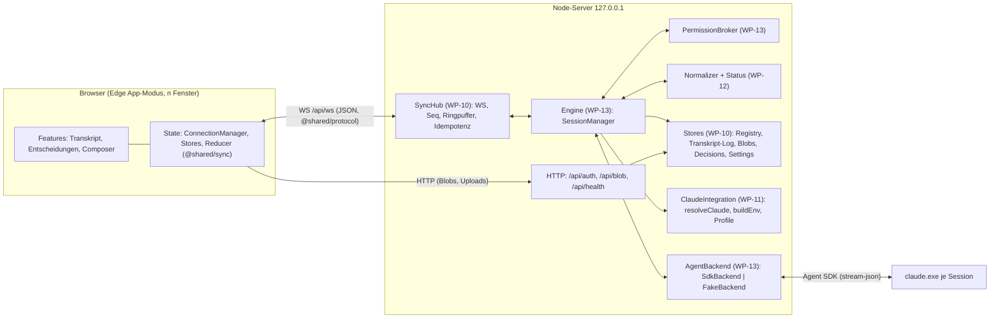
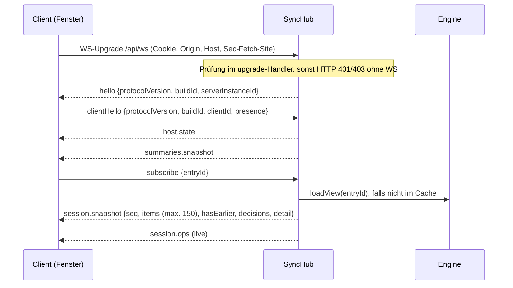
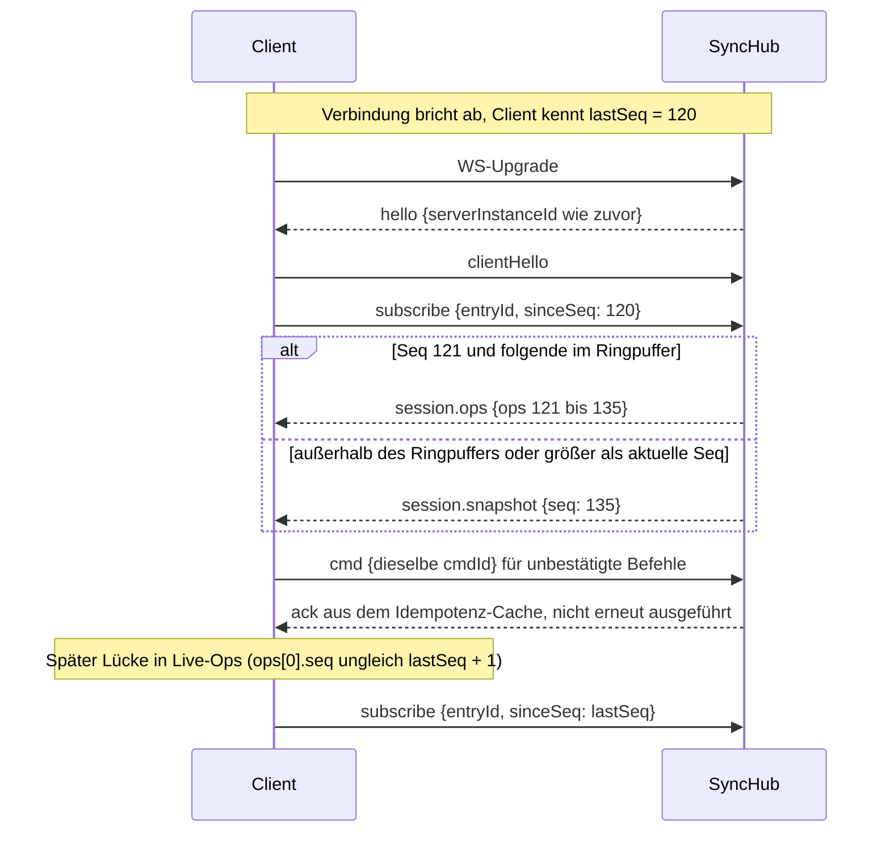
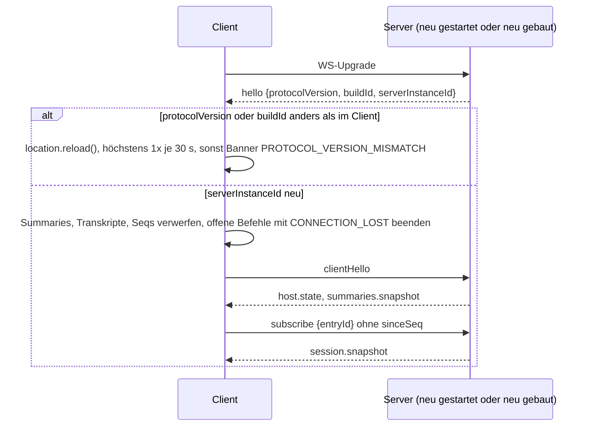
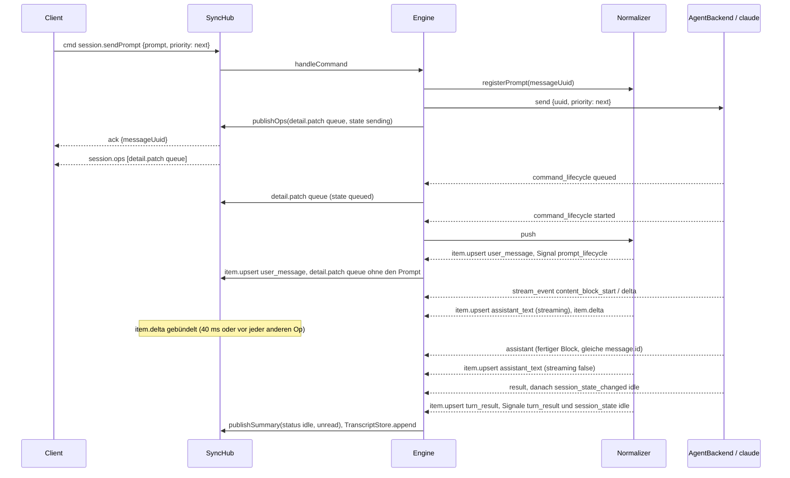
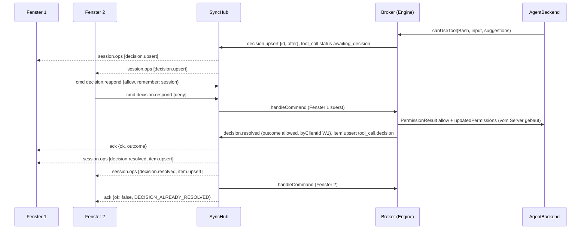
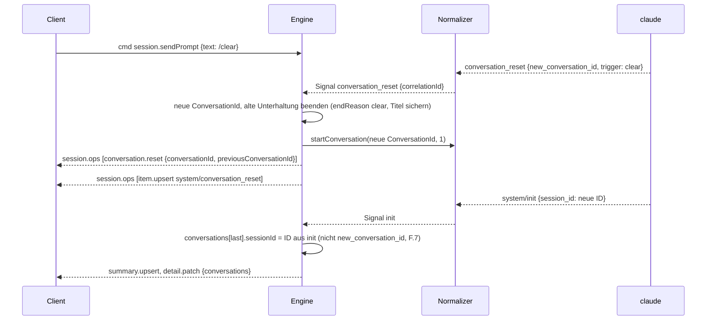
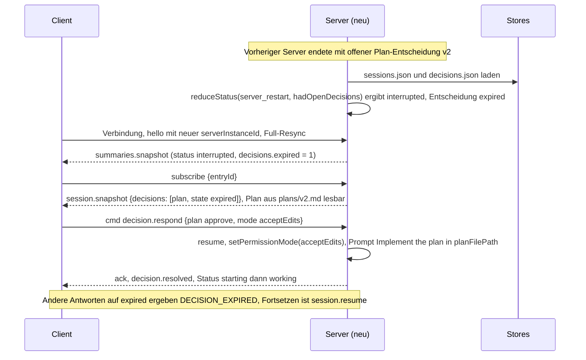

# Architektur

Stand: WP-02 (Contracts v1, eingefroren). Quelle der Entscheidungen: `docs/wp/WP-02.md` (Design,
normativ) und `docs/plan.md` („Änderungen nach kritischem Review“ geht vor). Dieses Dokument fasst
zusammen und trifft keine neuen Entscheidungen. Code-Wahrheit sind die zod-Schemas in `src/shared`
und die Port-Dateien in `src/server`.

---

## 1. Überblick

Parallax ist ein lokaler Node-Server (nur `127.0.0.1`) mit Web-UI. **Sessions leben im Server**:
Jede Session ist ein `claude`-Prozess, den der Server über das Agent SDK steuert. Fenster (Edge im
App-Modus) sind austauschbare Ansichten; ein Reload, ein zweites Fenster oder ein Reconnect ändern an
der Session nichts.



## 2. Module und Ownership

| Paket | liefert (Modul → Export) | nutzt | testet ohne die anderen über |
|---|---|---|---|
| WP-02 | `src/shared/{common,errors,status,model,protocol,sync,build,samples}.ts`; Ports `src/server/backend/types.ts`, `src/server/backend/fixture.ts`, `src/server/sessions/ports.ts`, `src/server/sync/ports.ts`, `src/server/claude/ports.ts` | – | zod-Roundtrips, Typ-Tests, Fixture-Tests |
| WP-10 | `sync/hub.ts` → `SessionPublisher`; `store/*` → `TranscriptStore`, `BlobStore`, `RegistryStore`, `DecisionStore`, `SettingsStore`; `http/app.ts`; `config.ts`; `lib/{logger,ids,paths}.ts` | `SessionSource` (Port), Shared | `createMemorySessionSource()`, echter `ws`-Client, Port 0, Temp-Home |
| WP-11 | `claude/integration.ts` → `ClaudeIntegration`; `resolveClaude`, `buildEnv`, `parseProfileArgs`, `parseAuthStatus`, Profil „Standard“; `scripts/preflight.ts` | Shared, `lib/paths.ts` | Fake-Dateisystem/`where`-Stub, `.cmd`-Shim-Fixture |
| WP-12 | `sessions/normalizer/*` → `createLiveNormalizer`, `normalizeHistory`, `normalizeContextUsage`; `sessions/status/machine.ts` → `reduceStatus` | Shared, `backend/fixture.ts`, Ports §9.4 | Fixture-Snapshots |
| WP-14 | `web/state/*` (Transport, ConnectionManager, Hooks), `web/i18n/*`, `web/ui/*`-Basis, Theme, Playground | Shared (`protocol`, `sync`, `status`, `errors`, `samples`) | In-Memory-Transport |
| WP-13 | `backend/{sdk,fake}Backend.ts` → `AgentBackend`; `sessions/manager.ts` → `SessionSource`; `sessions/broker.ts` | alle Server-Ports | FakeBackend + Memory-Publisher |
| WP-15 | `web/features/transcript/*` (`TranscriptView`, Renderer-Registry) | WP-14-State | Playground + Komponenten-Tests |
| WP-16 | `web/features/{decisions,composer}/*` (`DecisionBar`, `DecisionCard`, `Composer`, `ContextGauge`, `ModelPicker`, `ModePicker`) | WP-14-State | Playground + Komponenten-Tests |
| WP-20 | `main.ts`: `createApp` + `createSyncHub` + `createSessionManager` + Backend nach `--backend` | alles | E2E |

**Import-Grenzen (ADR-003):** `src/shared` ist ein Blatt (nur `zod` und relative Shared-Module, keine
Node-/DOM-APIs, keine SDK-Typen). Web ↛ Server, Server ↛ Web (tsconfig `rootDir` + ESLint
`no-restricted-imports`). Server-Dateien dürfen SDK-Typen importieren; rohe SDK-Messages existieren
nur hinter `AgentBackend` (`BackendEvent.message: unknown`). Skripte dürfen Server-Module importieren
(z. B. `scripts/record/format.ts` → `src/server/backend/fixture.ts`).

**Contract-Module (eingefroren):**

| Datei | Inhalt |
|---|---|
| `src/shared/common.ts` | IDs (`en_`/`cv_`/`dc_`/`cl_`/`pf_` + 32 Hex), `sessionKey`-Helfer, Zeit, JSON, SDK-Enums, `LIMITS` |
| `src/shared/errors.ts` | Fehlercode-Katalog, `ErrorPayload`, Mapper für `startup_failure_reason`/`assistant.error` |
| `src/shared/status.ts` | `StatusFacts`, `deriveDisplayStatus`, `canSleep`, `notificationFor` |
| `src/shared/model.ts` | Profile, Settings, Einträge/Unterhaltungen, Items, Entscheidungen, Host, Summary, Detail |
| `src/shared/protocol.ts` | alle WS-Nachrichten, Befehle, Ack-Ergebnisse, Parse-Helfer |
| `src/shared/sync.ts` | reine Reducer `applySessionOp`, `applySeqOps`, `mergeItems`, `trimItems` |
| `src/shared/build.ts` | `BUILD_ID` (per `define` eingebettet, sonst `'dev'`) |
| `src/shared/samples.ts` | gültige Beispielobjekte für Tests und Playground |
| `src/server/backend/types.ts` | Port `AgentBackend`, `AgentSession`, `BackendEvent`, `PermissionRequest` |
| `src/server/backend/fixture.ts` | Fixture-Format v1 (einzige Quelle), Laden, Payload-Views |
| `src/server/sessions/ports.ts` | Normalizer/Status ↔ Engine (`LiveNormalizer`, `StatusSignal`, `ReduceStatus`) |
| `src/server/sync/ports.ts` | Hub/Stores ↔ Engine (`SessionPublisher`, `SessionSource`, Stores, `CommandError`, Transkript-Log) |
| `src/server/claude/ports.ts` | Claude-Integration ↔ Engine (`LaunchSpec`, `ClaudeIntegration`, `ProfileStore`) |

## 3. Datenfluss

### 3.1 Server (Laufzeit)
```
AgentBackend.events ──▶ Engine(WP-13) ──push()──▶ LiveNormalizer(WP-12) ──▶ {ops, signals}
                          │                                               │
                          │◀──────────────── signals ─────────────────────┘
                          ├─ reduceStatus(facts, signal) → StatusFacts → SessionSummary
                          ├─ TranscriptStore.append(nicht-streamende upserts/removes)
                          ├─ SessionPublisher.publishOps(ops) / publishSummary(summary, urgent)
                          └─ Broker: canUseTool → Decision → decision.upsert / attachDecision
Client cmd ──▶ SyncHub(WP-10): parse, Idempotenz, ack ──▶ SessionSource.handleCommand
```
Der Hub hält pro abonniertem Eintrag einen materialisierten `SessionViewState` (dieselben Reducer wie
der Client, `applySessionOp` + `trimItems(LIMITS.snapshotItems)`) und baut daraus `session.snapshot`.

### 3.2 Client
```
Transport (WS | Memory) ──▶ ConnectionManager je Host ──parseServerMessage──▶
  host.state / summaries.*  ──▶ Host-Store (Summaries je sessionKey)
  session.snapshot / .ops   ──▶ viewStateFromSnapshot / applySeqOps (@shared/sync) ──▶ Session-Store
  ack                       ──▶ offene Befehle (cmdId) → parseCommandResult
Zustand-Selektoren je Session (useSummary, useDisplayStatus = deriveDisplayStatus, useSessionView,
useItem, useDecisions) ──▶ Features (Transkript, Entscheidungen, Composer)
Features ──useCommand──▶ ConnectionManager.send(cmd) → {type:'cmd', cmdId, cmd}
```
`sessionKey = hostId:entryId` existiert nur im Client (`makeSessionKey`); auf dem Draht steht nur
`entryId`. Phase 1 hat genau den Host `local`.

## 4. Source of Truth (A.3)

| Daten | maßgeblich | persistiert in | live über |
|---|---|---|---|
| Transkript (Anzeige) | eigenes Item-Log | `entries/<id>/<cv>.transcript.jsonl` | `session.ops` |
| Claude-Kontext, Resume | Claude-JSONL | `<configDir>/projects/…` | – (nur Fallback/Import, Worker je Config-Dir) |
| Eintrag, Titel, Profil, `cwd` | Registry | `sessions.json` | `summary.upsert` |
| Status-Fakten | Engine (`reduceStatus`) | `lastRunState`, `lastError`, `contextPct` | `summary.upsert` |
| Offene Entscheidungen | Broker (Speicher) | Metadaten `decisions.json`, Pläne `plans/v<N>.md` | `decision.*`-Ops |
| Tatsächlicher Modus / Modell | `init`/`status` bzw. `assistant.message.model` | `permissionMode`, `lastModel` | Summary |
| Profile, Settings | Server | `profiles.json` (Phase 2), `settings.json` | `host.state` |
| Blobs (Bilder, Volltexte) | Blob-Cache | `blobs/` | `/api/blob/<id>` |
| Entwürfe, Panelgrößen, gewählte Session | Client | `localStorage`/`sessionStorage` | – |
| Deltas, Retry, Rate-Limit-Banner, Hooks | Speicher | – (geht bei Neustart verloren, akzeptiert) | Ops |

## 5. Sync-Protokoll (`src/shared/protocol.ts`)

**Endpunkt** `GET /api/ws`; Auth per Geräte-Cookie und Origin/Host/`Sec-Fetch-Site` **im Upgrade**
(A.8). Ein JSON-Objekt pro Frame, Diskriminator `type`. `PROTOCOL_VERSION = 1`.

**Handshake:** `hello{protocolVersion, buildId, serverInstanceId, serverVersion, serverStartedAt}` →
`clientHello{protocolVersion, buildId, clientId, presence}` → `host.state` → `summaries.snapshot`.
Nachrichten vor `clientHello` → `error` + Close 4400. Client-Reaktion auf `hello`: andere
`protocolVersion` oder `buildId` → `location.reload()` (höchstens 1× je 30 s, sonst Banner
`PROTOCOL_VERSION_MISMATCH`); neue `serverInstanceId` → Full-Resync; gleiche Instanz → Abos mit
`sinceSeq`, unbestätigte Befehle mit **derselben** `cmdId` erneut.

**Kanal 1 (host-weit, an alle Clients):** `host.state`, `summaries.snapshot`, `summary.upsert`,
`summary.remove` – immer ganze Objekte, Last-Writer-Wins je `entryId`. Änderungen an `status`,
`title`, `permissionMode`, `model`, `lastError`, `archived`, `pinned` sofort; nur `context`,
`lastActivityAt`, `lastResultExcerpt` höchstens 1×/s je Eintrag (Trailing-Flush).

**Kanal 2 (Abo je Session):** `subscribe{entryId, sinceSeq?}` / `unsubscribe`. Seq pro Eintrag,
startet je `serverInstanceId` bei 1, eine Seq pro `SessionOp`; Ringpuffer `LIMITS.ringBufferOps`.
Antwort ist genau eine von `session.snapshot` (kein `sinceSeq` oder außerhalb des Puffers),
`session.ops` (Replay, ggf. leer) oder `session.unavailable`; danach Live-`session.ops`. Ops:
`item.upsert`, `item.delta` (`text`/`thinking`/`inputPartial`), `item.remove`, `conversation.reset`,
`decision.upsert`, `decision.resolved`, `detail.patch` (ersetzt genau die genannten Felder). Der Client
prüft `ops[0].seq === lastSeq + 1`, bei Lücke `subscribe{sinceSeq: lastSeq}`.

**Delta-Bündelung:** Der Hub puffert `item.delta` je `(itemId, field)` und flusht alle
`LIMITS.deltaFlushMs` (40 ms) **oder** sofort vor jeder anderen Op desselben Eintrags; zusammengelegte
Deltas sind **eine** Op. Der Client wendet Ops pro Animation-Frame an.

**Befehle:** `{type:'cmd', cmdId, cmd:{name, …}}`, der Server antwortet genau einmal mit
`ack{ok:true, result}` bzw. `ack{ok:false, error}`; `result` passt zu `commandResultSchemas[name]`.
Idempotenz host-weit: Cache `cmdId → ack` (LRU 1000, TTL 10 min); Duplikat während der Ausführung wartet
auf dasselbe Ergebnis, danach wird das gecachte `ack` erneut gesendet. Ungültige Nachricht ohne gültige
`cmdId` → `error{INVALID_MESSAGE}`, mit gültiger `cmdId` → `ack{VALIDATION_FAILED, params.path}`.
Phase-1-Pflicht und Semantik je Befehl: Befehlstabelle in `docs/wp/WP-02.md` §7.5.

**Entscheidungen:** Server-`DecisionId`, mehrere offene je Session (älteste zuerst), erster Klick
gewinnt. Der Client sendet **Absichten** (`remember: <Ziel>`, `acceptEdits`, Antworten, Plan-Modus),
der Server baut `PermissionResult`/`updatedPermissions` selbst aus den gespeicherten `suggestions`
(F.3, ADR-012). Andere Fenster erhalten `decision.resolved`.

**Präsenz/Benachrichtigungen (A.9):** `presence{focused, visible, viewingEntryId, typing}` nach jeder
Änderung (entprellt 250 ms). Der Server wählt je Ereignis genau einen Kanal: fokussiertes, sichtbares
Fenster zeigt die Session → nichts, sonst `notify{delivery:'in_app'}` dorthin; sonst `system` an genau
einen (zuletzt fokussierten) Client; ohne Client Phase 1 nichts (Phase 2 nativer Toast). Welches
Ereignis: `notificationFor` (§7).

### (a) Erstverbindung


### (b) Reconnect mit Replay bzw. Lücke → Snapshot


### (c) Neue `serverInstanceId` → Full-Resync, neue `buildId` → Reload


### (d) Prompt während eines Turns (`next`) → Queue → Streaming → Final


### (e) Entscheidung in zwei Fenstern (erster Klick gewinnt)


### (f) `/clear` → `conversation_reset` → neue `ConversationId` → Session-ID aus nächstem `init`


### (g) Serverneustart mit offener Plan-Entscheidung → `interrupted` + `expired` → „Fortsetzen & freigeben“


## 6. Item-Modell (`src/shared/model.ts`, §5.6)

**Item-IDs** (live und Verlauf identisch; Annahmen in `src/server/backend/fixture.test.ts` gegen alle
Fixtures geprüft):

| Quelle | `id` |
|---|---|
| Assistant-Content-Block (text/thinking/tool_use) | `${message.id}:${blockIndex}` – `blockIndex` = `content_block_start.index` bzw. Ordinalzahl je `message.id` |
| User-Prompt | gesendete `uuid` (`MessageUuid`) |
| andere SDK-Message mit `uuid` (System, Result, Interrupt-Marker) | `uuid` |
| von Parallax erzeugt (Fehler ohne SDK-Message, Reset-Marker) | `px:${conversationId}:${n}` |

`tool_result` erzeugt kein Item, sondern füllt `tool_call.result` (gleiche `toolUseId`).
**Reihenfolge:** `order` (≥ 1, pro Unterhaltung streng steigend, nie geändert); sortiert wird nur nach
`order`, `upsert` ersetzt am Platz. **Kappung:** Tool-Output, Thinking, Informational, Hook-Output und
String-Werte im Tool-Input über `LIMITS.itemTextChars` (48 Ki Zeichen), `structured` über
`LIMITS.itemStructuredChars`; der Volltext liegt als Blob (`truncated.blobId`, `GET /api/blob/<id>`).
Bilder immer als Blob. Assistant-Text wird nie gekappt.

**Zwei Adapter, gleiche Items (A.3):** Live (`LiveNormalizer.push`, mit Stream-Events) und Verlauf
(`normalizeHistory`, `getSessionMessages` mit Timestamps, ohne `tool_use_result` →
`result.structured = null`). Renderer verlassen sich nie allein auf `structured`.

| SDK-Message | Item | Signal / Wirkung |
|---|---|---|
| `stream_event` (`content_block_*`, Deltas) | Streaming-`assistant_text`/`thinking`/`tool_call` + `item.delta` | `context_estimate` |
| `assistant` (fertiger Block) | ersetzt das Streaming-Item gleicher ID; ohne Stream direkt final | `assistant_model` (Haupt-Thread); `assistant.error` → zusätzlich `system/error` + `assistant_error` |
| `user` Prompt (nach `registerPrompt`, `command_lifecycle started`) | `user_message` | – |
| `user` nur mit `tool_result` | – (→ `tool_call.result`) | – |
| `user` mit `isReplay` | – | – |
| `user` „[Request interrupted by user…]“ | `system/interrupted` | – |
| `result` | `turn_result` (synthetisch bei `num_turns 0`) | `turn_result` |
| `system/init` | – (→ `detail.init`) | `init` |
| `system/status` | – | `permission_mode`, `compacting` |
| `system/session_state_changed` | – | `session_state` |
| `system/compact_boundary`, `notification`, `informational`, `permission_denied`, `memory_recall`, `local_command_output` | gleichnamiges `system`-Item | – |
| `system/api_retry` | `system/api_retry` (ein Item je Serie, `upsert`) | `retry` |
| `system/hook_*` | `system/hook` (`upsert` je `hook_id`) | – |
| `rate_limit_event` | `system/rate_limit` nur bei `allowed_warning`/`rejected` | `rate_limit` |
| Modell-Fallback (`model_refusal_fallback`) | `system/model_fallback`; zurückgezogene Items → `item.remove` | – |
| `system/task_started`/`task_updated`/`task_progress`, `tool_progress` | – (→ `tool_call.task`, `elapsedSeconds`) | – |
| `system/task_notification` | `tool_call.task` bzw. `system/task_notification` ohne passendes `tool_call` | – |
| `system/background_tasks_changed` | – (→ `detail.backgroundTasks`) | `background_tasks` |
| `command_lifecycle` (untypisiert) | – (→ Queue) | `prompt_lifecycle` |
| `system/session_title_changed` (untypisiert) | – | `title_changed` |
| `prompt_suggestion`, `system/commands_changed` | – (→ Detail) | – |
| `conversation_reset` | Marker `system/conversation_reset` als erstes Item der neuen Unterhaltung | `conversation_reset` + Op `conversation.reset` |
| `system/thinking_tokens`, `keep_alive` | – | – |
| bekannte, bewusst ignorierte Typen (`files_persisted`, `auth_status`, `tool_use_summary` …) | – | Zähler `ignoredCounts` |
| unbekannte `type/subtype` | `system/unknown` | Zähler `unknownCounts` (Detail) |

Subagent-Messages werden immer über `parent_tool_use_id` unter das Agent-`tool_call` sortiert.

## 7. Statusmodell (`src/shared/status.ts`)

Der Server hält **Fakten** (`StatusFacts`: `runState`, Entscheidungszähler, `unread`,
`backgroundTasks`, `queuedPrompts`, `rateLimitedUntil`, `compacting`, `retrying`, `wakeupAt`,
`lastTurn`, `errorCode`); Server (Benachrichtigungen) und UI leiten die Anzeige mit derselben reinen
Funktion ab. „Wartet“ ist **kein** `runState`, sondern folgt aus offenen Entscheidungen.

| runState | Bedeutung |
|---|---|
| `starting` | Prozess gestartet/Query erzeugt, noch kein `init`/`running` |
| `working` | `session_state_changed` = `running` oder `requires_action` |
| `idle` | `session_state_changed` = `idle` („fertig“ nur hieraus; `result` ändert `runState` nicht) |
| `sleeping` | kein Prozess, regulär (Close, Leerlauf-Schlaf, Serverstart ohne offene Arbeit) |
| `interrupted` | kein Prozess, Arbeit von außen abgeschnitten (Neustart während Arbeit/offener Entscheidung) |
| `error` | Crash, Startfehler, Auth-/Setup-Fehler; `errorCode` gesetzt |
| `external` | an externe Konsole/Terminal übergeben (Phase 2/4) |

User-Stop führt über `idle` zu `lastTurn.outcome = 'interrupted'`, nicht zu `interrupted`/`error`.

**`deriveDisplayStatus(facts, now)`** – erste zutreffende Zeile gewinnt:

| # | Bedingung | `kind` | `needsAttention` | `sortBucket` |
|---|---|---|---|---|
| 1 | `runState = external` | `external` | nein | 4 |
| 2 | offene Entscheidungen > 0 und `runState ∉ {sleeping, interrupted, error}` | nach `oldestKind`: `needs-permission` / `needs-answer` / `needs-review` | ja | 0 |
| 3 | `runState = error` | `error` | nein | 1 |
| 4 | `runState = interrupted` | `interrupted` | nein | 1 |
| 5 | `rateLimitedUntil > now` und `runState ∈ {idle, sleeping}` | `rate-limited` | nein | 1 |
| 6 | `runState = starting` | `starting` | nein | 2 |
| 7 | `runState = working` | `working` | nein | 2 |
| 8 | `idle` und (`backgroundTasks > 0` oder `queuedPrompts > 0` oder `wakeupAt > now`) | `background` | nein | 2 |
| 9 | `idle` und `unread` | `done` | nein | 3 |
| 10 | `idle` | `idle` | nein | 4 |
| 11 | `sleeping` | `sleeping` | nein | 4 (3 wenn `unread`) |

`unread` und Badges (`background`, `compacting`, `retrying`, `queued`, `expiredDecisions`) werden
immer durchgereicht, `rateLimitedUntil` nur, wenn es in der Zukunft liegt.

**`canSleep(facts, now)`** – nur bei `idle` ohne offene/abgelaufene Entscheidungen, ohne
Hintergrund-Tasks, ohne gequeuete Prompts, ohne künftigen Wakeup, nicht `compacting`/`retrying`
(Handoff = `external` → nie).

**`notificationFor(prev, next, now, {minDoneTurnMs})`** (Vergleich der abgeleiteten `kind`s):

| `next.kind` | Bedingung | Ergebnis |
|---|---|---|
| `needs-permission` / `needs-answer` / `needs-review` | `prev.kind ≠ next.kind` oder mehr offene Entscheidungen als zuvor | `permission` / `question` / `plan` |
| `done` | `prev.kind ∈ {working, background, starting}` und `lastTurn.durationMs ≥ minDoneTurnMs` | `done` |
| `error` | `prev.kind ≠ error` | `error` |
| `rate-limited` | `prev.kind ≠ rate-limited` | `rate_limit` |
| sonst | | `null` |

`DONE_NOTIFY_MIN_TURN_MS = 20 000`; für unfokussierte Clients ruft der Server mit `minDoneTurnMs: 0`
auf. „Fertig“ nie bei laufender Hintergrundarbeit und nie nach User-Stop (kein `unread`).

## 8. Persistenz-Layout

Unter `PARALLAX_HOME` (Default `%LOCALAPPDATA%\Parallax`, Dev `.parallax-dev`, Tests Temp-Ordner):
```
sessions.json                         registryFileSchema
profiles.json                         profilesFileSchema (Phase 2)
settings.json                         settingsFileSchema
blobs/<blobId>                        inhaltsadressiert, Typ in blobs/<blobId>.meta.json
entries/<entryId>/<conversationId>.transcript.jsonl   append-only, transcriptLogLineSchema
entries/<entryId>/decisions.json      decisionRecordsFileSchema
entries/<entryId>/plans/v<N>.md       Plan-Versionen (Text exakt wie in canUseTool)
entries/<entryId>/attachments/<blobId>.<ext>   Uploads (C.11), Ordner in additionalDirectories
logs/                                 pino-roll
```
**JsonStore-Regeln (B, WP-10):** zod-Schema + `schemaVersion` + Migrationen; atomar über Temp-Datei
und Rename mit Retry bei EPERM/EBUSY; `.bak`; korrupte Dateien in Quarantäne + Host-Warnung
`STORE_CORRUPT_QUARANTINED`; ein Writer, Debounce. Neue Felder immer mit Default (kein Bump).

**Transkript-Log** (`src/server/sync/ports.ts`): eine Zeile je persistierter Op,
`{v:1, at, op:'upsert', item}` (nur nicht-streamende Items) oder `{v:1, at, op:'remove', itemId}`.
Deltas werden nie persistiert. Laden = Falten nach `id` (letzte Zeile gewinnt), sortieren nach `order`,
defekte Zeilen überspringen und zählen.

## 9. Prozesse und Sicherheit (Kurzfassung)

- **Auth (A.8):** Einmal-Code → `POST /api/auth` → persistentes HttpOnly-/SameSite=Strict-Cookie;
  Origin-, Host- und `Sec-Fetch-Site`-Prüfung für jeden nicht-GET-Request und den WS-Upgrade; kein
  Token in URLs, keine CORS-Header. Strikte CSP (C.10).
- **Env (C.2):** jeder `claude`-Start über `buildEnv()` (Session-Variablen der aufrufenden
  Claude-Session entfernt, `PARALLAX=1`, `PARALLAX_ENTRY_ID`).
- **Prozesse (C.8):** `close()`, bis 5 s warten, dann `taskkill /PID <pid> /T /F`; jeder Spawn mit
  `windowsHide: true`, ohne Shell; Spawn-Wrapper liest stderr (F.16).
- **Pfade (C.10):** UNC-, Device-, ADS-Pfade und reservierte Namen vor jedem Dateizugriff ablehnen;
  `cwd` exakt behalten, Vergleiche case-insensitiv über den Pfad-Helfer.
- **XSS = Codeausführung:** kein `rehype-raw`, kein `dangerouslySetInnerHTML`; der Client sendet nur
  Absichten, nie rohe `updatedPermissions` (ADR-012).

## 10. Erweiterungspunkte

- **Multi-Host:** `hostId` lebt nur im Client (`sessionKey`, Connection-Map); Transport austauschbar
  (`createWebSocketTransport`/`createMemoryTransport`); Blobs, Profile, Settings gelten pro Host.
- **Profile (Phase 2):** Dateiformat `profiles.json` steht (`profileSchema`); Phase 1 liefert das
  eingebaute Profil „Standard“ aus Code.
- **Terminal/externe Konsole:** `runState 'external'`, Befehle antworten `SESSION_EXTERNAL`.
- **Observer (Phase 5):** eigene Einträge, `user_message.origin = 'other'`.
- **Rewind/Fork:** neue Unterhaltung mit `endReason 'fork'`.
- **Settings:** additiv mit Defaults; `settings.update` patcht nur genannte Felder.
- **Anhänge:** Contract steht (HTTP-Upload → `BlobRef`, Prompt referenziert `blobId`), Phase 1
  `NOT_IMPLEMENTED`.

## 11. Contract-Änderungen und Versionierung

| Größe | Startwert | Erhöhen, wenn … |
|---|---|---|
| `PROTOCOL_VERSION` | `1` | ein Peer mit der alten Version eine Nachricht der neuen nicht mehr korrekt versteht (Feld entfernt/umbenannt, Semantik geändert, neues Pflichtfeld, Enum-Wert in Client→Server-Richtung entfernt). Nicht bei neuen optionalen Feldern, neuen Server-Nachrichtentypen (Client ignoriert sie), neuen Befehlen. |
| `buildId` | `dev` ohne Bundle; sonst `<package.version>+<git-Kurzhash>[.dirty-<Digest>]` (`resolveBuildId`, `repo.config.ts`), Override `PARALLAX_BUILD_ID` | jeder Build mit anderem Stand (Client-Reload nach `git pull`) |
| `REGISTRY_SCHEMA_VERSION`, `PROFILES_SCHEMA_VERSION`, `SETTINGS_SCHEMA_VERSION`, `DECISIONS_SCHEMA_VERSION` | `1` | Migration nötig (Umbenennung, Strukturwechsel); neue Felder mit Default → kein Bump |
| Transkript-Log-Zeile `v` (`TRANSCRIPT_LOG_VERSION`) | `1` | wie oben; alte Zeilen bleiben lesbar |
| `fixtureVersion` | `1` (ADR-010) | Formatänderung der Fixtures |

**Ablauf** jeder Contract-Änderung (Contracts sind eingefroren): Anfrage im WP-Bericht unter
„SCHNITTSTELLEN/CONTRACT-ABWEICHUNGEN“ → Freigabe durch den Koordinator → Änderung + Tests + Zeile im
Contract-Changelog (`docs/progress.md`) → Bump nach obiger Tabelle.
