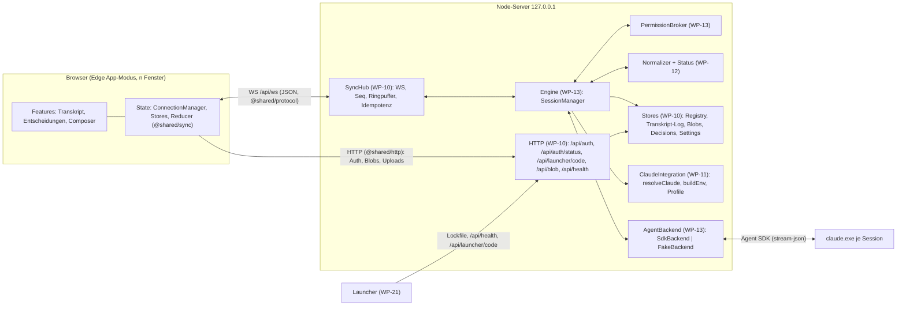
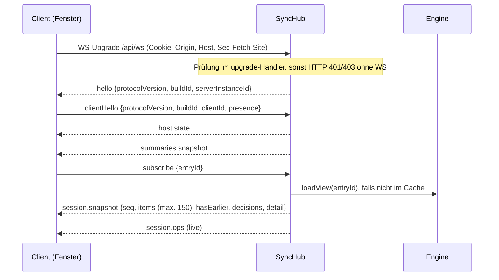
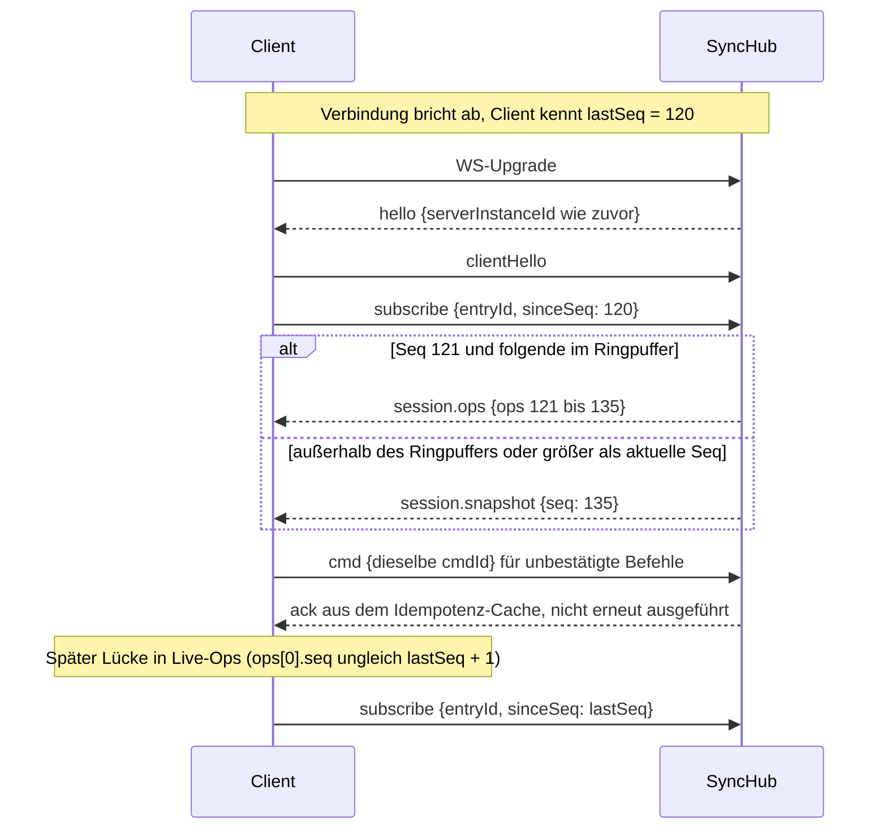
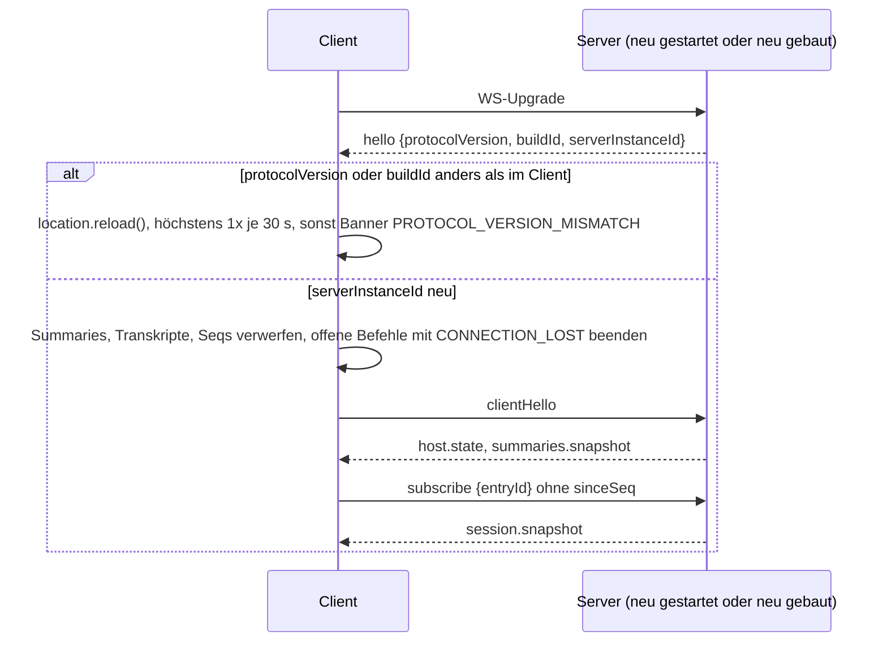
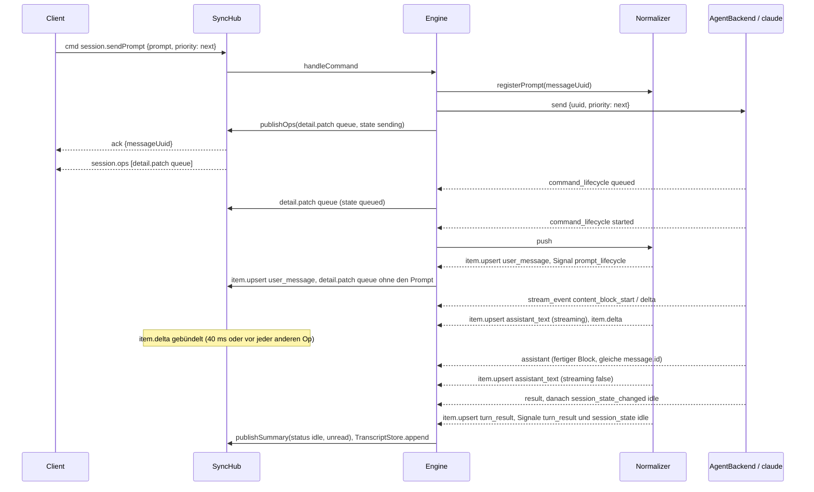
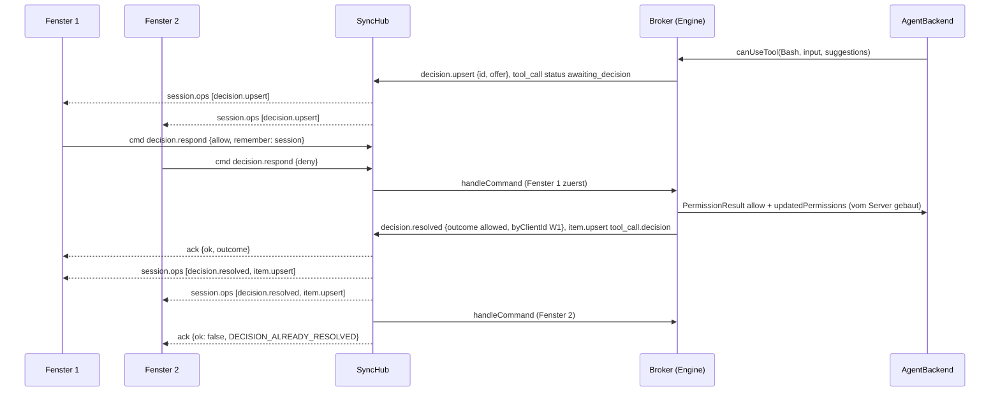
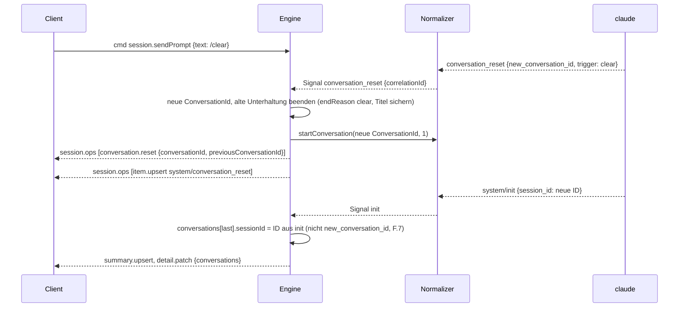
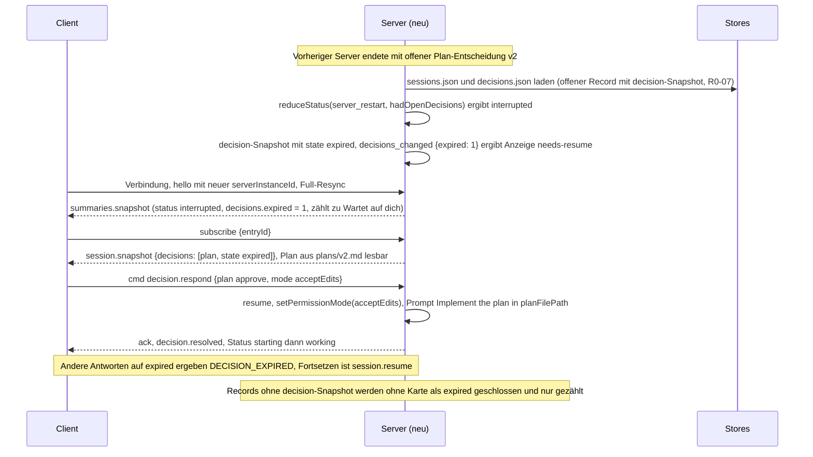
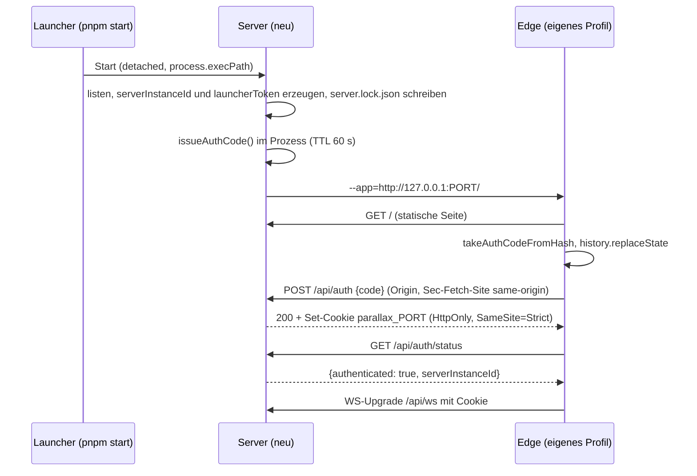
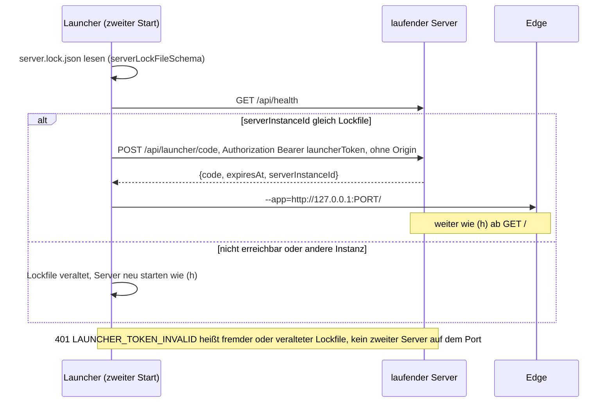

# Architektur

Stand: WP-02 (Contracts v1, eingefroren) plus R0-Fixes (HTTP-/Auth-Contract, Datei-Ownership,
Statusregeln; `docs/wp/R0.md`, Abschnitt „Umsetzung“). Code-Wahrheit sind die zod-Schemas in
`src/shared` und die Port-Dateien in `src/server`.

**Rangfolge bei Widersprüchen (R0-10):** Contracts (`src/shared`, Ports) > dieses Dokument und die
ADRs (`docs/decisions.md`) > Designs/Aufträge in `docs/wp/` > `docs/sdk-findings.md` > `docs/plan.md`
(dort „Änderungen nach kritischem Review“ vor älteren Abschnitten). Regeln mit „normativ“ gelten für
die genannten Pakete und werden dort tabellengetestet.

---

## 1. Überblick

Parallax ist ein lokaler Node-Server (nur `127.0.0.1`) mit Web-UI. **Sessions leben im Server**:
Jede Session ist ein `claude`-Prozess, den der Server über das Agent SDK steuert. Fenster (Edge im
App-Modus) sind austauschbare Ansichten; ein Reload, ein zweites Fenster oder ein Reconnect ändern an
der Session nichts.



## 2. Module und Ownership

| Paket | liefert (Modul → Export) | nutzt | testet ohne die anderen über |
|---|---|---|---|
| WP-02 | `src/shared/{common,errors,status,model,protocol,sync,build,samples}.ts`; Ports `src/server/backend/types.ts`, `src/server/backend/fixture.ts`, `src/server/sessions/ports.ts`, `src/server/sync/ports.ts`, `src/server/claude/ports.ts` | – | zod-Roundtrips, Typ-Tests, Fixture-Tests |
| WP-10 | `sync/hub.ts` → `SessionPublisher`; `store/*` → `TranscriptStore`, `BlobStore`, `RegistryStore`, `DecisionStore`, `SettingsStore`; `http/{app,auth,origin}.ts` (HTTP-/Auth-Contract §5.1); `config.ts`; `lib/{logger,ids,paths}.ts` | `SessionSource` (Port), Shared | `createMemorySessionSource()`, echter `ws`-Client, Port 0, Temp-Home |
| WP-11 | `claude/integration.ts` → `ClaudeIntegration`; `resolveClaude`, `buildEnv`, `parseProfileArgs`, `parseAuthStatus`, Profil „Standard“; `lib/process.ts`; `scripts/preflight.ts` | Shared (`@shared/paths`) | Fake-Dateisystem/`where`-Stub, `.cmd`-Shim-Fixture |
| WP-12 | `sessions/normalizer/*` → `createLiveNormalizer`, `normalizeHistory`, `normalizeContextUsage`; `sessions/status/machine.ts` → `reduceStatus` | Shared, `backend/fixture.ts`, Ports §9.4 | Fixture-Snapshots, synthetische Streams (§2.5) |
| WP-14 | `web/state/*` (Transport, ConnectionManager, Hooks, `auth.ts`), `web/i18n/*`, `web/ui/*`, `web/shell/*` (Shell + Slots), `web/playground/*`, Theme | Shared (`protocol`, `sync`, `status`, `errors`, `http`, `samples`) | In-Memory-Transport |
| WP-13 | `backend/{sdk,fake}Backend.ts` → `AgentBackend`; `sessions/manager.ts` → `SessionSource`; `sessions/broker.ts` | alle Server-Ports, `lib/{ids,paths,process}.ts` | FakeBackend + Memory-Publisher |
| WP-15 | `web/features/transcript/*` (`TranscriptView`, Renderer-Registry, Slots `Markdown`, `ToolInputPreview`) | WP-14-State, Slot `DecisionCard` | Playground + Komponenten-Tests |
| WP-16 | `web/features/{decisions,composer}/*` (`DecisionBar`, `DecisionCard`, `Composer`, `ContextGauge`, `ModelPicker`, `ModePicker`) | WP-14-State, Slots `Markdown`, `ToolInputPreview` | Playground + Komponenten-Tests |
| WP-20 | `main.ts`: `createApp` + `createSyncHub` + `createSessionManager` + Backend nach `--backend`; `App.tsx`: Slots mit den echten Komponenten füllen | alles | E2E |
| WP-21 | `src/server/launcher/**`: Lockfile schreiben/lesen, Health-Ping, Launcher-Code, Edge-Start, „Server beenden“ | `@shared/http`, `lib/process.ts` | Temp-Home, Port 0 |

**Import-Grenzen (ADR-003):** `src/shared` ist ein Blatt (nur `zod` und relative Shared-Module, keine
Node-/DOM-APIs, keine SDK-Typen). Web ↛ Server, Server ↛ Web (tsconfig `rootDir` + ESLint
`no-restricted-imports`). Server-Dateien dürfen SDK-Typen importieren; rohe SDK-Messages existieren
nur hinter `AgentBackend` (`BackendEvent.message: unknown`). Skripte dürfen Server-Module importieren
(z. B. `scripts/record/format.ts` → `src/server/backend/fixture.ts`).

**Contract-Module (eingefroren):**

| Datei | Inhalt |
|---|---|
| `src/shared/common.ts` | IDs (`en_`/`cv_`/`dc_`/`cl_`/`pf_` + 32 Hex), `sessionKey`-Helfer, Zeit, JSON, SDK-Enums, `LIMITS` |
| `src/shared/errors.ts` | Fehlercode-Katalog, `ErrorPayload`, Mapper für `startup_failure_reason`/`assistant.error` |
| `src/shared/status.ts` | `StatusFacts`, `deriveDisplayStatus`, `canSleep`, `notificationFor` |
| `src/shared/model.ts` | Profile, Settings, Einträge/Unterhaltungen, Items, Entscheidungen, Host, Summary, Detail |
| `src/shared/protocol.ts` | alle WS-Nachrichten, Befehle, Ack-Ergebnisse, Parse-Helfer |
| `src/shared/sync.ts` | reine Reducer `applySessionOp`, `applySeqOps`, `mergeItems`, `trimItems` |
| `src/shared/build.ts` | `BUILD_ID` (per `define` eingebettet, sonst `'dev'`) |
| `src/shared/http.ts` | HTTP-/Auth-Contract (R0-01): `API_PATHS`, Request/Response-Schemas, `authCookieName(port)`, Einmal-Code/Launcher-Token, `takeAuthCodeFromHash`, Lockfile-Schema |
| `src/shared/paths.ts` | reine Windows-Pfadregeln (C.10, R0-02): `windowsPathIssue`, `windowsPathKey`, `windowsPathsEqual`, `isWindowsPathInside` |
| `src/shared/samples.ts` | gültige Beispielobjekte für Tests und Playground |
| `src/server/backend/types.ts` | Port `AgentBackend`, `AgentSession`, `BackendEvent`, `PermissionRequest` |
| `src/server/backend/fixture.ts` | Fixture-Format v1 (einzige Quelle), Laden, Payload-Views |
| `src/server/sessions/ports.ts` | Normalizer/Status ↔ Engine (`LiveNormalizer`, `StatusSignal`, `ReduceStatus`) |
| `src/server/sync/ports.ts` | Hub/Stores ↔ Engine (`SessionPublisher`, `SessionSource`, Stores, `CommandError`, Transkript-Log) |
| `src/server/claude/ports.ts` | Claude-Integration ↔ Engine (`LaunchSpec`, `ClaudeIntegration`, `ProfileStore`, `ParseProfileArgs`) |

### 2.1 Datei-Ownership gemeinsamer Ordner (normativ, R0-02/R0-03)

Ziel: Welle 1a (WP-10, 11, 12, 14) und Welle 1b (WP-13, 15, 16) bearbeiten **keine Datei
gemeinsam**. Pakete legen in fremden Ordnern nichts an. `README.md` eines Ordners ändert nur sein
Owner; bei Ordnern mit mehreren Ownern (`src/server`, `src/server/lib`, `src/server/sessions`,
`src/server/backend`, `src/web`, `src/web/features`) nur der Koordinator (Pakete melden Änderungen
im Bericht).

| Datei/Pfad | Owner | Bemerkung |
|---|---|---|
| `src/shared/**`, `src/server/**/ports.ts`, `src/server/backend/{types,fixture}.ts` (+ Tests) | Koordinator (eingefroren) | Änderung nur per Contract-Änderung |
| `src/server/lib/logger.ts`, `lib/ids.ts`, `lib/paths.ts` | WP-10 | Exporte §2.2 |
| `src/server/lib/process.ts` | WP-11 | Exporte §2.2; WP-13/21 nutzen nur |
| `src/server/config.ts`, `src/server/{http,sync,store}/**` | WP-10 | |
| `src/server/claude/**` | WP-11 | kein eigener Pfad-Helfer, Pfadregeln nur `@shared/paths` |
| `src/server/sessions/normalizer/**`, `sessions/status/**` | WP-12 | |
| übrige Dateien in `src/server/sessions/` und `src/server/backend/` | WP-13 | |
| `src/server/main.ts`, `bootstrap.ts` | WP-20 | |
| `src/server/launcher/**` | WP-21 | |
| `src/web/{App,main}.tsx`, `index.html`, `index.css` | WP-14 | WP-20 füllt in `App.tsx` die Slots |
| `src/web/{shell,ui,lib,state,i18n,playground}/**` | WP-14 | in Welle 1b **nur lesen** |
| `src/web/features/transcript/**` | WP-15 | `i18n/{en,de}.ts` legt WP-14 als Stub an |
| `src/web/features/{decisions,composer}/**` | WP-16 | dito |
| `scripts/preflight.ts` | WP-11 | `scripts/record/**`: WP-01 (fertig) |
| `e2e/**` | WP-20 | |

### 2.2 Server-Helfer (normativ; „Helfer nur in `*/lib`“)

Es gibt **einen** Satz Pfadregeln: `@shared/paths` (rein, ohne Node-APIs, getestet). Der
Pfad-Helfer `src/server/lib/paths.ts` (WP-10) baut darauf auf und ergänzt nur Dateisystem-Prüfungen;
WP-11 und das Web importieren `@shared/paths` direkt. Niemand implementiert die Regeln ein zweites
Mal (auch kein „Minimal-Helfer“ in `claude/`).

```ts
// @shared/paths (R0-Fix, eingefroren)
windowsPathIssue(path): PathIssue | null   // C.10: UNC, Device, ADS, reservierte Namen, Punkt/Leerzeichen am Ende …
isSafeWindowsPath(path): boolean
windowsPathKey(path): string               // Vergleichsschlüssel (case-insensitiv, / → \), nie als Pfad speichern
windowsPathsEqual(a, b): boolean
isWindowsPathInside(child, parent): boolean

// src/server/lib/paths.ts (WP-10; WP-13 nutzt)
assertSafePath(path: string): void         // windowsPathIssue ≠ null → throw CommandError(PATH_REJECTED, {reason})
checkCwd(cwd: string): Promise<void>       // assertSafePath + stat: CWD_NOT_FOUND | CWD_NOT_DIRECTORY; cwd bleibt exakt

// src/server/lib/process.ts (WP-11; WP-13, WP-21 nutzen) – immer shell:false, windowsHide:true, nur .exe
interface RunFileOptions { cwd?: string; env?: Record<string, string>; timeoutMs: number; maxOutputBytes?: number }
interface RunFileResult { exitCode: number | null; signal: string | null; stdout: string; stderr: string; timedOut: boolean }
runFile(file, args: readonly string[], options: RunFileOptions): Promise<RunFileResult>  // execFile, wirft nicht bei Exit ≠ 0
spawnHidden(file, args: readonly string[], options: Omit<SpawnOptions, 'shell' | 'windowsHide'>): ChildProcess
killProcessTree(pid: number): Promise<void>  // taskkill /PID <pid> /T /F; „nicht gefunden“ ist kein Fehler
```

### 2.3 Web-Erweiterungspunkte (normativ für WP-14; WP-15/16 nutzen; WP-20 verdrahtet)

**(a) i18n mit Namespaces je Feature (B „i18n-Dateien pro Feature-Bereich“).** WP-14 besitzt
`src/web/i18n/**`: `index.ts` (`t`, `tError`, `useT`, Sprache), `en.ts`/`de.ts` (Namespaces der
Shell: `common`, `shell`, `status` – `status.<DisplayStatusKind>` inkl. `needs-resume` –, `auth`,
`connection`, `settings`), `errors.en.ts`/`errors.de.ts` (`Record<ErrorCode, string>`), `format.ts`
(Datum, relative Zeit, Zahlen über `Intl`). Feature-Wörterbücher liegen **im Feature-Ordner**:
`src/web/features/<f>/i18n/en.ts` (`export const en = { … }`) und `de.ts`
(`export const de: typeof en = { … }`), Namespace = Ordnername (`transcript`, `decisions`,
`composer`). WP-14 legt diese drei Stub-Paare (leere Objekte) an und registriert sie **statisch**
in `i18n/index.ts` (typisierte Schlüssel `t('transcript.toolCall.running')`); WP-15/16 füllen nur
ihre eigenen Dateien. Ein neuer Namespace (späteres Feature) wird vom Koordinator registriert.

**(b) `src/web/ui` (Primitives).** WP-14 liefert für Welle 1b mindestens: Button, Badge, Card,
Tooltip, DropdownMenu, Popover, Dialog, Select, Collapsible, ScrollArea, Separator, Input, Textarea,
ToggleGroup, RadioGroup, Checkbox, Tabs, Kbd, Progress, Skeleton, Spinner, Alert/Banner und
`StatusIcon` (`DisplayStatusKind` → Icon + `t('status.<kind>')`, nie nur Farbe). Kein Barrel
(`index.ts`). In Welle 1b ist `src/web/ui` read-only; fehlt etwas, bauen WP-15/16 eine Komposition
aus vorhandenen Primitives im eigenen Feature-Ordner (`features/<f>/components/`) und melden den
Wunsch im Bericht (Verschieben nach `ui/` macht später der Koordinator). Direkte `radix-ui`-Importe
nur in `src/web/ui`.

**(c) Playground.** `src/web/playground/**` (WP-14), Route `#playground`, nur bei
`import.meta.env.DEV`. Demos werden per `import.meta.glob('../features/*/playground.tsx', { eager:
true })` gefunden – keine zentrale Liste. Jede `features/<f>/playground.tsx` exportiert
`demos: PlaygroundDemo[]` (`{ id, title, render(): ReactNode }`, Typ aus
`src/web/playground/types.ts`); Titel sind englischer Entwicklertext ohne `t()`, Daten aus
`@shared/samples`.

**(d) Slots statt Querimporte.** `src/web/shell/slots.tsx` (WP-14) exportiert:
```ts
export interface FeatureSlots {
  // Shell-Slots (AppShell rendert sie für die gewählte Session)
  Transcript: ComponentType<{ sessionKey: string }>;   // WP-15 TranscriptView
  DecisionBar: ComponentType<{ sessionKey: string }>;  // WP-16
  Composer: ComponentType<{ sessionKey: string }>;     // WP-16
  SidePanel: ComponentType<{ sessionKey: string }>;    // später (Phase 2)
  // Feature-Slots (ein Feature nutzt eine Komponente eines anderen, ohne es zu importieren)
  DecisionCard: ComponentType<{ sessionKey: string; decisionId: DecisionId; placement: 'transcript' | 'bar' }>; // WP-16 → WP-15 (Plan-Karte über tool_call.decision)
  Markdown: ComponentType<{ text: string; sessionKey?: string }>;                                 // WP-15 → WP-16 (Plantext, Options-Previews)
  ToolInputPreview: ComponentType<{ toolName: string; input: JsonValue; sessionKey?: string }>;   // WP-15 → WP-16 (Diff-Vorschau in Permission-Karten)
}
export function FeatureSlotsProvider(props: { slots: Partial<FeatureSlots>; children: ReactNode }): ReactNode;
export function useFeatureSlots(): FeatureSlots;  // nicht gesetzte Slots = neutrale Platzhalter von WP-14 (mit t())
```
WP-15 importiert nie aus `features/decisions`, WP-16 nie aus `features/transcript` (ESLint erzwingt
es, (h)). WP-20 setzt in `App.tsx` einen `FeatureSlotsProvider` mit den echten Komponenten;
Playgrounds setzen eigene. `sessionKey` an `Markdown`/`ToolInputPreview` (optional, R1W-20) wählt
den Host für Blob-Links (`/api/blob/:id` je Host); WP-16 reicht ihn immer durch.

**(e) Regel für `DecisionCard` (normativ, R1W-03, ADR-031 – Variante A).**
- `DecisionCard` rendert **offene und abgelaufene** Entscheidungen (`useDecision(key, id) ≠ null`,
  `state: 'open' | 'expired'`) und gibt nach der Auflösung (`decision.resolved`) **`null`** zurück.
- `placement: 'bar'` ist die **einzige bedienbare** Instanz (Antworten, Kürzel mit `scopeRef` der
  eigenen Leiste, Fokus nur durch Nutzeraktion, nie `autoFocus`, nie `role="dialog"`).
- `placement: 'transcript'` ist lesend: Plantext (über den Slot `Markdown`), Status (offen/abgelaufen
  „Fortsetzen & Plan freigeben“) und die Schaltfläche **„Zur Entscheidung“**, die
  `focusDecision(sessionKey, decisionId)` (`src/web/shell/decision-focus.ts`) aufruft – kein
  eigener Fokus-Diebstahl, keine zweite bedienbare Kopie.
- Die Leiste (WP-16) registriert dafür `useDecisionFocusHandler(sessionKey, (id) => …)`: Karte
  zeigen (z. B. umschalten) und fokussieren, `true` zurückgeben. Ohne Handler fokussiert
  `focusDecision` die Karte `[data-decision-id="<id>"]` in der Leistenregion
  `[data-decision-bar="<sessionKey>"]` (rendert `SessionPane`, `tabIndex=-1`) bzw. die Region.
- **Nach der Auflösung** zeichnet WP-15 den Endzustand selbst aus `tool_call.decision.outcome`
  (`plan_approved` mit Modus, `plan_revised`, `allowed`/`denied` …) und `tool_call.input`
  (`input.plan` über den eigenen Markdown-Renderer). WP-16 hat dafür nichts zu liefern.

**(f) Auth-Client.** `src/web/state/auth.ts` (WP-14) setzt den Client-Ablauf aus §5.1 um.

**(g) Abgeleitete Selektoren und Render-Isolation (normativ, R1W-02/04/05, ADR-032).** Features
lesen Session-Daten nur über die Hooks in `src/web/state/hooks.ts`, nie über `clientStore` oder die
Store-Form. Listen: `useTopLevelItemIds(key)` (Top-Level-Zeilen; Items mit `parentToolUseId`, deren
Tool-Call fehlt, erscheinen oben) + `useItem` je Zeile, Kinder einer Agent-Karte
`useChildItemIds(key, toolUseId)`; Meta `useSessionMeta(key)` (`hasView`, `loading`,
`unavailable`, `hasEarlier`, `conversationId`); eigene Ableitungen `useSessionSelector(key,
select, fallback)` bzw. `useSummarySelector(key, select, fallback)` (shallow verglichen, `select`
rein, teure Ergebnisse je `view.items` per WeakMap cachen). `useSessionView`/`useSessionState`
ändern sich mit **jedem** Delta – nur für Werkzeuge/Tests. Die Shell rendert die Slots über
memoisierte Wrapper; `SessionPane` liest nur Titel + Meta, Sidebar-Zeilen bekommen primitive Props.

**(h) Importgrenzen per ESLint (normativ, R1W-08, R0-22, ADR-034).** `eslint.config.js` sperrt:
Querimporte zwischen `features/transcript` und `features/{decisions,composer}` (relativ und über
`@web/features/…`), Feature-Importe in `src/web/{shell,state,lib,ui,playground}` (Features hängen
nur über Slots bzw. `import.meta.glob`), in `src/web/i18n` alles außer `features/<f>/i18n/{en,de}`,
`radix-ui` außerhalb `src/web/ui`, Store-Schreiber (`clientStore`, `updateHost`, `updateSession`,
`removeSessions`, `resetClientStore`) in Feature-Code (Tests ausgenommen), Node-Builtins mit und
ohne `node:` in `src/web` und `src/shared`. `App.tsx`/`main.tsx` dürfen Features importieren (WP-20).

**(i) Lokale Hinweise (normativ, R1W-07, ADR-033).** Kurzlebige Hinweise eines Fensters („kopiert“,
„Prompt nicht gesendet“, `DECISION_ALREADY_RESOLVED` aus einem anderen Fenster, Einstellung nicht
gespeichert) nur über `showNotice`/`showTextNotice`/`showErrorNotice` aus `src/web/state/notices.ts`;
die Shell zeigt sie in der Region des `NotificationCenter` (Fehler `role="alert"`, sonst
`role="status"`, Übersetzung beim Rendern). Keine eigenen Toast-Regionen in Features;
Validierungsfehler direkt am Eingabefeld bleiben inline.

**(j) Bundle (normativ, R1W-09, V1-02, V1-09, ADR-035).** Start-Bundle in Chunks `react`, `vendor`
(nur `$initial`-Module aus `node_modules`) und `index`; die Warnschwelle 500 kB bleibt Wächter.
Schwere, spät gebrauchte Teile (Markdown-Renderer, Shiki, Diff) lädt WP-15 per `import()`/
`React.lazy` – sie landen automatisch in eigenen Chunks. Shiki nur mit der JavaScript-Regex-Engine
(`shiki/core` + `shiki/engine/javascript`, keine Oniguruma-WASM – CSP ohne `'wasm-unsafe-eval'`).
Assets werden nie als `data:` inlined (`build.assetsInlineLimit: 0`); zod läuft im Web `jitless`
(`src/web/lib/zod-jitless.ts`, erster Import in `main.tsx`), damit kein `eval`-Probe gegen die CSP
läuft.

### 2.4 Weitere Regeln für Pakete der Welle 1
- Feature-eigener State (z. B. Composer-Entwürfe) liegt in `features/<f>/state/`, Feature-Helfer in
  `features/<f>/lib/` – nie in `src/web/{state,lib}` (Welle 1b).
- Server-Pakete legen Helfer nur in ihrer `lib`-Datei laut §2.1 ab; fehlt etwas in einer fremden
  `lib`-Datei, wird es im Bericht angefragt (kein Duplikat).

### 2.5 Synthetische Test-Streams (R0-06)
Für SDK-Typen ohne aufgezeichnetes Fixture (`compact_boundary`, `api_retry`, `hook_*`,
`permission_denied`, `memory_recall`, `notification`, `informational`, `local_command_output`,
`tool_progress`, `task_progress`, `prompt_suggestion`, Modell-Fallback …) gibt es **`.ts`-Module**
im Fixture-Format v1: WP-12 `src/server/sessions/normalizer/synthetic/<name>.ts`, WP-13
`src/server/backend/fake/<name>.ts`, jeweils `export const events: FixtureEvent[]`, ein Test prüft
jedes Event mit `fixtureEventSchema`. Keine `.jsonl` außerhalb `test/fixtures/sdk/` – die sind
git-ignoriert und fehlen nach dem Merge.

## 3. Datenfluss

### 3.1 Server (Laufzeit)
```
AgentBackend.events ──▶ Engine(WP-13) ──push()──▶ LiveNormalizer(WP-12) ──▶ {ops, signals}
                          │                                               │
                          │◀──────────────── signals ─────────────────────┘
                          ├─ reduceStatus(facts, signal) → StatusFacts → SessionSummary
                          ├─ TranscriptStore.append(nicht-streamende upserts/removes)
                          ├─ SessionPublisher.publishOps(ops) / publishSummary(summary, urgent)
                          └─ Broker: canUseTool → Decision → decision.upsert / attachDecision
Client cmd ──▶ SyncHub(WP-10): parse, Idempotenz, ack ──▶ SessionSource.handleCommand
```
Der Hub hält pro abonniertem Eintrag einen materialisierten `SessionViewState` (dieselben Reducer wie
der Client, `applySessionOp` + `trimItems(LIMITS.snapshotItems)`) und baut daraus `session.snapshot`.

### 3.2 Client
```
Transport (WS | Memory) ──▶ ConnectionManager je Host ──parseServerMessage──▶
  host.state / summaries.*  ──▶ Host-Store (Summaries je sessionKey)
  session.snapshot / .ops   ──▶ viewStateFromSnapshot / applySeqOps (@shared/sync) ──▶ Session-Store
  ack                       ──▶ offene Befehle (cmdId) → parseCommandResult
Zustand-Selektoren je Session (useSummary, useDisplayStatus = deriveDisplayStatus, useSessionMeta,
useSessionSelector, useTopLevelItemIds, useItem, useDecisions; §2.3g) ──▶ Features (Transkript,
Entscheidungen, Composer); lokale Hinweise über state/notices.ts (§2.3i)
Features ──useCommand──▶ ConnectionManager.send(cmd) → {type:'cmd', cmdId, cmd}
```
`sessionKey = hostId:entryId` existiert nur im Client (`makeSessionKey`); auf dem Draht steht nur
`entryId`. Phase 1 hat genau den Host `local`.

## 4. Source of Truth (A.3)

| Daten | maßgeblich | persistiert in | live über |
|---|---|---|---|
| Transkript (Anzeige) | eigenes Item-Log | `entries/<id>/<cv>.transcript.jsonl` | `session.ops` |
| Claude-Kontext, Resume | Claude-JSONL | `<configDir>/projects/…` | – (nur Fallback/Import, Worker je Config-Dir) |
| Eintrag, Titel, Profil, `cwd` | Registry | `sessions.json` | `summary.upsert` |
| Status-Fakten | Engine (`reduceStatus`) | `lastRunState`, `lastError`, `contextPct` | `summary.upsert` |
| Offene Entscheidungen | Broker (Speicher) | Metadaten `decisions.json`, Pläne `plans/v<N>.md` | `decision.*`-Ops |
| Tatsächlicher Modus / Modell | `init`/`status` bzw. `assistant.message.model` | `permissionMode`, `lastModel` | Summary |
| Profile, Settings | Server | `profiles.json` (Phase 2), `settings.json` | `host.state` |
| Blobs (Bilder, Volltexte) | Blob-Cache | `blobs/` | `/api/blob/<id>` |
| Entwürfe, Panelgrößen, gewählte Session | Client | `localStorage`/`sessionStorage` | – |
| Deltas, Retry, Rate-Limit-Banner, Hooks | Speicher | – (geht bei Neustart verloren, akzeptiert) | Ops |

## 5. Sync-Protokoll (`src/shared/protocol.ts`)

**Endpunkt** `GET /api/ws`; Auth per Geräte-Cookie und Origin/Host/`Sec-Fetch-Site` **im Upgrade**
(A.8, §5.1). Ein JSON-Objekt pro Frame, Diskriminator `type`. `PROTOCOL_VERSION = 1`. Vor dem
Verbinden fragt der Client `GET /api/auth/status` (ein abgelehnter Upgrade ist im Browser nur Close
1006).

**Handshake:** `hello{protocolVersion, buildId, serverInstanceId, serverVersion, serverStartedAt}` →
`clientHello{protocolVersion, buildId, clientId, presence}` → `host.state` → `summaries.snapshot`.
Nachrichten vor `clientHello` → `error` + Close 4400. Client-Reaktion auf `hello`: andere
`protocolVersion` oder `buildId` → `location.reload()` (höchstens 1× je 30 s, sonst Banner
`PROTOCOL_VERSION_MISMATCH`); neue `serverInstanceId` → Full-Resync; gleiche Instanz → Abos mit
`sinceSeq`, unbestätigte Befehle mit **derselben** `cmdId` erneut.

**Kanal 1 (host-weit, an alle Clients):** `host.state`, `summaries.snapshot`, `summary.upsert`,
`summary.remove` – immer ganze Objekte, Last-Writer-Wins je `entryId`. Änderungen an `status`,
`title`, `permissionMode`, `model`, `lastError`, `archived`, `pinned` sofort; nur `context`,
`lastActivityAt`, `lastResultExcerpt` höchstens 1×/s je Eintrag (Trailing-Flush).

**Kanal 2 (Abo je Session):** `subscribe{entryId, sinceSeq?}` / `unsubscribe`. Seq pro Eintrag,
startet je `serverInstanceId` bei 1, eine Seq pro `SessionOp`; Ringpuffer `LIMITS.ringBufferOps`.
Antwort ist genau eine von `session.snapshot` (kein `sinceSeq` oder außerhalb des Puffers),
`session.ops` (Replay, ggf. leer) oder `session.unavailable`; danach Live-`session.ops`. Ops:
`item.upsert`, `item.delta` (`text`/`thinking`/`inputPartial`), `item.remove`, `conversation.reset`,
`decision.upsert`, `decision.resolved`, `detail.patch` (ersetzt genau die genannten Felder). Der Client
prüft `ops[0].seq === lastSeq + 1`, bei Lücke `subscribe{sinceSeq: lastSeq}`.

**Delta-Bündelung:** Der Hub puffert `item.delta` je `(itemId, field)` und flusht alle
`LIMITS.deltaFlushMs` (40 ms) **oder** sofort vor jeder anderen Op desselben Eintrags; zusammengelegte
Deltas sind **eine** Op. Der Client wendet Ops pro Animation-Frame an.

**Befehle:** `{type:'cmd', cmdId, cmd:{name, …}}`, der Server antwortet genau einmal mit
`ack{ok:true, result}` bzw. `ack{ok:false, error}`; `result` passt zu `commandResultSchemas[name]`.
Idempotenz host-weit: Cache `cmdId → ack` (LRU 1000, TTL 10 min); Duplikat während der Ausführung wartet
auf dasselbe Ergebnis, danach wird das gecachte `ack` erneut gesendet. Ungültige Nachricht ohne gültige
`cmdId` → `error{INVALID_MESSAGE}`, mit gültiger `cmdId` → `ack{VALIDATION_FAILED, params.path}`.
Phase-1-Pflicht und Semantik je Befehl: Befehlstabelle in `docs/wp/WP-02.md` §7.5, ergänzt und
vorrangig durch §5.2. Eingabefelder sind begrenzt (`LIMITS.modelChars`, `planChars`, `answerChars`,
`questionChars`, `answersMax`, `selectedMax`, `buildIdChars`; R0-08).

**Entscheidungen:** Server-`DecisionId`, mehrere offene je Session (älteste zuerst), erster Klick
gewinnt. Der Client sendet **Absichten** (`remember: <Ziel>`, `acceptEdits`, Antworten, Plan-Modus),
der Server baut `PermissionResult`/`updatedPermissions` selbst aus den gespeicherten `suggestions`
(F.3, ADR-012). Andere Fenster erhalten `decision.resolved`.

**Präsenz/Benachrichtigungen (A.9):** `presence{focused, visible, viewingEntryId, typing}` nach jeder
Änderung (entprellt 250 ms). Der Server wählt je Ereignis genau einen Kanal: fokussiertes, sichtbares
Fenster zeigt die Session → nichts, sonst `notify{delivery:'in_app'}` dorthin; sonst `system` an genau
einen (zuletzt fokussierten) Client; ohne Client Phase 1 nichts (Phase 2 nativer Toast). Welches
Ereignis: `notificationFor` (§7).

### (a) Erstverbindung


### (b) Reconnect mit Replay bzw. Lücke → Snapshot


### (c) Neue `serverInstanceId` → Full-Resync, neue `buildId` → Reload


### (d) Prompt während eines Turns (`next`) → Queue → Streaming → Final


### (e) Entscheidung in zwei Fenstern (erster Klick gewinnt)


### (f) `/clear` → `conversation_reset` → neue `ConversationId` → Session-ID aus nächstem `init`


### (g) Serverneustart mit offener Plan-Entscheidung → `interrupted` + `expired` → „Fortsetzen & freigeben“


### 5.1 HTTP und Auth (`src/shared/http.ts`, normativ; Server WP-10, Client WP-14, Launcher WP-21)

**Endpunkte** (alle unter `/api`, Fehlerkörper immer `ErrorPayload`, Status aus `ERROR_CATALOG`):

| Methode, Pfad | Zweck | Erfolg | Fehler |
|---|---|---|---|
| `GET /api/health` | Single-Instance-Check (C.8), ohne Auth, ohne Geheimnisse | `healthResponseSchema` `{ok, product, serverInstanceId, serverVersion, buildId, startedAt}` | – |
| `POST /api/auth` | Einmal-Code → Geräte-Cookie (A.8) | 200 `authExchangeResponseSchema` + `Set-Cookie` | 401 `AUTH_CODE_INVALID` (unbekannt, benutzt oder abgelaufen – bewusst nicht unterscheidbar) |
| `GET /api/auth/status` | „angemeldet?“ – vor dem WS und nach abnormalem Close | immer 200 `authStatusResponseSchema` `{authenticated, serverInstanceId}` | – |
| `POST /api/launcher/code` | neuer Einmal-Code für ein weiteres Fenster | 200 `launcherCodeResponseSchema` `{code, expiresAt, serverInstanceId}` | 401 `LAUNCHER_TOKEN_INVALID`, 403 `ORIGIN_REJECTED` |
| `GET /api/blob/:blobId` | Volltexte, Bilder (`blobPath(id)`) | Rohbytes mit `Content-Type` aus der Meta-Datei | 401 `AUTH_REQUIRED`, 404 `BLOB_NOT_FOUND` |
| `POST /api/attachments` | Upload → `BlobRef` (Phase 2) | – | 501 `NOT_IMPLEMENTED` |
| `GET /api/ws` | WebSocket-Upgrade (§5) | `101` | 401/403 + `ErrorPayload` (Browser sieht nur Close 1006) |

**Codes, Token, Cookie:** Einmal-Code und Launcher-Token sind je 32 Zufallsbytes als base64url
ohne Padding (43 Zeichen, `authCodeSchema`/`launcherTokenSchema`). Ein Code ist **einmal**
gültig und höchstens `AUTH_CODE_TTL_MS` = 60 s (nur die Dev-URL `DEV_AUTH_CODE_TTL_MS` = 10 min),
liegt nur im Speicher, Vergleich zeitkonstant. Das Geräte-Cookie heißt `authCookieName(port)` =
`parallax_<port>` (Port des ausstellenden Servers, im Dev-Modus 4712, nicht 5173), Attribute
`AUTH_COOKIE_ATTRIBUTES` (HttpOnly, SameSite=Strict, Path=/, Max-Age 400 Tage, kein `Secure`, keine
Domain); der Wert ist opak und mit dem persistenten Secret `PARALLAX_HOME/auth-secret.json` signiert
(Rotation = alle Cookies ungültig, offene WS mit Close 4401 `AUTH_REVOKED`; Rotations-UI Phase 2).
Codes stellt WP-10 über `issueAuthCode(ttlMs?) → LauncherCodeResponse` aus (`http/auth.ts`).

**Request-Prüfung (A.8, WP-10 `http/origin.ts`):** `Host` muss für **jeden** Request in
`allowedHosts(port, dev)` liegen (sonst 403 `HOST_HEADER_REJECTED`); `Origin: null` wird überall
abgelehnt, wo Origin geprüft wird; nie CORS-Header.

| Request | Origin | `Sec-Fetch-Site` | Auth |
|---|---|---|---|
| statische Seite (`/`, Assets) | – | – | – |
| `GET /api/health`, `GET /api/auth/status` | falls vorhanden ∈ `allowedOrigins` | falls vorhanden ∈ {`same-origin`, `none`} | – |
| `GET /api/blob/:blobId` | falls vorhanden ∈ `allowedOrigins` | falls vorhanden ∈ {`same-origin`, `none`} | Cookie |
| `POST /api/auth` | Pflicht ∈ `allowedOrigins` | Pflicht `same-origin` | Code |
| WS-Upgrade `GET /api/ws`, jeder andere nicht-GET-Request | Pflicht ∈ `allowedOrigins` | Pflicht `same-origin` | Cookie |
| `POST /api/launcher/code` | **muss fehlen** | fehlt oder `none` | `Authorization: Bearer <launcherToken>` |

Verstöße: 403 `ORIGIN_REJECTED` mit `params.reason` (`origin`, `origin-null`, `sec-fetch-site`).
`same-site` wird abgelehnt (andere Ports auf 127.0.0.1 sind „same-site“). Requests ohne Origin sind
für Zustandsänderungen **nur** auf dem Launcher-Endpunkt mit gültigem Token zulässig. Blob-Antworten
mit `X-Content-Type-Options: nosniff`, `Content-Security-Policy: sandbox; default-src 'none'`,
`Cross-Origin-Resource-Policy: same-origin`; Seiten-CSP nach C.10.

**Dev-Modus (`--dev`, ADR-006):** `allowedHosts`/`allowedOrigins` enthalten zusätzlich
`127.0.0.1:5173` bzw. `http://127.0.0.1:5173` (der Vite-Proxy behält `Host`, kein `changeOrigin`).
Beim Start loggt der Server einmal `http://127.0.0.1:5173/#code=<code>` (TTL 10 min); nur im
Dev-Modus landet ein Code im Log. Das Secret liegt in `.parallax-dev`, das Cookie überlebt also
`tsx watch`-Neustarts.

**Client-Ablauf (WP-14 `state/auth.ts`):**
1. Beim Laden `{code, hash} = takeAuthCodeFromHash(location.hash)`; enthielt der Hash `code=`,
   sofort `history.replaceState` mit dem Rest-Hash (auch bei ungültigem Code).
2. Mit Code: `POST /api/auth {code}`. Ein 401 wird gemerkt, der Ablauf geht weiter (ein altes
   Cookie kann noch gelten).
3. `GET /api/auth/status`: `authenticated:false` → Ansicht „Nicht angemeldet“ (Hinweis: Parallax
   über den Launcher bzw. `pnpm start` öffnen, Dev: URL aus dem Server-Log; ggf. Text zu
   `AUTH_CODE_INVALID`), **kein** WS. Netzwerkfehler → „Server nicht erreichbar“, Retry mit Backoff.
4. `authenticated:true` → WS `ws://<location.host>/api/ws` öffnen (Handshake §5).
5. Close vor `hello` oder 1006 → wieder Schritt 3 (unterscheidet nicht angemeldet / nicht
   erreichbar / Reconnect). Close 4401 → „Nicht angemeldet“; 4503 → „Server beendet“.
   Eine neue `serverInstanceId` aus dem Status wirkt wie im `hello` (Full-Resync).

**Launcher und Lockfile (WP-21, Koordinator-Entscheidung, ADR-015):** Der Server schreibt nach
`listen` atomar `PARALLAX_HOME/server.lock.json` (`serverLockFileSchema`: `pid`, `port`,
`serverInstanceId`, zufälliger `launcherToken`, `startedAt`, `buildId`) und löscht ihn beim
regulären Beenden.

### (h) Erster Start: Code im Prozess, Tausch gegen Cookie


### (i) Server läuft schon: weiteres Fenster über den Launcher-Code


### 5.2 Server entscheidet (normativ für WP-13, tabellengetestet; R0-09, R0-19, R0-21)

Der Client sendet nur Absichten (§5); der Server prüft jede gegen die gespeicherte Entscheidung
bzw. das Profil.

| Fall | Regel | Fehler |
|---|---|---|
| `bypassPermissions` in `session.create.permissionMode`, `session.setPermissionMode`, Plan `approve`/`approve_fresh_context`, Profil-Default | nur wenn das Profil des Eintrags `allowsBypass` hat (aus `parseProfileArgs`) | `MODE_NOT_ALLOWED` |
| Resume (Schlaf, Neustart, `session.resume`, Auto-Resume bei `sendPrompt`) | gespeicherten tatsächlichen Modus nur übergeben, wenn er weiter erlaubt ist, sonst weglassen (`null`, C.3) | – |
| Plan `approve.mode` | ∈ `decision.approveModes` | `DECISION_OPTION_UNAVAILABLE` |
| `response.kind ≠ decision.kind` | – | `DECISION_OPTION_UNAVAILABLE` |
| Permission `remember: D` | `D ∈ offer.ruleDestinations`; gebaut werden **nur** `addRules` mit `behavior:'allow'` und `addDirectories` aus den gespeicherten `suggestions`, mit `destination: D` (kein `deny`/`ask`, kein `cliArg`) | `DECISION_OPTION_UNAVAILABLE` |
| Permission `acceptEdits: true` | nur wenn `offer.acceptEdits`; immer `{type:'setMode', mode:'acceptEdits', destination:'session'}` | `DECISION_OPTION_UNAVAILABLE` |
| Frage `answers[]` | jede `question` ist ein Fragetext der Entscheidung und kommt höchstens einmal vor; `selected` ⊆ Labels dieser Frage; ohne `multiSelect` höchstens ein Label | `DECISION_OPTION_UNAVAILABLE` (`params.path`) |
| `prompt.attachments[].blobId` | nur eigene Uploads dieses Eintrags (`entries/<id>/attachments/`) | `BLOB_NOT_FOUND` (Phase 1: `NOT_IMPLEMENTED`) |
| `model` | `modelNameSchema` (kein führendes `-`, keine Leerzeichen, ≤ `LIMITS.modelChars`) | `VALIDATION_FAILED` |
| `cwd` | `checkCwd` (`lib/paths.ts`), String exakt speichern | `PATH_REJECTED` / `CWD_NOT_FOUND` / `CWD_NOT_DIRECTORY` |
| Antwort auf eine `expired`-Entscheidung | Plan `approve` = „Fortsetzen & Plan freigeben“ (Diagramm g); alles andere | `DECISION_EXPIRED` |
| `session.resume` ohne Claude-Session-ID (Eintrag ohne ersten Prompt) | frischer Start im gespeicherten `cwd`, kein `resume` | – |
| `session.resume` | schließt abgelaufene Entscheidungen (`decision.resolved`, Outcome `expired`) | – |
| `server.shutdown` | `ack` zuerst; `sessionsStopped` = Anzahl der zu stoppenden Sessions, **vor** dem Schließen gezählt | – |
| `title_changed` (Engine) | Echo des eigenen `/rename X` (Titel = X) → `custom`; Titel ist `custom` → ignorieren; im laufenden Turn nach `conversation_reset` → ignorieren (Echo des alten Titels); sonst Titel übernehmen, `titleSource 'ai'` | – |

## 6. Item-Modell (`src/shared/model.ts`, §5.6)

**Item-IDs** (live und Verlauf identisch; Annahmen in `src/server/backend/fixture.test.ts` gegen alle
Fixtures geprüft):

| Quelle | `id` |
|---|---|
| Assistant-Content-Block (text/thinking/tool_use) | `${message.id}:${blockIndex}` – `blockIndex` = `content_block_start.index` bzw. Ordinalzahl je `message.id` |
| User-Prompt | gesendete `uuid` (`MessageUuid`) |
| andere SDK-Message mit `uuid` (System, Result, Interrupt-Marker) | `uuid` |
| von Parallax erzeugt (Fehler ohne SDK-Message, Reset-Marker) | `px:${conversationId}:${n}` |

`tool_result` erzeugt kein Item, sondern füllt `tool_call.result` (gleiche `toolUseId`).
**Reihenfolge:** `order` (≥ 1, pro Unterhaltung streng steigend, nie geändert); sortiert wird nur nach
`order`, `upsert` ersetzt am Platz. **Kappung:** Tool-Output, Thinking, Informational, Hook-Output und
String-Werte im Tool-Input über `LIMITS.itemTextChars` (48 Ki Zeichen), `structured` über
`LIMITS.itemStructuredChars`; der Volltext liegt als Blob (`truncated.blobId`, `GET /api/blob/<id>`).
Bilder immer als Blob. Assistant-Text wird nie gekappt.

**Zwei Adapter, gleiche Items (A.3):** Live (`LiveNormalizer.push`, mit Stream-Events) und Verlauf
(`normalizeHistory`, `getSessionMessages` mit Timestamps, ohne `tool_use_result` →
`result.structured = null`). Renderer verlassen sich nie allein auf `structured`.

| SDK-Message | Item | Signal / Wirkung |
|---|---|---|
| `stream_event` (`content_block_*`, Deltas) | Streaming-`assistant_text`/`thinking`/`tool_call` + `item.delta` | `context_estimate` |
| `assistant` (fertiger Block) | ersetzt das Streaming-Item gleicher ID; ohne Stream direkt final | `assistant_model` (Haupt-Thread); `assistant.error` → zusätzlich `system/error` + `assistant_error` |
| `user` Prompt (nach `registerPrompt`, `command_lifecycle started`) | `user_message` | – |
| `user` nur mit `tool_result` | – (→ `tool_call.result`) | – |
| `user` mit `isReplay` | – | – |
| `user` „[Request interrupted by user…]“ | `system/interrupted` | – |
| `result` | `turn_result` (synthetisch bei `num_turns 0`) | `turn_result` |
| `system/init` | – (→ `detail.init`) | `init` |
| `system/status` | – | `permission_mode`, `compacting` |
| `system/session_state_changed` | – | `session_state` |
| `system/compact_boundary`, `notification`, `informational`, `permission_denied`, `memory_recall`, `local_command_output` | gleichnamiges `system`-Item | – |
| `system/api_retry` | `system/api_retry` (ein Item je Serie, `upsert`) | `retry` |
| `system/hook_*` | `system/hook` (`upsert` je `hook_id`) | – |
| `rate_limit_event` | `system/rate_limit` nur bei `allowed_warning`/`rejected` | `rate_limit` |
| Modell-Fallback (`model_refusal_fallback`) | `system/model_fallback`; zurückgezogene Items → `item.remove` | – |
| `system/task_started`/`task_updated`/`task_progress`, `tool_progress` | – (→ `tool_call.task`, `elapsedSeconds`) | – |
| `system/task_notification` | `tool_call.task` bzw. `system/task_notification` ohne passendes `tool_call` | – |
| `system/background_tasks_changed` | – (→ `detail.backgroundTasks`) | `background_tasks` |
| `command_lifecycle` (untypisiert) | – (→ Queue) | `prompt_lifecycle` |
| `system/session_title_changed` (untypisiert) | – | `title_changed` |
| `prompt_suggestion`, `system/commands_changed` | – (→ Detail) | – |
| `conversation_reset` | Marker `system/conversation_reset` als erstes Item der neuen Unterhaltung | `conversation_reset` + Op `conversation.reset` |
| `system/thinking_tokens`, `keep_alive` | – | – |
| bekannte, bewusst ignorierte Typen (`files_persisted`, `auth_status`, `tool_use_summary` …) | – | Zähler `ignoredCounts` |
| unbekannte `type/subtype` | `system/unknown` | Zähler `unknownCounts` (Detail) |

Subagent-Messages werden immer über `parent_tool_use_id` unter das Agent-`tool_call` sortiert;
`readHistory` liefert sie mit (`getSubagentMessages`, nach Zeit gemischt, R0-18).

**Normalizer-Regeln aus R0 (normativ für WP-12, Port-Kommentar in `src/server/sessions/ports.ts`):**
- **Größenbudget (R0-11):** Jedes Item bleibt unter `LIMITS.itemTotalChars` (64 Ki Zeichen JSON;
  Assistant-Text ausgenommen). Darüber wandert Inhalt in dieser Reihenfolge in Blobs:
  `result.structured` (→ `structuredTruncated`) → Text-Teile des Ergebnisses → Input-Strings. Bei
  Bash/PowerShell/Read werden Felder aus `structured`, die schon in `content` stehen (`stdout`,
  `stderr`, `file.content`), entfernt. Snapshots: der Hub hält die Items eines
  `session.snapshot` unter `LIMITS.snapshotMaxChars` (2 Mi) und lässt sonst die ältesten weg
  (`hasEarlier: true`; das neueste Item ist immer enthalten).
- **Ops schema-treu (R0-28):** Jede Op übersteht `sessionOpSchema.parse` unverändert (kein
  `undefined` statt `null`); die Fixture-Snapshot-Tests prüfen das je Op, der Hub prüft im Dev- und
  Testmodus jede veröffentlichte Op.
- **Ohne `command_lifecycle` (R0-29):** Fehlt die Capability `msg_lifecycle_v1` (ältere CLI),
  entsteht das `user_message`-Item beim ersten Auftauchen der UUID in `user_message_uuids`
  (`status`/`result`), spätestens beim nächsten `turn_result`.
- **Nach `/clear` (R0-05f):** Nach `startConversation` veröffentlicht der Normalizer keine Ops für
  Items älterer Unterhaltungen (z. B. ein Hintergrund-Task der alten Unterhaltung endet); sie gehen
  nur ins Log.
- **Neuere CLI (R0-05d):** Unbekannte Permission-Modi/Effort-Level werden `null` (`init.permissionMode`,
  Signale `init`/`permission_mode`) und als `enum/<name>:<wert>` in `unknownCounts` gezählt;
  unbekannte Effort-Level in Modell-Listen fallen weg (`parsePermissionMode`, `parseEffortLevels`,
  `unknownEnumCountKey` in `@shared/common`).
- **Reducer defensiv (R0-15):** `applySessionOp` ignoriert `item.delta` auf Items, die nicht mehr
  streamen (`streaming:false` bzw. `tool_call.status ≠ 'streaming_input'`).

## 7. Statusmodell (`src/shared/status.ts`)

Der Server hält **Fakten** (`StatusFacts`: `runState`, Entscheidungszähler, `unread`,
`backgroundTasks`, `queuedPrompts`, `rateLimitedUntil`, `compacting`, `retrying`, `wakeupAt`,
`lastTurn`, `errorCode`); Server (Benachrichtigungen) und UI leiten die Anzeige mit derselben reinen
Funktion ab. „Wartet“ ist **kein** `runState`, sondern folgt aus offenen Entscheidungen.

| runState | Bedeutung |
|---|---|
| `starting` | Prozess gestartet/Query erzeugt, noch kein `init`/`running` |
| `working` | `session_state_changed` = `running` oder `requires_action` |
| `idle` | `session_state_changed` = `idle` („fertig“ nur hieraus; `result` ändert `runState` nicht) |
| `sleeping` | kein Prozess, regulär (Close, Leerlauf-Schlaf, Serverstart ohne offene Arbeit) |
| `interrupted` | kein Prozess, Arbeit von außen abgeschnitten (Neustart während Arbeit/offener Entscheidung) |
| `error` | Crash, Startfehler, Auth-/Setup-Fehler; `errorCode` gesetzt |
| `external` | an externe Konsole/Terminal übergeben (Phase 2/4) |

User-Stop führt über `idle` zu `lastTurn.outcome = 'interrupted'`, nicht zu `interrupted`/`error`.

**`reduceStatus` (WP-12, normativ; WP-02 §9.4 + R0-05, Port-Kommentar in `sessions/ports.ts`):**
- `session_state running|requires_action` → `working`; `idle` → `idle`, `unread` bleibt.
- `turn_result` (nicht synthetisch): `lastTurn` setzen; `unread = true`, wenn `outcome ≠ interrupted`
  und kein sichtbarer Client die Session zeigt. `unread` wird **nur hier** gesetzt – „result → idle“
  und „idle → result“ ergeben dieselben Fakten (C.5); „fertig“ braucht trotzdem `idle`.
- `turn_result.synthetic` (`/rename`, `/clear`, `num_turns 0`) ändert weder `lastTurn` noch `unread`.
- `turn_result.startupFailure` oder Fehler der Kategorie `setup` → `error` mit `errorCode`
  (Fallback `CLAUDE_STARTUP_FAILED`); ein folgendes `process_exit` behält diesen Code.
- Ohne `ctx.sessionStateSeen` (alte CLI ohne `session_state_changed`) zählt ein nicht-synthetisches
  `turn_result` zusätzlich als `idle`.
- `process_starting` → `starting`; `process_exit` erwartet → `sleeping`, sonst `error`
  (`CLAUDE_PROCESS_CRASHED` bzw. übergebener Fehler); `assistant_error` mit Setup-Kategorie → `error`.
- `server_restart`: `starting|working` oder offene Entscheidungen → `interrupted`, `idle` →
  `sleeping`, sonst unverändert; danach `decisions_changed` mit `expired` (→ `needs-resume`).
  `unread` und `context` kommen aus dem Registry-Eintrag (R0-17).
- `rate_limit rejected` → `rateLimitedUntil = resetsAt`.

**`deriveDisplayStatus(facts, now)`** – erste zutreffende Zeile gewinnt (`kind` ist zugleich Icon-
und i18n-Schlüssel `status.<kind>`):

| # | Bedingung | `kind` | `needsAttention` | `sortBucket` |
|---|---|---|---|---|
| 1 | `runState = external` | `external` | nein | 4 |
| 2 | offene Entscheidungen > 0 und `runState ∉ {sleeping, interrupted, error}` | nach `oldestKind`: `needs-permission` / `needs-answer` / `needs-review` | ja | 0 |
| 3 | `runState = interrupted` und `decisions.expired > 0` (ADR-016) | `needs-resume` | ja | 0 |
| 4 | `runState = error` | `error` | nein | 1 |
| 5 | `runState = interrupted` | `interrupted` | nein | 1 |
| 6 | `rateLimitedUntil > now` und `runState ∈ {idle, sleeping}` | `rate-limited` | nein | 1 |
| 7 | `runState = starting` | `starting` | nein | 2 |
| 8 | `runState = working` | `working` | nein | 2 |
| 9 | `idle` und (`backgroundTasks > 0` oder `queuedPrompts > 0` oder `wakeupAt > now`) | `background` | nein | 2 |
| 10 | `idle` und `unread` | `done` | nein | 3 |
| 11 | `idle` | `idle` | nein | 4 |
| 12 | `sleeping` | `sleeping` | nein | 4 (3 wenn `unread`) |

`unread` und Badges (`background`, `compacting`, `retrying`, `queued`, `expiredDecisions`) werden
immer durchgereicht, `rateLimitedUntil` nur, wenn es in der Zukunft liegt. `needs-resume` hat ein
eigenes Icon (nicht das der aktiven Entscheidungen) und zählt zu „Wartet auf dich (n)“; die Aktion
ist „Fortsetzen & Plan freigeben“ bzw. „Fortsetzen“.

**`canSleep(facts, now)`** – nur bei `idle` ohne offene/abgelaufene Entscheidungen, ohne
Hintergrund-Tasks, ohne gequeuete Prompts, ohne künftigen Wakeup, nicht `compacting`/`retrying`
(Handoff = `external` → nie).

**`notificationFor(prev, next, now, {minDoneTurnMs})`** (Vergleich der abgeleiteten `kind`s):

| `next.kind` | Bedingung | Ergebnis |
|---|---|---|
| `needs-permission` / `needs-answer` / `needs-review` | mehr offene Entscheidungen als zuvor → Art der **neu hinzugekommenen** (R0-13); sonst bei `prev.kind ≠ next.kind` die Art von `next.kind` | `permission` / `question` / `plan` |
| `needs-resume` | entsteht nur beim Serverstart | `null` |
| `done` | `prev.kind ∈ {working, background, starting}` und `lastTurn.durationMs ≥ minDoneTurnMs` | `done` |
| `error` | `prev.kind ≠ error` | `error` |
| `rate-limited` | `prev.kind ≠ rate-limited` | `rate_limit` |
| sonst | | `null` |

`DONE_NOTIFY_MIN_TURN_MS = 20 000`; für unfokussierte Clients ruft der Server mit `minDoneTurnMs: 0`
auf. „Fertig“ nie bei laufender Hintergrundarbeit und nie nach User-Stop (kein `unread`).

## 8. Persistenz-Layout

Unter `PARALLAX_HOME` (Default `%LOCALAPPDATA%\Parallax`, Dev `.parallax-dev`, Tests Temp-Ordner):
```
sessions.json                         registryFileSchema (Entry inkl. unread, context – R0-17)
profiles.json                         profilesFileSchema (Phase 2)
settings.json                         settingsFileSchema
auth-secret.json                      Secret des Geräte-Cookies (WP-10, rotierbar, §5.1)
server.lock.json                      serverLockFileSchema (@shared/http; WP-21 schreibt/liest, §5.1)
blobs/<blobId>                        inhaltsadressiert
blobs/<blobId>.meta.json              blobRefSchema (Medientyp, Größe, Name; R0-30)
entries/<entryId>/<conversationId>.transcript.jsonl   append-only, transcriptLogLineSchema
entries/<entryId>/decisions.json      decisionRecordsFileSchema (offene Records mit decision-Snapshot, R0-07)
entries/<entryId>/plans/v<N>.md       Plan-Versionen (Text exakt wie in canUseTool)
entries/<entryId>/attachments/<blobId>.<ext>   Uploads (C.11), Ordner in additionalDirectories
logs/                                 pino-roll
```
`decisions.json`: Solange eine Entscheidung offen ist, trägt ihr Record `decision` (Stand bei
Erzeugung, gekappt wie auf dem Draht); bei Auflösung wird `decision` auf `null` gesetzt. Nach einem
Neustart stellt die Engine offene Records mit Snapshot als `state:'expired'` wieder her (A.10);
Records ohne Snapshot (alte Dateien) werden als `expired` geschlossen und nur gezählt.
**JsonStore-Regeln (B, WP-10):** zod-Schema + `schemaVersion` + Migrationen; atomar über Temp-Datei
und Rename mit Retry bei EPERM/EBUSY; `.bak`; korrupte Dateien in Quarantäne + Host-Warnung
`STORE_CORRUPT_QUARANTINED`; ein Writer, Debounce. Neue Felder immer mit Default (kein Bump).

**Transkript-Log** (`src/server/sync/ports.ts`): eine Zeile je persistierter Op,
`{v:1, at, op:'upsert', item}` (nur nicht-streamende Items) oder `{v:1, at, op:'remove', itemId}`.
Deltas werden nie persistiert. Laden = Falten nach `id` (letzte Zeile gewinnt), sortieren nach `order`,
defekte Zeilen überspringen und zählen.

## 9. Prozesse und Sicherheit (Kurzfassung)

- **Auth (A.8):** Einmal-Code → `POST /api/auth` → persistentes HttpOnly-/SameSite=Strict-Cookie;
  Host-Prüfung für jeden Request, Origin- und `Sec-Fetch-Site`-Prüfung für jeden nicht-GET-Request
  und den WS-Upgrade; kein Token in URLs (nur im `#`-Fragment, sofort entfernt), keine CORS-Header.
  Weitere Fenster über `POST /api/launcher/code` mit Launcher-Token. Details und Tabelle: §5.1.
  Strikte CSP (C.10).
- **Env (C.2):** jeder `claude`-Start über `buildEnv()` (Session-Variablen der aufrufenden
  Claude-Session entfernt, `PARALLAX=1`, `PARALLAX_ENTRY_ID`).
- **Prozesse (C.8):** `close()`, bis 5 s warten, dann `taskkill /PID <pid> /T /F`; jeder Spawn mit
  `windowsHide: true`, ohne Shell; Spawn-Wrapper liest stderr (F.16).
- **Pfade (C.10):** UNC-, Device-, ADS-Pfade und reservierte Namen vor jedem Dateizugriff ablehnen
  (`@shared/paths`, eine Implementierung, §2.2); `cwd` exakt behalten, Vergleiche case-insensitiv
  über `windowsPathKey`.
- **XSS = Codeausführung:** kein `rehype-raw`, kein `dangerouslySetInnerHTML`; der Client sendet nur
  Absichten, nie rohe `updatedPermissions` (ADR-012).

## 10. Erweiterungspunkte

- **Multi-Host:** `hostId` lebt nur im Client (`sessionKey`, Connection-Map); Transport austauschbar
  (`createWebSocketTransport`/`createMemoryTransport`); Blobs, Profile, Settings gelten pro Host.
- **Profile (Phase 2):** Dateiformat `profiles.json` steht (`profileSchema`); Phase 1 liefert das
  eingebaute Profil „Standard“ aus Code.
- **Terminal/externe Konsole:** `runState 'external'`, Befehle antworten `SESSION_EXTERNAL`.
- **Observer (Phase 5):** eigene Einträge, `user_message.origin = 'other'`.
- **Rewind/Fork:** neue Unterhaltung mit `endReason 'fork'`.
- **Settings:** additiv mit Defaults; `settings.update` patcht nur genannte Felder.
- **Anhänge:** Contract steht (HTTP-Upload → `BlobRef`, Prompt referenziert `blobId`), Phase 1
  `NOT_IMPLEMENTED`.
- **Wakeups und `/loop` (R0-27):** `wakeupAt` ist in Phase 1 immer `null`. Die Erkennung
  (`ScheduleWakeup`/`CronCreate`, `/loop`) ist Pflicht, **bevor** der Leerlauf-Schlaf (Phase 2)
  aktiviert wird – sonst schläft eine geplante Session ein.
- **Profil-Args (C.12):** `parseProfileArgs` (WP-11) ist schon in Phase 1 eine reine, getestete
  Funktion mit Fehlercodes `PROFILE_*` (`params.index`, `params.flag`); der Profil-Editor folgt in
  Phase 2.

## 11. Contract-Änderungen und Versionierung

| Größe | Startwert | Erhöhen, wenn … |
|---|---|---|
| `PROTOCOL_VERSION` | `1` | ein Peer mit der alten Version eine Nachricht der neuen nicht mehr korrekt versteht (Feld entfernt/umbenannt, Semantik geändert, neues Pflichtfeld, Enum-Wert in Client→Server-Richtung entfernt). Nicht bei neuen optionalen Feldern, neuen Server-Nachrichtentypen (Client ignoriert sie), neuen Befehlen. |
| `buildId` | `dev` ohne Bundle; sonst `<package.version>+<git-Kurzhash>[.dirty-<Digest>]` (`resolveBuildId`, `repo.config.ts`), Override `PARALLAX_BUILD_ID` | jeder Build mit anderem Stand (Client-Reload nach `git pull`) |
| `REGISTRY_SCHEMA_VERSION`, `PROFILES_SCHEMA_VERSION`, `SETTINGS_SCHEMA_VERSION`, `DECISIONS_SCHEMA_VERSION` | `1` | Migration nötig (Umbenennung, Strukturwechsel); neue Felder mit Default → kein Bump |
| Transkript-Log-Zeile `v` (`TRANSCRIPT_LOG_VERSION`) | `1` | wie oben; alte Zeilen bleiben lesbar |
| `fixtureVersion` | `1` (ADR-010) | Formatänderung der Fixtures |
| `SERVER_LOCK_SCHEMA_VERSION` | `1` | Strukturwechsel des Lockfiles (wird je Start neu geschrieben, keine Migration) |

**Server→Client-Erweiterungen (R0-16):** Neue Item-Arten, System-Events, Ops, Fehlercodes oder
Anzeige-Status lassen einen **alten** Client die ganze Nachricht verwerfen (`discriminatedUnion`,
`errorCodeSchema`). In Phase 1 ist das unkritisch, weil ein neuer Build per `buildId` jeden Client neu
lädt. Spätestens mit Multi-Host (Clients und Server verschiedener Stände) gilt: solche Erweiterungen
entweder mit `PROTOCOL_VERSION`-Bump oder mit toleranten Fallbacks im Client (unbekannte Art →
generisches Item, unbekannter Code → `INTERNAL_ERROR`-Text) einführen.

**Ablauf** jeder Contract-Änderung (Contracts sind eingefroren): Anfrage im WP-Bericht unter
„SCHNITTSTELLEN/CONTRACT-ABWEICHUNGEN“ → Freigabe durch den Koordinator → Änderung + Tests + Zeile im
Contract-Changelog (`docs/progress.md`) → Bump nach obiger Tabelle.
