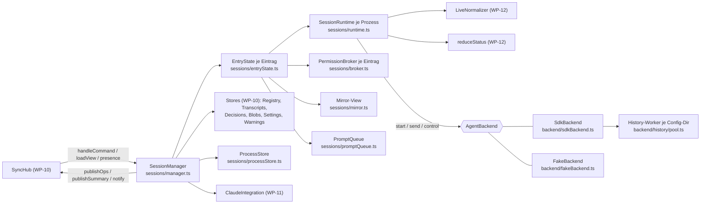

# WP-13 – Session-Engine (Design)

> Welle 1b, kritischer Pfad 12 → **13** → 20 → 22. Design-Schritt nach ADR-014 (Planer-Rolle, kein
> Code). Stand: `main` = `1900207` (WP-10, WP-11, WP-12 gemergt), SDK 0.3.296, CLI 2.1.300.
> Rangfolge bei Widersprüchen: Contracts/Ports > `docs/architecture.md`/ADRs > dieses Dokument >
> `docs/sdk-findings.md` > `docs/plan.md`. Verweise: **§a.b** = `docs/architecture.md`,
> **F.n** = Findings-Punkt n, **A./B./C.n** = Plan-Review, **WP-02 §x** = `docs/wp/WP-02.md`.

---

## 1. Auftrag

### Ziel
Die Engine, die aus Befehlen der UI echte bzw. simulierte `claude`-Sessions macht:
- **`SdkBackend`** – Port `AgentBackend` über `query()` des Agent SDK (Streaming-Input), Spawn-Wrapper
  mit PID/Startzeit/stderr, Steuer-APIs, Verlauf über einen `worker_threads`-Worker je Config-Dir.
- **`FakeBackend`** – derselbe Port ohne `claude`: spielt Fixtures (Format v1) und synthetische
  Szenarien ab, wartet an `canUseTool` auf echte Entscheidungen, simuliert Interrupt, Crash,
  Zeitraffer; Default für `pnpm dev`, alle Tests und E2E.
- **`PermissionBroker`** – `canUseTool` → `Decision` (Permission/Frage/Plan), Queue offener
  Entscheidungen je Session, erster Klick gewinnt, Server baut `PermissionResult` (ADR-012),
  Persistenz und „abgelaufen“ nach Neustart (A.10).
- **`SessionManager`** – Port `SessionSource`: Lebenszyklus je Eintrag, alle Phase-1-Befehle,
  Prompt-Queue, Normalizer/Status-Verdrahtung, Publizieren, Persistenz, Crash/Retry, Serverstart
  (Recovery, Waisen), Shutdown.

### Pflichtlektüre (Umsetzer)
Dieses Dokument vollständig; `CLAUDE.md`; `docs/progress.md`; `docs/architecture.md` §2, §3, §4,
§5 (inkl. §5.2 „Server entscheidet“), §6, §7, §8, §9; ADR-012, -016; `docs/sdk-findings.md`
(Punkte 2, 3, 5–12, 14–16, „Fixture-Format“); `docs/wp/WP-10.md` und `docs/wp/WP-12.md`
(Ergebnis, „Hinweise für WP-13“); Ports `src/server/{backend/types,backend/fixture,sessions/ports,
sync/ports,claude/ports}.ts`; `src/shared/{common,errors,status,model,protocol,sync,samples}.ts`.

### Besitz-Pfade (WP-13 gesamt; Aufteilung datei-genau in §4)
- `src/server/backend/**` **außer** `types.ts`, `fixture.ts` (+ deren Tests) und `README.md`.
- `src/server/sessions/**` **außer** `ports.ts`, `normalizer/**`, `status/**` und `README.md`.
- `docs/wp/WP-13a.md`, `docs/wp/WP-13b.md`, `docs/wp/WP-13c.md` (Ergebnisse der Teilpakete).

### Tabu
`src/shared/**`, alle `ports.ts`, `backend/{types,fixture}.ts`, `sessions/{normalizer,status}/**`
(WP-12), `src/server/{lib,http,sync,store,claude}/**` (WP-10/11), `main.ts`/`bootstrap.ts`
(WP-20), `test/fixtures/sdk/**` (nur lesen), `scripts/**`, Root-Configs, `package.json`, Lockfile,
READMEs der Ordner mit mehreren Ownern (`src/server`, `server/backend`, `server/sessions`,
`server/lib`) – Änderungswünsche im Bericht. Fehlt etwas in einer fremden Datei: anfragen, kein
Duplikat.

### Live-`claude`
**Verboten** in allen Teilpaketen: kein `pnpm dev:live`, kein `record`, kein Spawn eines echten
`claude.exe`, `SdkBackend` nur mit gemocktem `query()` und gemocktem Spawn. Der Live-Smoke ist
WP-22.

### Abnahme (je Teilpaket, Details §4)
`pnpm check` grün; `pnpm build` grün; eigene Pfade gezielt (`pnpm exec vitest run <pfade>`,
`pnpm exec eslint <pfade>`); `git diff --stat main...HEAD` nur in den eigenen Besitz-Pfaden; keine
übrig gebliebenen Prozesse (Worker-Threads beendet, kein `claude.exe`).

### Commit
Je Teilpaket ein Worktree `.worktrees/wp-13x` auf Branch `wp/13x` (x = a, b, c), Commit-Betreff
`WP-13a: FakeBackend und Broker`, `WP-13b: SessionManager`, `WP-13c: SdkBackend`; mehrere `-m`,
kein Heredoc, nie pushen. Ergebnis je Teilpaket in `docs/wp/WP-13x.md`; den Abschnitt „Ergebnis
(Umsetzung)“ unten füllt der Koordinator nach dem Merge mit Verweisen.

---

## 2. Überblick und Grundentscheidungen

### 2.1 Modulschnitt



| Datei | Teilpaket | Inhalt |
|---|---|---|
| `backend/lib/asyncQueue.ts` | 13a | `AsyncQueue<T>` (Events, Streaming-Input) |
| `backend/permissionRequest.ts` | 13a | `toPermissionRequest` – `canUseTool`-Argumente → `PermissionRequest` (Sdk + Fake) |
| `backend/history/parse.ts` | 13a | `SessionMessage[]` → `HistoryMessage[]`, `mergeHistory`, `toSessionInfo` (Sdk + Fake) |
| `backend/fakeBackend.ts` | 13a | `createFakeBackend`, Szenario-Typen, Session-Handles |
| `backend/fake/player.ts` | 13a | Abspieler für `FixtureEvent[]` mit Toren, UUID-Abbildung, Zeitraffer |
| `backend/fake/dsl.ts` | 13a | höhere Bausteine (Turns, Tool-Calls, Entscheidungen, Interrupt, Crash) über WP-12 `synthetic/build.ts` |
| `backend/fake/interactive.ts` | 13a | Dev-Szenario mit Schlüsselwörtern (`pnpm dev`, E2E) |
| `backend/fake/defaults.ts` | 13a | Fake-Antworten: `getContextUsage`, `supportedModels`, `supportedCommands` |
| `backend/fake/history.ts` | 13a | `FakeHistoryStore` (Verlauf/Info/Rename im Speicher, Import aus `history.jsonl`) |
| `backend/fake/integration.ts` | 13a | `createFakeClaudeIntegration()` (Port `ClaudeIntegration` ohne echtes `claude`) |
| `backend/fake/testing.ts` | 13a | `fixtureDecisionResponder`, `loadFixtureScenario` (nur Tests) |
| `backend/fake/<name>.ts` | 13a | synthetische Engine-Szenarien (`export const events: FixtureEvent[]`, R0-06), Index `synthetic.ts` |
| `sessions/brokerRules.ts` | 13a | reine Regeln: Angebot, `PermissionResult`, Validierung, Outcome (tabellengetestet) |
| `sessions/broker.ts` | 13a | `createBroker` – Lebenszyklus, Queue, Persistenz, Restore |
| `sessions/testing/memoryStores.ts` | 13a | Speicher-Doubles aller Store-Ports (`sync/ports.ts`) |
| `sessions/testing/memoryPublisher.ts` | 13a | Speicher-Double `SessionPublisher` mit Hub-gleicher Validierung |
| `backend/sdkBackend.ts` | 13c | `createSdkBackend` |
| `backend/sdkOptions.ts` | 13c | reine Abbildung `StartSessionRequest` → SDK-`Options` |
| `backend/spawn.ts` | 13c | `spawnClaudeCodeProcess`-Wrapper (PID, Startzeit, stderr, Kill) |
| `backend/history/pool.ts`, `backend/history/workerSource.ts` | 13c | Worker-Pool je Config-Dir, Worker-Quelltext |
| `sessions/manager.ts` | 13b | `createSessionManager` (Port `SessionSource` + Lebenszyklus) |
| `sessions/entryState.ts` | 13b | Zustand je Eintrag (Entry, Fakten, Broker, Queue, Mirror, Runtime, Lifecycle-Lock) |
| `sessions/runtime.ts` | 13b | `SessionRuntime` je Prozess: Event-Schleife, Normalizer, Signale |
| `sessions/commands.ts` | 13b | Befehlsbehandlung und Prüfungen (§3.5.6) |
| `sessions/promptQueue.ts` | 13b | Queue mit `uuid`/`priority`, Übernahme-Regeln |
| `sessions/summary.ts` | 13b | `summaryOf`, Entry-Patches, Titel-Regeln, Unterhaltungs-Helfer |
| `sessions/mirror.ts` | 13b | Mirror-View, `loadView` (Live oder aus Stores + Puffer) |
| `sessions/recovery.ts` | 13b | Serverstart: Fakten, abgelaufene Entscheidungen, offene Tool-Calls, Waisen |
| `sessions/processStore.ts` | 13b | `processes.json` (PID, Startzeit) + Speicher-Variante |
| `sessions/notifier.ts` | 13b | Benachrichtigungs-Kanal (A.9), rein |
| `sessions/retry.ts` | 13b | Auto-Retry-Politik (A.10), rein |
| `sessions/models.ts` | 13b | `supportedModels()` → `ModelOption[]` (tolerant) |
| `sessions/lib/serial.ts` | 13b | serielle Ausführung je Eintrag (Lifecycle-Lock) |
| `sessions/testing/harness.ts` | 13b | `createEngineHarness` (Manager + Fake + Doubles), `answerFromFixture` |

Alle Tests liegen daneben (`*.test.ts`). Synthetische Szenarien nie als `.jsonl` (R0-06).

### 2.2 Genutzte Exporte anderer Pakete (gemergt)
- **WP-12** (`sessions/normalizer/index.ts`): `createLiveNormalizer`, `normalizeHistory`,
  `normalizeContextUsage`, `estimateContextGauge`, `modelContextWindow`; `sessions/status/machine.ts`:
  `reduceStatus` (gibt bei No-op **dasselbe Objekt** zurück). Testhilfen: `normalizer/testing/harness.ts`
  (`replayLive`, `replayStatus`), `normalizer/synthetic/build.ts` (Frame-Fabriken), `SYNTHETIC_STREAMS`.
- **WP-10**: `lib/ids.ts` (`newId`, `newUuid`), `lib/paths.ts` (`checkCwd`), `lib/logger.ts`,
  `store/jsonStore.ts` (`JsonStore`), Hub-Regeln (Validierung „übersteht `parse` unverändert“,
  `loadView` enthält alle bis zur Auflösung veröffentlichten Ops), `http/testServer.ts` (WS-Test).
- **WP-11**: `lib/process.ts` (`spawnHidden` mit `onStderr`, `killProcessTree`, `processInfo`,
  `isProcessAlive`), `claude/integration.ts` (`profileNeedsSetup`), `claude/profiles.ts`
  (`createProfileStore`, `STANDARD_PROFILE`).

### 2.3 Grundentscheidungen (mit Begründung)
1. **Mirror-View je geladenem Eintrag.** Jede Op, die die Engine veröffentlicht, wendet sie
   zusätzlich mit `applySessionOp` + `trimItems(LIMITS.snapshotItems)` auf eine eigene
   `SessionViewState` an. `loadView` liefert diese synchron (laufend) bzw. baut sie aus dem
   Transkript-Log und puffert währenddessen veröffentlichte Ops (ruhend). Grund: Der Hub verlangt,
   dass der geladene View **alle** bis zur Auflösung veröffentlichten Ops enthält (WP-10 Punkt 5),
   und nur die Engine kennt streamende Items, offene Entscheidungen und Queue (§3.1, R0-20).
2. **Ein Op-Pfad.** Alle Ops (Normalizer, Broker, Engine) laufen durch `EntryState.emit(ops)`:
   publizieren → Log (nur nicht-streamende Upserts/Removes, laufende Unterhaltung) → Mirror →
   `conversation.lastOrder`. So stimmen Hub-View, Log und Mirror immer überein (A.3).
3. **`order` gehört dem Normalizer.** Die Engine erzeugt eigene Items (`px:`-Fehler) nur, wenn kein
   Normalizer lebt (nach Prozessende/Startfehler), mit `order = lastOrder + 1`; ein neuer
   Normalizer startet mit `nextOrder = lastOrder + 1` (WP-12-Hinweis).
4. **Broker je Eintrag, Client sendet Absichten** (ADR-012, §5.2): „erster Klick gewinnt“ wird
   synchron vor dem ersten `await` entschieden; offene Entscheidungen werden mit Snapshot
   persistiert (R0-07). Ein **Server-Shutdown bricht sie nicht ab**, damit sie nach dem Neustart
   als `expired` erscheinen (A.10, ADR-016).
5. **Fakten nur über `reduceStatus`.** Die Engine erzeugt keine Anzeige, sondern StatusEvents
   (inkl. `decisions_changed`, `queue_changed`, `viewed`, `process_*`, `server_restart`) und
   veröffentlicht die Summary bei geänderter Referenz.
6. **Bereitschaft = `supportedModels()`.** Das SDK beantwortet es erst nach dem `initialize`-
   Handshake (`sdk.mjs`: `return (await this.initialization).models`). Ein ohne Prompt gestarteter
   Prozess meldet sonst nichts und bliebe `starting`; nach der Antwort setzt die Engine `idle`
   (synthetisches `session_state`, zählt nicht als `sessionStateSeen`) und füllt `detail.models`.
7. **Ein Abspieler im FakeBackend.** Fixtures, synthetische Szenarien und das interaktive
   Dev-Szenario laufen über denselben Player mit denselben Toren (§3.3). Die DSL baut auf den
   WP-12-Frame-Fabriken auf (keine zweiten Fabriken).
8. **Dependency Injection mit echten Defaults.** Manager/Broker/Backends bekommen Normalizer,
   Statusmaschine, IDs, Pfadprüfung, Uhr, Prozess-Helfer als Abhängigkeiten mit Default auf die
   echten Module – Tests ersetzen gezielt, WP-20 verdrahtet minimal.

---

## 3. Design je Modul

### 3.1 Gemeinsame Backend-Bausteine (13a)

```ts
// backend/lib/asyncQueue.ts – one producer, ONE consumer (AgentSession.events, streaming input)
export class AsyncQueue<T> implements AsyncIterable<T> {
  push(value: T): void;                 // throws after end()
  end(error?: Error): void;             // idempotent; pending next() resolves done / rejects
  readonly ended: boolean;
  readonly size: number;                // buffered, not yet consumed
  [Symbol.asyncIterator](): AsyncIterator<T>;  // second iterator → throws (single consumer)
}

// backend/permissionRequest.ts – tolerant (F.3): untyped keys (decisionReasonType,
// requiresUserInteraction) kept; invalid suggestions dropped (logged), never thrown
export function toPermissionRequest(toolName: string, input: Record<string, unknown>, options: unknown): PermissionRequest;

// backend/history/parse.ts
export function toHistoryMessages(raw: unknown): HistoryMessage[];        // SessionMessage[] → HistoryMessage[]; other types/invalid skipped
export function mergeHistory(main: HistoryMessage[], subagents: readonly HistoryMessage[][]): HistoryMessage[];
//   stable merge by Date.parse(timestamp); a message without timestamp keeps its predecessor's key (R0-18)
export function toSessionInfo(raw: unknown): BackendSessionInfo | null;   // SDKSessionInfo → port type
```
`toPermissionRequest` wird gegen **alle** `canUseTool`-Payloads der Fixtures getestet (Fixture-
`options` = SDK-Optionen ohne `signal`). `raw` = alle Optionsschlüssel außer `signal`. Wird der
Contract-Wunsch `HistoryMessage.origin` (WP-12) freigegeben, füllt `toHistoryMessages` das Feld aus
`SessionMessage.origin`.

### 3.2 SdkBackend (13c)

**Verantwortung:** Port `AgentBackend` gegen das installierte `claude`. Keine Normalisierung, keine
Statuslogik; rohe Messages als `BackendEvent.message`.

```ts
export interface SdkBackendDeps {
  query?: typeof import('@anthropic-ai/claude-agent-sdk').query;  // test seam (Tests: gemockt)
  spawn?: typeof spawnHidden;                 // lib/process.ts
  killProcessTree?: (pid: number) => Promise<void>;
  history?: HistoryPool;                      // default createHistoryPool()
  now?: () => Date;
  timeouts?: Partial<SdkTimeouts>;
}
export interface SdkTimeouts {
  closeGraceMs: 5000;        // C.8: close() → max. 5 s auf exit warten
  killWaitMs: 5000;          // nach taskkill noch so lange auf exit warten, dann exit synthetisieren
  controlMs: 15000;          // interrupt/setModel/setPermissionMode/applyFlagSettings/stopTask/supportedModels
  contextFullMs: 60000;      // getContextUsage('full') (Gateway-Modelle, C.1)
  iteratorAfterExitMs: 2000; // nach Prozess-exit max. so lange auf das Iterator-Ende warten
}
export function createSdkBackend(deps?: SdkBackendDeps): AgentBackend & { readonly kind: 'sdk' };
```

**Options-Abbildung** (`sdkOptions.ts`, rein, tabellengetestet):
```ts
export function buildQueryOptions(req: StartSessionRequest, hooks: {
  canUseTool: CanUseTool; spawn: (o: SpawnOptions) => SpawnedProcess; stderr: (d: string) => void;
}): Options;
```
| Option | Wert | Beleg |
|---|---|---|
| `cwd` | `req.cwd` exakt | B „cwd exakt“ |
| `pathToClaudeCodeExecutable` | `launch.executablePath` (nur `.exe`) | C.7 |
| `env` | `launch.env` unverändert (SDK ergänzt `CLAUDE_CODE_ENTRYPOINT`) | C.2, WP-11-Follow-up |
| `settingSources` | `['user','project','local']` | Plan „SessionManager“ |
| `systemPrompt` | `{type:'preset', preset:'claude_code'}` + `append` = `sdkOptions.appendSystemPrompt` (falls gesetzt) | C.12 |
| `includePartialMessages` | `true` | Plan |
| `thinking` | `{type:'adaptive', display:'summarized'}` | Plan, Recorder |
| `toolConfig` | `{askUserQuestion:{previewFormat:'markdown'}}` | F.5 |
| `promptSuggestions` | `req.promptSuggestions` (Phase 1: Manager übergibt `false`, B „Setting“) | B |
| `permissionMode` | `req.permissionMode`, **`null` → Schlüssel weglassen** | C.3, F.2 |
| `allowDangerouslySkipPermissions` | `true` nur wenn `launch.allowDangerouslySkipPermissions` (sonst weglassen) | C.3 |
| `model` | `req.model` (null → weglassen) | Manager entscheidet (§3.5.3) |
| `effort` | `req.effort` (null → weglassen) | |
| `resume` | `req.resumeSessionId` (null → weglassen) | F.14 |
| `additionalDirectories`, `allowedTools`, `disallowedTools`, `betas` | aus `launch.sdkOptions` (nur wenn gesetzt) | C.12 |
| `plugins` | `sdkOptions.plugins` → `[{type:'local', path}]` | WP-11-Follow-up |
| `settings` | `sdkOptions.settings` (Pfad) **oder** `{autoCompactWindow}` wenn `launch.autoCompactWindow ≠ null` und kein Pfad; bei **beidem**: Pfad hier, `autoCompactWindow` per `applyFlagSettings` direkt nach dem Start (Bereitschaft) | C.1 |
| `extraArgs` | `launch.extraArgs`; `sdkOptions.mcpConfig` → `extraArgs['mcp-config']` = erster Wert (mehrere: Warnung im Log, Phase 2, §7) | C.12 |
| `canUseTool` | Wrapper: `toPermissionRequest` → `req.canUseTool(request, options.signal)`; wirft der Handler → Log + `{behavior:'deny', message:'Parallax could not process this request.'}` + Event `error{where:'control'}` | F.3 |
| `stderr` | an Event `stderr` (wird mit eigenem Spawn nie aufgerufen, F.16) | |
| `spawnClaudeCodeProcess` | Wrapper aus `spawn.ts` | C.8, F.16 |

Nicht gesetzt (bewusst): `enableFileCheckpointing`, `replay-user-messages` (F.9: unnötig),
`perTaskStopAffordance` (C.5: erst mit Task-Panel), `sessionId`, `forkSession`, `maxTurns`.

**Spawn-Wrapper** (`spawn.ts`):
```ts
export function createSpawner(opts: {
  spawn: typeof spawnHidden; killProcessTree: (pid: number) => Promise<void>; now: () => Date;
  onSpawned(pid: number, startedAt: Date): void;   // → Event spawned
  onStderr(text: string): void;                    // → Event stderr (immer gelesen, F.16)
  onExit(code: number | null, signal: string | null): void;
  onError(error: Error): void;                     // ENOENT/EACCES → Event error{where:'spawn'}
}): (o: SpawnOptions) => SpawnedProcess;
```
`spawnHidden(o.command, o.args, {cwd: o.cwd, env: <o.env ohne undefined>, stdio:['pipe','pipe','pipe'],
onStderr})` – `shell:false`/`windowsHide:true` erzwingt `lib/process.ts`. Das weitergeleitete
`o.signal` wird **nicht** an `spawn()` gegeben (Windows-`TerminateProcess` tötet keine Kinder);
stattdessen `signal.addEventListener('abort', () => killProcessTree(pid))`. Startzeit = `now()` beim
Spawn (für die Waisen-Prüfung mit Toleranz, §3.5.13 – `processInfo` ist zu langsam für den heißen
Pfad). Der `ChildProcess` erfüllt `SpawnedProcess`.

**`start(req)` (synchron):** `AsyncQueue<BackendEvent>` (events) und `AsyncQueue<SDKUserMessage>`
(input) anlegen; `query({prompt: input, options})` in `try` (synchrone Fehler → `error{where:'spawn'}`
+ `exit{code:null, expected:false}`); Pumpe `for await (m of q) events.push({type:'message', message:m, at:now()})`
im Hintergrund; Iterator-Fehler → `error{where:'iterator'}`. **`exit` ist immer das letzte Event:**
es wird erst gesendet, wenn der Kindprozess beendet ist **und** die Pumpe endete (max.
`iteratorAfterExitMs` nach dem Prozessende), danach `events.end()`. `expected` = `close()`/`dispose()`
wurde aufgerufen. Ohne Spawn (Fehler vor dem Spawn) gilt der Iterator-Abschluss als Ende.

**`AgentSession`-Methoden:**
| Methode | Verhalten |
|---|---|
| `send(p)` | `SDKUserMessage {type:'user', message:{role:'user', content}, parent_tool_use_id:null, uuid:p.uuid, priority:p.priority, origin:{kind:'human'}}`; `content` = String bei genau einem Textblock, sonst Blöcke (`image`/`document` als base64-`source`); nach `exit` oder `close()` → `Error('session closed')` |
| `interrupt()` | `q.interrupt()` → `{stillQueued: res?.still_queued ?? []}` (alte CLI: `undefined` → `[]`, F.10) |
| `setModel(m)` | `q.setModel(m ?? undefined)` |
| `setPermissionMode(m)` | `q.setPermissionMode(m)` (Leerlauf: kein `status`-Event, F.2 – der Manager übernimmt lokal) |
| `applyFlagSettings(s)` | durchreichen (`null` löscht den Schlüssel) |
| `getContextUsage(d)` | `q.getContextUsage({detail:d})` roh; Timeout `controlMs` bzw. `contextFullMs` |
| `supportedModels()` / `supportedCommands()` | durchreichen (warten intern auf `initialize`) |
| `stopTask(id)` | durchreichen |
| `close()` | `input.end()`, `q.close()`; ≤ `closeGraceMs` auf `exit`; sonst `killProcessTree(pid)` und ≤ `killWaitMs`; sonst `exit{code:null, signal:'SIGKILL', expected:true}` synthetisieren (Log `error`). Löst nach `exit` auf, idempotent |

Alle Steuer-Aufrufe mit Timeout; Ablehnung = `Error` (Manager → `CLAUDE_CONTROL_FAILED`).

**Verlauf** (`history/pool.ts`, `history/workerSource.ts`; A.3, F.15):
```ts
export type HistoryOp =
  | { op: 'messages'; sessionId: string }
  | { op: 'subagents'; sessionId: string }
  | { op: 'subagentMessages'; sessionId: string; agentId: string }
  | { op: 'info'; sessionId: string }
  | { op: 'rename'; sessionId: string; title: string };
export interface HistoryPool {
  run(launch: LaunchSpec, op: HistoryOp): Promise<unknown>;   // raw SDK result
  dispose(): Promise<void>;
}
export function createHistoryPool(opts?: { sdkModuleUrl?: string; idleMs?: number; timeoutMs?: number }): HistoryPool;
```
- **Ein Worker je Config-Dir** (Schlüssel `windowsPathKey(launch.configDir)` bzw. `<default>`),
  `new Worker(HISTORY_WORKER_SOURCE, {eval:true, env:{...launch.env}, workerData:{sdkUrl}})`: das
  `env` des Workers ist sein eigenes `process.env` (F.15: `CLAUDE_CONFIG_DIR` wird je Aufruf
  gelesen); im Hauptprozess wird `process.env` nie umgesetzt.
- **Worker als Quelltext-String** (`workerSource.ts`, schlichtes JS, ~60 Zeilen): lädt das SDK per
  `await import(workerData.sdkUrl)`, ruft `getSessionMessages(id)` (ohne `dir`, B „Lookups per ID“),
  `listSubagents`, `getSubagentMessages`, `getSessionInfo`, `renameSession` und antwortet
  `{id, ok, result | error:{name,message}}`. `sdkUrl` = `pathToFileURL(createRequire(import.meta.url)
  .resolve('@anthropic-ai/claude-agent-sdk'))` (Export `default` → `sdk.mjs`). Grund: kein zweiter
  Bundle-Einstieg nötig (`scripts/build-server.ts` hat nur `main.ts`), funktioniert unter `tsx`,
  Vitest und im Bundle.
- Antworten werden im Hauptthread mit zod geprüft (`history/parse.ts`). Timeout je Auftrag
  30 s → Worker beenden und neu anlegen; Leerlauf 60 s → `terminate()`; `dispose()` beendet alle.
- `readHistory(req)` = `messages` + `subagents` → je Agent `subagentMessages` → `mergeHistory`
  (R0-18); `getSessionInfo` → `toSessionInfo`; `renameSession` → `rename` (nur ruhend, C.6 – der
  Manager garantiert das).

**Fehlerfälle:** `.exe` fehlt → `spawnHidden` wirft/`error`-Event → `error{spawn}` + `exit`
(Manager: `CLAUDE_SPAWN_FAILED`); Iterator wirft nach Prozess-Crash → `error{iterator}` + `exit`
(Manager: `CLAUDE_PROCESS_CRASHED`); `close()` hängt → `taskkill /T /F`; Worker stirbt → laufende
Aufträge abgelehnt, nächster Auftrag startet neu.

### 3.3 FakeBackend (13a)

**Verantwortung:** Port `AgentBackend` ohne `claude`, deterministisch, mit echten Wartepunkten.

```ts
export type FakeScenario =
  | { kind: 'events'; name: string; events: readonly FixtureEvent[]; options?: FakeEventsOptions }
  | { kind: 'script'; name: string; run(ctx: FakeScriptContext): Promise<void> };
export interface FakeEventsOptions {
  /** Emit exit{code:1, expected:false} right after the event with this seq was started. */
  crashAfterSeq?: number;
  /** What happens to send() after the last input gate: diagnostics only (default) or echo turns. */
  onExhausted?: 'idle' | 'echo';
}
export interface FakeBackendOptions {
  /** Scenario per start; n = 0-based start counter of this backend. Default: interactiveScenario(). */
  scenario?: (req: StartSessionRequest, n: number) => FakeScenario;
  /** 0 = no waiting (tests), 1 = recorded timing, 0.1 = 10× faster. Delays capped at maxDelayMs. */
  speed?: number;
  maxDelayMs?: number;                      // default 3000
  sleep?: (ms: number) => Promise<void>;    // test seam (fake timers); default setTimeout
  now?: () => Date;
  history?: FakeHistoryStore;               // shared between starts (resume, readHistory)
  pidBase?: number;                         // default 40000
}
export interface FakeBackend extends AgentBackend {
  readonly kind: 'fake';
  readonly starts: readonly StartSessionRequest[];
  readonly sessions: readonly FakeSessionHandle[];
  readonly history: FakeHistoryStore;
  /** Resolves when every live session waits at a gate (input/decision/control/close). */
  settle(): Promise<void>;
}
export interface FakeSessionHandle {
  readonly entryId: string; readonly pid: number; readonly scenario: string;
  readonly state: 'running' | 'waiting-input' | 'waiting-decision' | 'waiting-control' | 'waiting-close' | 'exited';
  readonly sent: readonly OutgoingPrompt[];
  readonly controls: readonly { method: string; args: unknown[] }[];
  readonly calls: readonly { fn: string; args: unknown[] }[];
  readonly diagnostics: readonly FakeDiagnostic[];   // input/decision mismatches, unexpected input/control
  crash(code?: number): void;                        // test: process dies now (exit expected:false)
  abortDecision(toolUseId?: string): void;           // test: CLI cancels canUseTool (signal)
}
export function createFakeBackend(options?: FakeBackendOptions): FakeBackend;
export function eventsScenario(name: string, events: readonly FixtureEvent[], options?: FakeEventsOptions): FakeScenario;
export function fixtureScenario(parsed: ParsedFixture, options?: FakeEventsOptions): FakeScenario;
```

**Abspielregeln** (`player.ts`; WP-02 §9.2, ergänzt):
| Kind | Verhalten |
|---|---|
| `spawn` | Event `spawned{pid}` (PID aus Payload, sonst `pidBase + n`); fehlt es, sendet der Player es als erstes |
| `message` | nach `Δt × speed` ausgeben; vorher **UUID-Abbildung** anwenden (jeder String, der exakt einer abgebildeten Fixture-UUID entspricht, tief ersetzt – `command_uuid`, `user_message_uuid(s)`, Replay-`uuid`); jede Message geht zusätzlich in den `FakeHistoryStore` (`session_id`, Typ user/assistant) |
| `input` | **Tor:** wartet auf das nächste `send()`; bildet Fixture-`uuid` → gesendete `uuid` ab; abweichender Text/Priorität → Diagnose (kein Abbruch) |
| `canUseTool` | `toPermissionRequest(payload.toolName, payload.input, payload.options)` → `req.canUseTool(request, signal)`; **Tor bis zur Antwort**. Erweiterung (Fake-only, lockerer Payload): `payload.fake.parallel === true` → nicht blockieren, das passende `decision`-Event wird zum Join-Punkt |
| `decision` | nur Prüfung: Ergebnis der Engine vs. Aufzeichnung (`behavior`, `message`, `updatedPermissions` als Menge, `updatedInput` tief) → Diagnose |
| `control` | `interrupt`: **Tor** – wartet auf `interrupt()` und beantwortet es mit `result`/`error`; andere Methoden blockieren nicht, sie liefern nur die Antwort für den nächsten passenden Aufruf |
| `call` | blockiert nie; Antworten für `getContextUsage`/`supportedModels`/`supportedCommands` = letzter schon abgespielter passender `call`, sonst erster der Datei, sonst `defaults.ts` |
| `abort` | bricht das Signal der offenen `canUseTool`-Anfrage ab (Payload `toolUseID`, sonst die älteste) |
| `stderr` | Event `stderr` |
| `error` | Event `error{where:'iterator'}` |
| `exit` | mit `msSinceClose` (Aufzeichnung nach `close`) → **Tor bis `close()`**, dann `exit{expected:true, code}`; ohne `msSinceClose` → spontaner Exit (`expected:false`, Crash) |
| `mark`, `process`, unbekannt | ignorieren |

Weitere Regeln: `close()` jederzeit → Abspielen stoppt, offene `canUseTool`-Signale abbrechen,
`exit{code:0, expected:true}`; `crash()`/`crashAfterSeq` → offene Signale abbrechen,
`exit{code:1, expected:false}`; `send()` nach `exit` wirft; `interrupt()` ohne kommendes
`control interrupt`-Tor → sofort `{stillQueued:[]}` + Diagnose (im Script-Modus: Turn-Abbruch, s. u.);
nach dem letzten Event bleibt die Session „wartend“ (wie eine echte CLI). Verzögerungen werden nach
jedem Tor neu ab dessen `tMs` gezählt; `speed: 0` gibt nur per `setImmediate` frei (Reihenfolge
bleibt, Tests laufen schnell).

**Script-Modus** (`run(ctx)`): für das Dev-Szenario und Abläufe, die vom Engine-Verhalten abhängen.
```ts
export interface FakeScriptContext {
  readonly req: StartSessionRequest;
  readonly sessionId: string;                 // resumeSessionId ?? neue UUID
  readonly state: { model: string; permissionMode: PermissionMode; effort: EffortLevel | null; turns: number };
  readonly ids: { uuid(): string; messageId(): string; toolUseId(): string };  // random im Dev, deterministisch in Tests
  nextInput(): Promise<OutgoingPrompt>;
  emit(messages: readonly unknown[], gapMs?: number): Promise<void>;  // wirft TurnInterrupted bei interrupt()
  canUseTool(toolName: string, input: Record<string, unknown>, options: Record<string, unknown>): Promise<PermissionResult>;
  play(events: readonly FixtureEvent[]): Promise<void>;               // gleicher Player wie oben
  readonly turnSignal: AbortSignal;           // interrupt() oder Prompt mit priority 'now'
  crash(code?: number): Promise<never>;
}
```
`interrupt()` im Script-Modus bricht `turnSignal` ab; `emit` wirft `TurnInterrupted`, das Script
sendet den Interrupt-Epilog der DSL (User-Text „[Request interrupted by user]“ bzw. „… for tool use“,
`result error_during_execution` mit `terminal_reason aborted_streaming|aborted_tools`,
`command_lifecycle cancelled`, `session_state idle`, F.10). Steuer-Aufrufe ändern `ctx.state`
(`setPermissionMode` im Turn → zusätzlich `system/status {permissionMode}`, F.2; im Leerlauf erst
im nächsten `init`).

**DSL** (`dsl.ts`): höhere Bausteine über WP-12 `normalizer/synthetic/build.ts` (`msg`, `init`,
`state`, `lifecycle`, `assistant`, `toolResult`, `stream`, `messageStart`, `result`, `system`;
IDs/Zeitstempel über deren `extra`-Parameter überschrieben): `textTurn`, `streamedText`,
`thinkingBlock`, `toolUseBlock` (mit `input_json_delta`), `permissionStep` (`canUseTool` +
erwartete `decision`), `questionStep`, `planStep`, `subagentRun` (Agent im Hintergrund,
`task_*`, `background_tasks_changed`, Subagent-Messages mit `parent_tool_use_id`),
`interruptEpilogue`, `clearCommand` (`conversation_reset`, zwei `session_title_changed`, neues
`init`, `result num_turns 0`, F.7), `renameCommand` (F.8), `startupFailure(reason)`,
`assistantErrorTurn(error)`, `crash(code)`, `events([...])` (seq lückenlos, tMs). Jeder Baustein
liefert `FixtureEvent[]`; ein Test prüft jedes Event mit `fixtureEventSchema` und spielt jeden
Baustein durch den **echten** Normalizer (gleiche Item-Arten wie das entsprechende Fixture).

**Interaktives Dev-Szenario** (`interactive.ts`, Default von `createFakeBackend`, `pnpm dev`, E2E):
Schleife `nextInput()` → Antwort nach Schlüsselwort (Groß-/Kleinschreibung egal, erstes Wort):
| Prompt | Ablauf |
|---|---|
| beliebiger Text | Thinking + gestreamte Antwort „Echo: …“ (~1 s bei `speed 1`), `result success` |
| `fake:bash` / `fake:permission` | Bash-Tool-Call mit Suggestions wie `permissions.jsonl` (addRules localSettings, addDirectories, setMode) → nach allow Tool-Result + Text; deny → Fehler-Result; deny+interrupt → abgebrochener Turn |
| `fake:edit` | Write mit Suggestion `setMode acceptEdits` |
| `fake:question` | AskUserQuestion (2 Optionen mit Markdown-Previews) → Antwort wird zitiert |
| `fake:plan` | Plan-Modus-Ablauf: Write der Plan-Datei ohne Karte, ExitPlanMode; revise → v2; approve → `system/status` mit gewähltem Modus, Umsetzung, „IMPLEMENTED“ |
| `fake:subagent` | Agent im Hintergrund, erstes `result`, Task-Ende, zweiter Turn, erst dann `idle` (F.11) |
| `fake:parallel` | zwei Hintergrund-Subagents fragen gleichzeitig je eine Bash-Permission an (mehrere offene Entscheidungen, A.6) |
| `fake:slow` | 20 s Streaming (Stop-Test) |
| `fake:compact` | `compacting`-Status + `compact_boundary` |
| `fake:ratelimit` | `rate_limit_event allowed_warning`, danach `rejected` |
| `fake:error` | `assistant.error authentication_failed` (Setup-Fehler) |
| `fake:crash` | Teil-Stream, dann Prozessende Code 1 |
| `fake:held` | Startfehler `session_held_by_background` (→ `SESSION_HELD_ELSEWHERE`) |
| `/rename X`, `/clear` | wie F.8/F.7 (neue Session-ID im nächsten `init`) |
Nach dem ersten Turn setzt der Fake im `FakeHistoryStore` einen KI-Titel („Fake: <erste Wörter>“),
damit die Titel-Abfrage (§3.5.8) sichtbar wird. `priority:'now'` während eines Turns = Abbruch
des Turns (`aborted_tools`) + neuer Turn; `'next'` wird nach dem laufenden Turn bearbeitet
(vereinfacht gegenüber F.9, das Fixture `queue-priority` deckt das echte Falten ab).

**Weitere Fake-Bausteine:**
- `defaults.ts`: `getContextUsage` wächst je Turn (20 000 + 1 500 × Turns von 200 000), Modelle wie
  `auth-probe#24` (bereinigt, als TS-Konstante, keine Laufzeit-Abhängigkeit von Fixture-Dateien),
  Befehle (kurze Liste).
- `history.ts`: `FakeHistoryStore {record(sessionId, raw), messages(id), subagents(id), info(id),
  rename(id, title), seedFromHistoryFixture(parsed)}` – Import nimmt je Session-ID das erste
  `call getSessionMessages`/`getSubagentMessages`/`getSessionInfo` mit Array- bzw. Objekt-Ergebnis
  (Zusammenfassungs-Calls wie `{count, types}` werden übersprungen). `readHistory` nutzt
  `history/parse.ts` (gleiche Abbildung wie das SdkBackend); `renameSession` auf eine laufende
  Session → Diagnose (C.6).
- `integration.ts`: `createFakeClaudeIntegration({profiles?, allowsBypass?})` – Profil-Store aus
  WP-11 (`createProfileStore`), Status `ok`/`logged_in` (kein Setup-Screen im Dev-Modus),
  `launchSpecFor` → `LaunchSpec` mit `executablePath 'C:\\fake\\claude.exe'`, leerem `env`,
  `allowDangerouslySkipPermissions` laut Option.
- Synthetische Engine-Szenarien `backend/fake/<name>.ts` (`export const events`, Index
  `synthetic.ts` mit `FAKE_SCENARIOS`): `crash-mid-turn`, `crash-awaiting-decision` (Crash während
  offener Permission), `idle-crash` (Turn fertig, dann Exit Code 3 – Auto-Retry), `startup-held-elsewhere`,
  `setup-auth-error`, `parallel-decisions` (zwei `canUseTool` mit `fake.parallel`, `agentID`),
  `abort-decision` (CLI bricht `canUseTool` per Signal ab), `queued-then-crash` (Prompt `queued`,
  Prozess stirbt vor `started`). WP-12-Streams (`SYNTHETIC_STREAMS`) sind direkt abspielbar und
  werden nicht dupliziert.
- `testing.ts` (nur Tests): `loadFixtureScenario(name)` (liest `test/fixtures/sdk/<name>.jsonl`
  über `loadFixture`), `fixtureDecisionResponder(parsed)` – `PermissionHandler`, der die
  aufgezeichneten `decision`-Ergebnisse je `toolUseID` zurückgibt (Fake-Tests ohne Broker).

### 3.4 PermissionBroker (13a)

**Verantwortung:** genau eine `Decision` je `canUseTool`-Anfrage; Queue offener Entscheidungen
eines Eintrags; Absicht → `PermissionResult`; Persistenz; Neustart → `expired`.

```ts
export type CancelReason = (typeof CANCEL_REASONS)[number];   // signal_aborted | interrupted | process_exit | conversation_reset
export interface BrokerDeps {
  entryId: EntryId;
  now(): Date;
  newDecisionId(): DecisionId;
  store: DecisionStore;
  conversationId(): ConversationId;            // current (changes on /clear)
  permissionMode(): PermissionMode | null;     // actual mode (offer.acceptEdits)
  allowsBypass(): boolean;                     // ProfileSummary.allowsBypass (R0-09)
  supportsAutoMode(): boolean;                 // detail.models of the current model
  findToolCall(toolUseId: string): ToolCallItem | null;   // from the mirror (requester, capped input)
  capInput(input: Record<string, unknown>): { input: JsonValue; truncated: Truncation | null };
  emit(ops: SessionOp[]): void;                // decision.upsert / decision.resolved
  attachDecision(toolUseId: string, ref: ToolDecisionRef): void;  // → normalizer + emit; no-op without a live normalizer
  onCountsChanged(counts: DecisionCounts, addedKind: DecisionKind | null): void;
  recordsKeep?: number;                        // resolved records kept (default 200)
}
export type RespondResult =
  | { kind: 'resolved'; outcome: DecisionOutcome }
  /**
   * expired plan + approve: the decision is now CLAIMED (a second respond → DECISION_ALREADY_RESOLVED,
   * closeExpired skips it); the manager resumes, then calls resolveExpired (A.10, diagram g).
   */
  | { kind: 'resume-and-approve'; decision: PlanDecision; mode: PermissionMode };
export interface Broker {
  readonly handler: PermissionHandler;         // StartSessionRequest.canUseTool
  /** Synchronous check-and-set: first click wins. Throws CommandError. */
  respond(decisionId: DecisionId, response: DecisionResponse, byClientId: ClientId | null): RespondResult;
  resolveExpired(decisionId: DecisionId, outcome: DecisionOutcome, byClientId: ClientId | null): void;
  releaseExpired(decisionId: DecisionId): void;              // resume failed → clickable again
  /** Cancel open decisions; 'deny-interrupt' answers the SDK with {deny, interrupt:true}. */
  cancel(scope: 'all' | 'main', reason: CancelReason, answer: 'deny' | 'deny-interrupt'): void;
  /** Server start: open records → expired cards (with snapshot) or counted-only (without). */
  restore(records: DecisionRecord[]): { hadOpen: boolean };
  /** Session start: every expired card → decision.resolved {expired}; counter → 0. */
  closeExpired(byClientId: ClientId | null): void;
  open(): Decision[];      // by createdAt
  expired(): Decision[];
  counts(): DecisionCounts;
  /** Shutdown: stop persisting and cancelling (open records stay open → expired after restart). */
  freeze(): void;
}
export function createBroker(deps: BrokerDeps): Broker;
```

**Ablauf `canUseTool(req, signal)`:**
1. Art: `AskUserQuestion` → `question` (Input mit zod tolerant geparst; unbrauchbar → als
   `permission` behandeln, damit der Nutzer wenigstens erlauben/ablehnen kann), `ExitPlanMode` →
   `plan`, sonst `permission`.
2. `requester`: `req.agentId` gesetzt oder `findToolCall(toolUseId).parentToolUseId ≠ null` →
   `{kind:'subagent', agentId: req.agentId ?? parentToolUseId, parentToolUseId, description:
   input.description des Agent-Tool-Calls (Mirror) ?? null}`; sonst `{kind:'main'}` (A.6).
3. `Decision` bauen (Server-ID `newDecisionId()`, `conversationId()`, `createdAt = now()`,
   `state:'open'`): Permission-`input`/`inputTruncated` aus dem Mirror-Tool-Call (vom Normalizer
   schon gekappt), sonst `capInput(req.input)`; `offer` = `buildOffer(...)`; Frage-`questions`;
   Plan: `plan` = `input.plan` (nie gekappt), `planFilePath` = `input.planFilePath ?? null` (C.4),
   `version` = nächste Plan-Version **des Eintrags** (monoton, §6 Nr. 4), `previousVersionPlan` =
   Text der vorigen Version, wenn diese zur selben Unterhaltung gehört (sonst `null`),
   `approveModes` (s. u.); Plan-Text per `store.savePlan(entryId, version, text)` (Fehler nur loggen).
4. Record `{…, outcome:null, resolvedAt:null, decision: <Snapshot>}` → `store.save(entryId, records)`.
5. `emit([{op:'decision.upsert', decision}])`, `attachDecision(toolUseId, {decisionId, kind,
   planVersion, outcome:null})` (Tool-Call → `awaiting_decision`), `onCountsChanged(counts, kind)`.
6. Promise bis `respond`/`cancel`. `signal`-Abort → `cancel` dieser Entscheidung mit
   `signal_aborted` (bzw. `interrupted`, wenn der Manager gerade unterbricht) – Karte verschwindet
   (`decision.resolved`), SDK-Antwort `{deny, message:'Cancelled.'}` (wird nicht mehr gelesen).

**Angebot** (`brokerRules.buildOffer(req, mode)`, F.3, ADR-012):
| Feld | Regel |
|---|---|
| `rules` | alle `addRules`-Vorschläge mit `behavior:'allow'` (`deny`/`ask` nie), Regeln flach, dedupliziert (`ruleContent ?? null`) |
| `directories` | alle `addDirectories`-Vorschläge, flach, dedupliziert |
| `ruleDestinations` | `RULE_DESTINATIONS` (alle vier), wenn `rules`/`directories` nicht leer und nicht `suppressAlwaysAllowRule`; sonst `[]` |
| `acceptEdits` | Vorschlag `setMode acceptEdits` vorhanden **und** `mode ∉ {acceptEdits, auto, bypassPermissions}` |
| `defaultToNo` | `req.defaultToNo` |

`approveModes` (C.4): `acceptEdits`, `auto` (nur wenn `supportsAutoMode()`), `default`,
`bypassPermissions` (nur wenn `allowsBypass()`) – in dieser Reihenfolge.

**Antwort → `PermissionResult`** (`brokerRules.buildResult(decision, pending, response)`;
WP-02 §5.7 + §5.2, normativ, tabellengetestet; `updatedInput` immer aus dem **ungekappten**
Original-Input der offenen Anfrage):
| Antwort | `PermissionResult` | Outcome |
|---|---|---|
| permission `allow`, `remember:null`, `acceptEdits:false` | `{allow, updatedInput:input, decisionClassification:'user_temporary'}` | `allowed{remember:null, acceptEdits:false}` |
| … `remember:D` (`D ∈ offer.ruleDestinations`) | + `updatedPermissions`: `{addRules, rules: offer.rules, behavior:'allow', destination:D}` (falls Regeln) und `{addDirectories, directories: offer.directories, destination:D}` (falls Verzeichnisse); Klassifikation `user_permanent` (bei `D='session'` `user_temporary`) | `allowed{remember:D, …}` |
| … `acceptEdits:true` (`offer.acceptEdits`) | + `{type:'setMode', mode:'acceptEdits', destination:'session'}` | `allowed{…, acceptEdits:true}` |
| permission `deny` | `{deny, message, interrupt, decisionClassification:'user_reject'}`; leere `message` → `'The user denied this action.'` | `denied{withMessage, interrupt}` |
| question `answer` | `{allow, updatedInput:{...input, answers:{[q]: selected.concat(otherText ?? []).join(', ')}, annotations:{[q]:{notes?, preview?}}}, decisionClassification:'user_temporary'}`; `annotations[q]` nur mit Inhalt, `preview` = Preview der **einzigen** gewählten Option (Beleg `ask-user-question#45`) | `answered` |
| question `decline` | `{deny, message, decisionClassification:'user_reject'}`; leere `message` → `'The user declined to answer.'` | `declined` |
| plan `approve` | `{allow, updatedInput: editedPlan ? {...input, plan: editedPlan} : input, updatedPermissions:[{type:'setMode', mode, destination:'session'}], decisionClassification:'user_temporary'}` (C.4: Modus immer explizit) | `plan_approved{mode, edited: editedPlan ≠ null && editedPlan ≠ plan}` |
| plan `revise` | `{deny, message: feedback, decisionClassification:'user_reject'}` (F.6) | `plan_revised` |
| plan `approve_fresh_context` | – | `NOT_IMPLEMENTED` (Phase 3) |

**Prüfungen** (`brokerRules.validate`, §5.2): unbekannte ID → `DECISION_NOT_FOUND`; schon
aufgelöst (Record mit Outcome) → `DECISION_ALREADY_RESOLVED`; `expired` und nicht Plan-`approve`
→ `DECISION_EXPIRED`; `response.kind ≠ decision.kind` → `DECISION_OPTION_UNAVAILABLE`;
`remember ∉ ruleDestinations`, `acceptEdits` ohne `offer.acceptEdits`, `approve.mode ∉ approveModes`
→ `DECISION_OPTION_UNAVAILABLE`; Frage: jede `question` ist ein Fragetext der Entscheidung und
kommt höchstens einmal vor, `selected ⊆ Labels`, ohne `multiSelect` höchstens ein Label, je
Antwort `selected` oder `otherText` nicht leer → sonst `DECISION_OPTION_UNAVAILABLE` mit
`params.path` (z. B. `answers.1.selected`). Fragen ohne Antwort sind erlaubt (die UI kann alle
verlangen).

**Erster Klick gewinnt** (A.2, Diagramm e): `respond` prüft und markiert **synchron**; die zweite
Antwort bekommt `DECISION_ALREADY_RESOLVED`. Danach: Promise mit dem Result auflösen,
`emit([{op:'decision.resolved', decisionId, outcome, byClientId, at}])`, `attachDecision(toolUseId,
{…ref, outcome})`, Record (`outcome`, `resolvedAt`, `decision:null`) speichern, Zähler melden.

**Abbruch** (`cancel`): Prozessende → `process_exit`; `conversation_reset` → `conversation_reset`
(Entscheidungen der alten Unterhaltung); `session.interrupt` → alle offenen mit `interrupted` und
SDK-Antwort `{deny, message:'The user interrupted.', interrupt:true}` **vor** `interrupt()` (sonst
kann der Turn in `requires_action` hängen – ob die CLI `canUseTool` beim Interrupt selbst abbricht,
ist unbelegt); Prompt mit `priority:'now'` → offene des Haupt-Agents mit `interrupted` und
`{deny, message:'The user sent a new message instead.', interrupt:false}`. Outcome
`cancelled{reason}`, Op `decision.resolved` (`byClientId:null`), Record mit Outcome.

**„Composer-Text bei offener Entscheidung = deny + message“** (Plan „Plan-Modus“): Die UI (WP-16)
schickt dafür `decision.respond` – Permission `deny{message: text}` („Als Antwort senden“),
Plan `revise{feedback: text}` (Tippen = Feedback, nie Freigabe). `session.sendPrompt` mit
`priority:'next'` ändert offene Entscheidungen **nie** (expliziter Wille; der Prompt wartet in der
Queue); nur `'now'` bricht die offenen des Haupt-Agents ab (s. o.).

**Persistenz und Neustart** (A.10, R0-07): Records offen mit Snapshot, aufgelöst mit
`decision:null`; behalten werden alle offenen und die letzten `recordsKeep` aufgelösten.
`restore(records)` beim Serverstart: offene Records mit Snapshot → Karte `{...snapshot,
state:'expired'}`; ohne Snapshot → nur gezählt und sofort mit Outcome `expired` geschlossen;
`counts().expired` = Karten + nur gezählte; die Plan-Versionsnummer setzt bei `max(planVersion)+1`
fort. `closeExpired` (jeder Session-Start) → `decision.resolved{expired}` je Karte, Records
schließen, `expired → 0`. `freeze()` beim Shutdown: keine Abbrüche, keine Saves mehr – offene
Records bleiben offen und erscheinen nach dem Neustart als `expired`.

**Mehrere offene Entscheidungen** (A.6, F.3): Map in Erzeugungsreihenfolge; `counts()` =
Anzahl je Art (nur `open`), `oldestKind` = Art der ältesten offenen, `expired`. Der Haupt-Agent
fragt nacheinander, Subagents parallel.

### 3.5 SessionManager (13b)

#### 3.5.1 Öffentliche API und Verdrahtung

```ts
export interface SessionManagerDeps {
  backend: AgentBackend;
  claude: ClaudeIntegration;
  stores: {
    registry: RegistryStore; transcripts: TranscriptStore; decisions: DecisionStore;
    blobs: BlobStore; settings: SettingsStore; warnings: StoreWarnings; processes: ProcessStore;
  };
  host: { serverVersion: string; sdkVersion: string; sdkClaudeCodeVersion: string;
          platform: string; dataDirLabel: string; dev: boolean };
  /** Called (setImmediate) after server.shutdown was acknowledged; WP-20 then calls shutdown(). */
  onShutdownRequested?: () => void;
  // Defaults = the real modules (tests override):
  normalizer?: { createLiveNormalizer: CreateLiveNormalizer; normalizeHistory: NormalizeHistory;
                 normalizeContextUsage: NormalizeContextUsage; estimateContextGauge: typeof estimateContextGauge;
                 modelContextWindow: typeof modelContextWindow };
  reduceStatus?: ReduceStatus;
  ids?: { newId: typeof newId; newUuid: () => string };
  checkCwd?: (cwd: string) => Promise<void>;
  proc?: { processInfo: typeof processInfo; killProcessTree: (pid: number) => Promise<void> };
  capInput?: BrokerDeps['capInput']; capText?: (text: string) => CappedText;   // WP-12 limits.ts, §6 Nr. 6
  now?: () => Date;
  options?: Partial<SessionManagerOptions>;
}
export interface SessionManagerOptions {
  autoRetry: { delaysMs: readonly number[]; stableMs: number } | false;  // default [2000, 10000, 30000], 300000
  contextRefreshDelayMs: number;      // 250 – nach idle, entprellt
  shutdownTimeoutMs: number;          // 15000 – Obergrenze für alle close()
  promptSuggestions: boolean;         // false (B: Setting, kostet einen Request je Turn)
}
export interface SessionManager extends SessionSource {
  attachPublisher(publisher: SessionPublisher): void;   // Kreis Hub ↔ Source (vor start())
  start(): Promise<void>;          // Registry laden, Recovery (§3.5.13); Waisen laufen im Hintergrund
  shutdown(): Promise<void>;       // §3.5.14
  publishHostState(): void;        // z. B. nach warnings.onChange / checkProfile (WP-20)
  inspect(entryId: EntryId): EngineEntryInfo | null;   // Debug/Tests (Phase, PID, Queue, Fakten)
}
export function createSessionManager(deps: SessionManagerDeps): SessionManager;
```
Verdrahtung für WP-20 (`main.ts`, nach `http/README.md`):
```ts
const backend = config.backend === 'fake' ? createFakeBackend({ speed: 1 }) : createSdkBackend();
const claude = config.backend === 'fake' ? createFakeClaudeIntegration() : createClaudeIntegration({ appVersion });
const processes = await openProcessStore({ home: config.home, warnings });
const manager = createSessionManager({ backend, claude, stores: { registry, transcripts, decisions, blobs, settings, warnings, processes },
  host: { serverVersion, sdkVersion, sdkClaudeCodeVersion, platform: process.platform, dataDirLabel: config.dataDirLabel, dev: config.dev },
  onShutdownRequested: () => void stop() });
const hub = createSyncHub({ source: manager, instance, validation: config.dev ? 'log' : 'off' });
manager.attachPublisher(hub);
warnings.onChange(() => manager.publishHostState());
await manager.start();   // vor listen()
// stop(): await manager.shutdown(); await app.close() (Sockets 4503); Stores flush/close; backend.dispose(); process.exit(0)
```

#### 3.5.2 Zustand je Eintrag und Lebenszyklus
```ts
interface EntryState {
  entry: Entry;                         // Registry-Stand (einzige Quelle, persist() nach jeder Änderung)
  facts: StatusFacts;                   // nur über reduce(event)
  broker: Broker;
  queue: PromptQueue;
  mirror: SessionViewState | null;      // geladen/laufend; sonst null
  loading: { buffer: SessionOp[] } | null;
  runtime: SessionRuntime | null;       // genau ein Prozess oder keiner
  phase: 'dormant' | 'starting' | 'running' | 'closing';   // Prozess-Phase (≠ runState)
  lifecycle: Serial;                    // start/close/resume/rename(ruhend) nacheinander
  pendingRename: string | null; resetInTurn: boolean; promptTitle: string | null;
  retry: RetryState; orphanCleanup: Promise<void>;
  viewedByVisibleClient: boolean; lastSummary: SessionSummary | null;
  lastSdkMaxTokens: number | null; lastResultRaw: unknown;
}
```

```mermaid
stateDiagram-v2
  [*] --> dormant: Serverstart (Recovery) / session.create ohne Prompt
  dormant --> starting: sendPrompt · resume · create mit Prompt · Plan-Freigabe (expired) · Auto-Retry
  starting --> running: backend.start() ok (spawned)
  starting --> dormant: launchSpecFor/checkCwd scheitert (runState error)
  running --> closing: session.close · Shutdown · (Phase 2: Schlaf, Handoff)
  running --> dormant: exit unerwartet (runState error, ggf. Auto-Retry)
  closing --> dormant: exit erwartet (runState sleeping; beim Shutdown nicht persistiert)
```

`runState` (Fakten) und `phase` sind getrennt: `phase` sagt, ob ein Prozess existiert;
`runState` kommt nur aus `reduceStatus` (`starting` → `working`/`idle` → `sleeping`/`error`;
`interrupted` nur aus `server_restart`).

#### 3.5.3 Start einer Runtime (Ablauf, im `lifecycle`-Lock)
1. `await orphanCleanup` (nie zwei Writer auf einem JSONL, Plan B „Claude-Settings“).
2. `launch = await claude.launchSpecFor(entry.profileId, entry.id)`; `checkCwd(entry.cwd)`
   (der Ordner kann inzwischen fehlen). Fehler → `reduce(process_starting)`,
   `reduce(process_exit{expected:false, error})` (→ `error` mit Code, z. B. `CLAUDE_NOT_FOUND`,
   `PROFILE_INVALID`, `CWD_NOT_FOUND`), `px`-Item `system/error`, `lastError`; Fehler an den Befehl.
3. Startparameter: `resumeSessionId = currentSessionId(entry)` (null → frischer Start im
   gespeicherten `cwd`, R0-21); `model = entry.modelSetting ?? launch.sdkOptions.model ?? null`;
   `permissionMode` = Override (Plan-Freigabe) ?? `entry.permissionMode` ?? Profil-Default
   (`profile.defaults.permissionMode` bzw. `launch.sdkOptions.permissionMode`), aber
   `bypassPermissions` nur mit `allowsBypass`, sonst `null` (C.3, §5.2); `effort = entry.effort`.
4. `broker.closeExpired(clientId)` (§5.2: Start schließt abgelaufene Entscheidungen).
5. Normalizer `{entryId, conversationId: current.id, nextOrder: current.lastOrder + 1,
   storeBlob: blobs.put, now}`; `agent = backend.start({…, promptSuggestions, canUseTool: broker.handler})`;
   `reduce(process_starting)`; `phase = 'running'`; Event-Schleife starten (§3.5.4).
6. Bereitschaft: `agent.supportedModels()` → `detail.models` (+ Cache je Profil); kam bis dahin
   kein `session_state` und wurde seit dem Start nichts gesendet → `reduce({type:'session_state',
   state:'idle'})`. Bei `settings`-Pfad **und** `autoCompactWindow`: `applyFlagSettings({autoCompactWindow})`.
Gleichzeitige `sendPrompt` warten auf denselben Start (single-flight), danach `send()` direkt –
während `starting` puffert die Input-Queue.

#### 3.5.4 Event-Schleife und Op-Pfad (`runtime.ts`)
```
for await (ev of agent.events):
  spawned  → processes.add({entryId, pid, image: basename(executablePath), startedAt}); runtime.pid
  stderr   → logger.debug (gekürzt), Ringpuffer 4 KB für die Crash-Meldung
  error    → merken (spawn → CLAUDE_SPAWN_FAILED; iterator → Crash-Detail; control → nur Log)
  message  → raw.type === 'result' ⇒ lastResultRaw = raw
             out = normalizer.push(raw, ev.at); emit(out.ops); out.signals.forEach(handleSignal)
  exit     → onExit(ev) (§3.5.12)
```
`emit(ops)` (für Normalizer-, Broker- und Engine-Ops gleich): `publisher.publishOps(entryId, ops)`
→ für `item.upsert` nicht streamender Items (`isStreamingItem` von WP-10) und `item.remove`:
`transcripts.append(entryId, <laufende Unterhaltung>, {v:1, at, op, …})` → Mirror
(`applySessionOp`, `trimItems`) bzw. `loading.buffer` → `lastOrder = max(lastOrder, item.order)`
(nur Upserts der laufenden Unterhaltung) → `persist()` bei Änderung (Registry entprellt selbst).
Jede Engine-Op wird schema-treu gebaut (alle Defaults explizit, R0-28; der Hub prüft im Test-Modus).

#### 3.5.5 Signale → Engine (Tabelle, Reihenfolge = Ausgabe-Reihenfolge, Ops vorher publiziert)
| Signal | Wirkung |
|---|---|
| `session_state` | `sessionStateSeen = true`; `reduce`; bei `idle`: Context-Abfrage planen (§3.5.10), `resetInTurn = false`, Retry-Stabilität; bei `running`/`requires_action`: `lastError = null` (der Fehler gilt bis zum nächsten Turn, WP-12) |
| `init` | `entry.cliVersion`, `apiKeySource`, `permissionMode` (nur nicht-`null`), `conversations[last].sessionId` falls `null`; `reduce` (Alt-CLI-Regel) |
| `session_id` | `conversations[last].sessionId = id` (F.7: nie `new_conversation_id`) → Registry, Summary, `detail.patch {conversations}` |
| `permission_mode` | `entry.permissionMode` (nur nicht-`null`, R0-05d) |
| `compacting`, `retry`, `background_tasks`, `rate_limit` | `reduce`; `rate_limit` zusätzlich `accountLimits[profileId]` → `publishHostState()` (entprellt 1 s) |
| `assistant_model` | `entry.lastModel` (F.6: je Message, nie `init.model`) |
| `assistant_error` | `reduce` (Setup → `error`); `entry.lastError = {...error, at}` (auch für `RATE_LIMIT_REJECTED`, WP-12) |
| `context_estimate` | `estimateContextGauge(sig, {override: launch.contextWindow, lastSdkMaxTokens, modelContextWindow: modelContextWindow(lastResultRaw, lastModel)}, now)` → `entry.context`/`contextPct` (Summary gedrosselt) |
| `turn_result` | `reduce` (ctx `viewedByVisibleClient`, `sessionStateSeen`); Queue-Übernahme `userMessageUuids`; `lastResultExcerpt`, `lastActivityAt`, `conversations[last].costUsd = costUsdTotal` (F.14: nicht summieren); Erfolg → `lastError = null`, Retry-Zähler zurück; nicht synthetisch → KI-Titel-Abfrage (§3.5.8); ohne `sessionStateSeen` Context-Abfrage hier; `resetInTurn = false` |
| `conversation_reset` | §3.5.9 |
| `title_changed` | §3.5.8 |
| `prompt_lifecycle` | Queue (§3.5.7) → `detail.patch {queue}`, `reduce(queue_changed)` |
| `mcp_servers` | Host-Warnung `{id:'mcp:<entryId>', error: MCP_SERVER_NOT_APPROVED {servers}}` (leer → entfernen), `publishHostState()` |

Nach jeder Fakten-Änderung (neue Referenz): Summary veröffentlichen (`publishSummary(summary,
urgent:true)` bei Statuswechsel, sonst `false`; der Hub entscheidet zusätzlich selbst),
`lastRunState`/`unread` persistieren, Benachrichtigung prüfen (§3.5.15).

#### 3.5.6 Befehle (`commands.ts`, Phase-1-Tabelle WP-02 §7.5, vorrangig §5.2)
Allgemein: Eintrag fehlt → `ENTRY_NOT_FOUND`; Shutdown läuft → `SERVER_SHUTTING_DOWN`;
`runState external` → `SESSION_EXTERNAL` (Phase 2+); unerwartete Fehler → geloggt, `INTERNAL_ERROR`.

| Befehl | Prüfungen (Fehler) | Wirkung | Ergebnis |
|---|---|---|---|
| `session.create` | Profil (Default `profiles.getDefault()`) → `PROFILE_NOT_FOUND`; `checkCwd` → `PATH_REJECTED`/`CWD_NOT_FOUND`/`CWD_NOT_DIRECTORY`; `bypassPermissions` (Befehl oder Profil-Default) ohne `allowsBypass` → `MODE_NOT_ALLOWED`; `prompt.attachments ≠ []` → `NOT_IMPLEMENTED` | Entry (`en_`, erste Unterhaltung `cv_`, `cwd` exakt; Titel: `title` → `custom`, sonst aus dem Prompt → `prompt`; `modelSetting`/`permissionMode`/`effort` = Befehl ?? Profil-Default ?? `null`; `lastRunState sleeping`), Registry, Summary; mit Prompt Start + Senden | `{entryId, messageUuid}` (`null` ohne Prompt oder wenn der Start scheiterte – Status `error` in der Summary) |
| `session.sendPrompt` | Anhänge → `NOT_IMPLEMENTED` | `messageUuid = newUuid()`; `/rename X` erkannt → `pendingRename`; Titel aus Prompt (nur `titleSource none`, kein Slash-Befehl); nicht laufend → Start (resume; Fehler → Befehlsfehler + Status `error`); `'now'` + offene Haupt-Entscheidungen → `broker.cancel('main', 'interrupted', 'deny')`; `registerPrompt` **vor** `send()`; Queue `sending`; `agent.send({uuid, content:[text], priority})`; `lastActivityAt` | `{messageUuid}` |
| `session.interrupt` | – | laufend: `broker.cancel('all', 'interrupted', 'deny-interrupt')`, `agent.interrupt()` (Fehler → `CLAUDE_CONTROL_FAILED`); sonst No-op (F.10) | `{stillQueued}` |
| `session.setModel` | – | laufend `agent.setModel` (→ `CLAUDE_CONTROL_FAILED`); `entry.modelSetting = model` | `{}` |
| `session.setPermissionMode` | `bypassPermissions` ohne `allowsBypass` → `MODE_NOT_ALLOWED` | laufend `agent.setPermissionMode`, danach `entry.permissionMode = mode` lokal (F.2); ruhend nur speichern (gilt beim nächsten Resume, weiter C.3-geprüft) | `{}` |
| `session.setEffort` | – | laufend `applyFlagSettings({effortLevel})`; `entry.effort` | `{}` |
| `session.setFastMode`, `session.setPinned`, `session.setArchived` | – | Phase 2 | `NOT_IMPLEMENTED` |
| `session.rename` | – | `title X`: sofort `title = X`, `custom`; laufend → `pendingRename = X`, Prompt `/rename X` (`next`, F.8); ruhend mit Session-ID → `backend.renameSession({sessionId, cwd, launch, title})` (C.6; Fehler nur loggen, lokaler Titel bleibt); ohne Session-ID nur lokal. `null` → zurück auf Auto-Titel (`promptTitle` → `prompt`, sonst `''`/`none`), kein CLI-Aufruf | `{}` |
| `session.close` | – | laufend → `closeRuntime('user')` (§3.5.12, erwartet → `sleeping`); sonst No-op | `{}` |
| `session.resume` | – | laufend → No-op; sonst Start (schließt abgelaufene Entscheidungen) | `{}` |
| `decision.respond` | §3.4 | `broker.respond`; `resume-and-approve` → Start mit `permissionMode = mode`, dann Prompt `Implement the plan in <planFilePath>` (ohne Pfad: `Implement this plan:` + Plantext), `resolveExpired(plan_approved{mode, edited:false})`; Start scheitert → `releaseExpired`, Fehler | `{outcome}` |
| `transcript.loadEarlier` | `conversationId ∉ entry.conversations` → `CONVERSATION_NOT_FOUND` | `transcripts.readBefore(entryId, cv, beforeOrder, limit)` | `{items, hasEarlier}` |
| `session.getContext` | ruhend → `SESSION_NOT_RUNNING` | `getContextUsage(detail)` → `normalizeContextUsage(raw, {contextWindow: launch.contextWindow}, now, detail)`; `null`/Fehler → `CLAUDE_CONTROL_FAILED {detail}`; `summary` aktualisiert zusätzlich die Gauge | `{context}` |
| `session.refreshModels` | ruhend ohne Cache → `SESSION_NOT_RUNNING` | laufend `supportedModels()` → `models.ts` → `detail.patch {models}` + Cache je Profil; ruhend aus dem Cache | `{models}` |
| `settings.update` | – | `settings.update(patch)` → `publishHostState()` | `{settings}` |
| `server.shutdown` | – | `sessionsStopped` = Einträge mit Runtime (vor dem Schließen gezählt, R0-19); `shuttingDown = true`; `setImmediate(onShutdownRequested)` | `{sessionsStopped}` |

#### 3.5.7 Prompt-Queue (`promptQueue.ts`; B „Gequeuete Nachrichten“, F.9, R0-29)
```ts
export class PromptQueue {
  add(p: { messageUuid: string; text: CappedText; attachments: BlobRef[]; priority: PromptPriority; queuedAt: string }): void; // 'sending'
  onLifecycle(uuid: string, state: 'queued' | 'started' | 'completed' | 'cancelled'): boolean;
  /** Taken over once listed in a result's user_message_uuids (also without lifecycle). */
  onTurnResult(uuids: readonly string[]): boolean;
  /** Process end: removes all and returns the ones never started. */
  drain(): QueuedPrompt[];
  list(): QueuedPrompt[]; count(): number;
}
```
Regeln: `queued` → `state:'queued'` (unbekannte UUID ignorieren); `started`/`completed`/`cancelled`
→ entfernen (das `user_message`-Item kommt vom Normalizer); `onTurnResult` entfernt gelistete
(Fallback ohne `msg_lifecycle_v1`); Reihenfolge = Einfügereihenfolge; jede Änderung →
`detail.patch {queue}` + `reduce(queue_changed{count})`. `stillQueued` aus `interrupt()` ändert
nichts (die CLI meldet `cancelled` selbst). Beim Prozessende `drain()`: nie gestartete Prompts
werden als `px`-Item `system/error` mit `PROMPT_NOT_DELIVERED` (§6 Nr. 5; bis zur Freigabe
`SESSION_NOT_RUNNING` mit `params.reason:'prompt_not_delivered'`) und `params.messageUuid`,
`params.preview` (≤ 100 Zeichen) protokolliert – sie werden **nicht** automatisch erneut gesendet
(Gefahr doppelter Ausführung). Queue-Text gekappt über `capText` (`LIMITS.itemTextChars`, Blob).

#### 3.5.8 Titel (`summary.ts`; §5.2, WP-02 §5.3, F.7, F.8, C.6)
- **Aus dem Prompt:** erster nicht-leerer Prompt ohne führendes `/`, solange `titleSource none`:
  erste Zeile, Leerraum zusammengefasst, ≤ 80 Zeichen an Wortgrenze (+ „…“) → `prompt`;
  `promptTitle` merken.
- **`title_changed`** (Engine entscheidet, R0-05e):
  | Bedingung | Wirkung |
  |---|---|
  | `pendingRename === title` (Echo des eigenen `/rename`) | `title`, `custom`; `pendingRename = null` |
  | `titleSource === 'custom'` | ignorieren |
  | `resetInTurn` (laufender Turn nach `conversation_reset`, `clear-rename#40/41`) | ignorieren |
  | sonst | `title`, `ai` |
- **KI-Titel** (C.6, F.8): nach jedem nicht-synthetischen `turn_result` mit `titleSource ∈ {none,
  prompt, ai}` (höchstens eine Abfrage gleichzeitig) `backend.getSessionInfo({sessionId, cwd,
  launch})`; übernommen wird `summary` (≤ 200), wenn `customTitle == null`, nicht leer, ≠ aktueller
  Titel und nicht der erste Prompt (bis `firstPrompt` im Port steht, §6 Nr. 2: Heuristik
  „`summary` beginnt mit `promptTitle` ohne ‚…‘“) → `ai`. Fehler nur loggen.

#### 3.5.9 `/clear` im selben Eintrag (Diagramm f, F.7, WP-12 Entscheidung 1)
Beim Signal `conversation_reset {trigger, correlationId}` (die Ops dieser Ausgabe sind schon in die
**alte** Unterhaltung geschrieben):
1. `broker.cancel('all', 'conversation_reset', 'deny')`.
2. Alte Unterhaltung: `endedAt = now`, `endReason` = `trigger` ∈ {`clear`, `plan_mode_exit`} sonst
   `unknown`, `title` = aktueller Titel. Neue: `{id: newId('cv'), sessionId:null, startedAt: now,
   resetCorrelationId: correlationId, costUsd:null, lastOrder:0, …Defaults}`.
3. Titel: `custom` bleibt (die CLI übernimmt ihn, F.7), sonst `''`/`none`, `promptTitle = null`;
   `resetInTurn = true`; `entry.context = null`, `contextPct = null` (Plan „Gauge zurücksetzen“).
4. Registry; `emit([{op:'conversation.reset', conversationId, previousConversationId, trigger},
   {op:'detail.patch', patch:{conversationId, conversations}}])`.
5. **Danach** `normalizer.startConversation(newId, 1)`; der Marker `system/conversation_reset`
   kommt mit der nächsten Ausgabe (gehört schon zur neuen Unterhaltung).
6. Die Session-ID kommt mit dem nächsten `session_id`/`init`-Signal. Plan-Versionen laufen je
   Eintrag weiter.

#### 3.5.10 Context (C.1, F.12)
Nach `session_state idle` (Alt-CLI: nach `turn_result`) entprellt `contextRefreshDelayMs`,
höchstens eine Abfrage gleichzeitig: `getContextUsage('summary')` → `normalizeContextUsage(raw,
{contextWindow: launch.contextWindow}, now, 'summary')` → `ContextGauge` (Felder ohne `detail`,
`categories`, `autoCompact*`) → `entry.context`, `contextPct = round(percentage)`,
`lastSdkMaxTokens = maxTokens`. Während des Turns die Schätzung (§3.5.5). Fehler nur loggen. Wird
der Contract-Wunsch `context_estimate.contextWindow` freigegeben (WP-12), entfällt
`modelContextWindow(lastResultRaw, …)` – die Engine liest dann keine Roh-`result`-Messages mehr.

#### 3.5.11 `loadView` und Mirror (`mirror.ts`; §3.1, R0-20, WP-10 Punkt 5)
- Eintrag unbekannt → `null`. Mirror vorhanden (laufend oder kürzlich geladen) → sofort zurück.
- Sonst: `loading = {buffer: []}` (ab jetzt landen alle Ops dieses Eintrags im Puffer);
  `readTail(entryId, current.id, LIMITS.snapshotItems)`; **Fallback** (A.3): Tail leer **und**
  (`current.lastOrder > 0` oder Session-ID gesetzt), also Log verloren/fremd → `backend.readHistory` →
  `normalizeHistory(messages, {…, nextOrder: 1})` → Items ins Log schreiben (einmaliger Import,
  `lastOrder` aktualisieren). Basis = `{entryId, seq:0, conversationId, items, hasEarlier,
  decisions: [...broker.expired(), ...broker.open()], detail}` mit `detail = {entryId,
  conversationId, conversations, init:null, models: Cache je Profil ?? null, commands:null,
  queue: queue.list(), backgroundTasks:[], promptSuggestion:null, rateLimit:null, unknownCounts:{}}`;
  dann `applySessionOps(Basis, buffer)` → Mirror; `loading = null`.
- `onSubscribersChanged(entryId, 0)` ohne Runtime → Mirror verwerfen (B „Cache-Verdrängung“);
  laufende Einträge behalten ihn (≤ 150 Items).

#### 3.5.12 Prozessende, Crash, Auto-Retry (A.10, C.5, C.8)
`closeRuntime(reason)`: `phase = 'closing'`, `await agent.close()` (5-s-Regel im Backend). Das
eigentliche Aufräumen macht immer `onExit(ev)`:
1. Shutdown aktiv → nur `processes.remove`, nichts persistieren/abbrechen (§3.5.14), fertig.
2. `broker.cancel('all', 'process_exit', 'deny')` (Normalizer lebt noch → Tool-Calls bekommen das
   Outcome), dann `emit(normalizer.finalizeOpen('process_exit'))`.
3. Queue `drain()` → `px`-Items (§3.5.7), `detail.patch {queue: []}`, `reduce(queue_changed 0)`.
4. Fehler bei `expected:false`: Spawn-Fehler → `CLAUDE_SPAWN_FAILED {reason}`; sonst
   `CLAUDE_PROCESS_CRASHED {exitCode, signal}` (stderr-Ende nur im englischen `message`, nie in
   der UI); ein Startfehler aus `turn_result` bleibt (`reduceStatus` behält `errorCode`).
   `px`-Item `system/error` (außer der Normalizer hat für denselben Startfehler schon eines
   erzeugt); `entry.lastError`.
5. `reduce(process_exit{expected, error})`; `processes.remove(entryId)`; `runtime = null`,
   `phase = 'dormant'`; Mirror bleibt.
6. **Auto-Retry** (`retry.ts`, rein): nur wenn `expected:false`, der Code
   `CLAUDE_PROCESS_CRASHED` ist und **vor** dem Exit `runState idle` mit leerer Queue und ohne
   offene Entscheidungen galt; Wartezeiten 2 s / 10 s / 30 s, höchstens 3 in Folge; Zähler zurück
   nach erfolgreichem Turn oder `stableMs` (5 min) Laufzeit. Retry = Start wie `session.resume`
   ohne Prompt (`byClientId:null`). Jeder Nutzerbefehl, der startet oder schließt, bricht den Timer
   ab. Absturz während der Arbeit oder mit Entscheidung → `error` + „Neu starten“ (kein Retry,
   keine Wiederholung von Seiteneffekten).

`SESSION_HELD_ELSEWHERE` (Startfehler `session_held_by_background`, R0-26) landet über
`turn_result.startupFailure` als `error` mit diesem Code – kein Retry; die UI bietet „Neu starten“,
nachdem die Konsole geschlossen ist. Ein *später* parallel in einer Konsole fortgesetzter Lauf ist
in Phase 1 nicht erkennbar (§7).

#### 3.5.13 Serverstart: Recovery und Waisen (`recovery.ts`; A.10, R0-17, B „Windows-Prozesse“)
Für jeden Registry-Eintrag (parallel, vor `listen`):
1. `records = decisions.load(entryId)`; `{hadOpen} = broker.restore(records)`.
2. Fakten: `{...INITIAL_STATUS_FACTS, runState: entry.lastRunState, unread: entry.unread,
   errorCode: lastRunState === 'error' ? (entry.lastError?.code ?? 'CLAUDE_PROCESS_CRASHED') : null}`
   → `reduce(server_restart{hadOpenDecisions: hadOpen})` → `reduce(decisions_changed(broker.counts()))`
   (→ `needs-resume` bei abgelaufenen Karten, ADR-016); `lastRunState` persistieren.
3. War der Eintrag `starting|working` oder hat offene Records: `readTail` der laufenden
   Unterhaltung; Tool-Calls mit `pending|awaiting_decision|running|background` → Kopie mit
   `status:'interrupted'` und – falls `decision`-Ref mit `outcome:null` – `decision.outcome =
   {type:'expired'}` per `emit` (Log + später Mirror) – das Gegenstück zu
   `finalizeOpen('process_exit')` für persistierte Items. (Ohne lebenden Normalizer ist
   `BrokerDeps.attachDecision` ein No-op; `closeExpired` sendet nur `decision.resolved`.)
4. **Waisen** (C.8): `processes.load()`; je Record im Hintergrund (`orphanCleanup`-Promise je
   Eintrag, Start wartet darauf): `processInfo(pid)`; Name = `image` (case-insensitiv) **und**
   `|startedAt − record.startedAt| ≤ 5 s` → `killProcessTree(pid)` (Log `warn`); Record entfernen.
   Nur `win32`. Kinder eines bereits toten `claude.exe` findet Phase 1 nicht (§7).

`ProcessStore` (`processStore.ts`, WP-13-eigen, §6 Nr. 3): `PARALLAX_HOME/processes.json`,
`{schemaVersion: 1, records: [{entryId, pid, image, startedAt}]}` über `JsonStore` (WP-10);
`add` schreibt mit `flush()` (der Eintrag muss einen harten Abbruch überleben), `remove` entprellt;
`createMemoryProcessStore()` für Tests.
```ts
export interface ProcessRecord { entryId: EntryId; pid: number; image: string; startedAt: string }
export interface ProcessStore {
  load(): Promise<ProcessRecord[]>;
  add(record: ProcessRecord): Promise<void>;    // durable (flush)
  remove(entryId: EntryId, pid: number): void;   // debounced
  flush(): Promise<void>;
}
export function openProcessStore(o: { home: string; warnings?: StoreWarningSink }): Promise<ProcessStore & { close(): Promise<void> }>;
export function createMemoryProcessStore(seed?: ProcessRecord[]): ProcessStore;
```

#### 3.5.14 Shutdown (C.8, R0-19, A.10)
`shutdown()`: `shuttingDown = true` (neue Befehle → `SERVER_SHUTTING_DOWN`, Auto-Retry-Timer weg);
Fakten und `lastRunState` werden **nicht** mehr geändert (der letzte Stand – z. B. `working` –
bleibt persistiert, damit der Neustart `interrupted` ableitet); `broker.freeze()` je Eintrag;
alle `agent.close()` parallel (Obergrenze `shutdownTimeoutMs`); dann `registry.flush()`,
`transcripts.flush()`, `processes.flush()` (DecisionStore: §6 Nr. 1, bis dahin `close()` durch
WP-20); `backend.dispose()`. Sockets schließt WP-20 (`app.close()` → 4503). `SIGINT`/`SIGTERM`
(auch `tsx watch`) gehen denselben Weg (WP-20).

#### 3.5.15 Präsenz und Benachrichtigungen (`notifier.ts`; A.9, §5 „Präsenz“)
- `onPresenceChanged(all)`: je Eintrag `viewedByVisibleClient = all.some(c => c.presence.visible
  && c.presence.viewingEntryId === entryId)`; wird ein Eintrag sichtbar und ist `unread` →
  `reduce(viewed)` + `clearNotification(entryId)`.
- Nach jeder Fakten-Änderung: `kind = notificationFor(prev, next, now, {minDoneTurnMs})`; Kanal
  (rein, tabellengetestet): fokussiertes + sichtbares Fenster zeigt den Eintrag → nichts;
  sonst fokussiertes + sichtbares Fenster → `in_app` dorthin (`minDoneTurnMs =
  DONE_NOTIFY_MIN_TURN_MS`); sonst `system` an den zuletzt fokussierten Client (`minDoneTurnMs 0`);
  ohne Client nichts (Phase 2: nativer Toast). `notify(clientId, {id: newUuid(), kind, entryId,
  title: entry.title || Pfad-Ende, delivery, at})`. `clearNotification(entryId)`, sobald keine
  offene Entscheidung mehr besteht oder der Eintrag gesehen wurde.

#### 3.5.16 HostState
`hostState()` = `{...deps.host, backend: backend.kind, profiles: claude.profiles.summaries(),
defaultProfileId, settings: settings.get(), setupRequired: profileNeedsSetup(Status des
Default-Profils), warnings: [...stores.warnings.list(), ...engineWarnings], accountLimits}` – alle
Felder explizit (Hub-Validierung). `listSummaries()` = Summaries aller Einträge (auch archivierte).

#### 3.5.17 Erweiterungspunkte (ohne späteren Umbau)
- **Leerlauf-Schlaf (Phase 2):** `SleepPolicy {schedule(entryId, facts, now): number | null}`
  (Default: nie); Schlaf = `closeRuntime('sleep')` (erwartet → `sleeping`, `unread` bleibt);
  Bedingung `canSleep(facts, now)`; **vorher Pflicht:** Wakeup-/`/loop`-Erkennung (R0-27).
- **Terminal-Handoff (Phase 2/4):** `handoff(entryId)` = `closeRuntime('handoff')` +
  `reduce(external{active:true})`; `reclaim` = `reduce(external{active:false})` + Start. Der
  `lifecycle`-Lock garantiert „SDK und PTY nie gleichzeitig“; Befehle prüfen schon heute
  `SESSION_EXTERNAL`.
- **Multi-Host:** nichts im Server (host-agnostisch, nur `entryId`).
- **Anhänge (Phase 2):** `OutgoingContent` ist vorbereitet; `sendPrompt` lehnt heute ab.
- **Rewind/Fork:** neue Unterhaltung mit `endReason 'fork'` über denselben Reset-Pfad (§3.5.9).

### 3.6 Test-Doubles für WP-13 und WP-20
| Double | Datei | Inhalt |
|---|---|---|
| `createMemoryPublisher({validate?})` | `sessions/testing/memoryPublisher.ts` (13a) | `SessionPublisher` + Protokolle (`ops` je Eintrag, `summaries`, `hostStates`, `notifications`, `cleared`, `closedWith`), `setPresence(list)`, `view(entryId)` (Ops auf einen gesetzten Startzustand angewendet), `waitFor(pred, timeoutMs)`; `validate` (Default an): jede Op/Summary/HostState/Notification muss `parse` unverändert überstehen (wie der Hub, WP-10 Punkt 4) |
| `createMemoryStores(seed?)` | `sessions/testing/memoryStores.ts` (13a) | Registry (mit `entrySchema.parse`), Transkript (Falten, streamende verworfen), Decisions (+ Pläne), Blobs (SHA-256 synchron), Settings, Warnings (`add`) |
| `createMemoryProcessStore()` | `sessions/processStore.ts` (13b) | ProcessStore im Speicher |
| `createFakeBackend`, `interactiveScenario`, `createFakeClaudeIntegration` | `backend/…` (13a) | Dev/E2E-Betrieb (`--backend=fake`) |
| `createEngineHarness(opts)` | `sessions/testing/harness.ts` (13b) | Manager + FakeBackend + Doubles + echte WP-12-Module; `cmd(cmd, clientId?)`, `status(entryId)` (= `deriveDisplayStatus`), `waitFor`, `restart()` (neuer Manager auf denselben Stores), `answerFromFixture(parsed)` (aufgezeichnete Entscheidung → `DecisionResponse`-Absicht) |

---

## 4. Teilpakete

**Vorschlag: drei Teilpakete**, 13a und 13c parallel ab sofort, 13b nach dem Merge von 13a (13c
darf vor oder nach 13b gemergt werden). Keine Datei wird von zwei Teilpaketen bearbeitet.

| Teilpaket | Besitz (datei-genau, jeweils + `*.test.ts`) | Abhängig | Umfang |
|---|---|---|---|
| **13a FakeBackend + Broker** | `backend/lib/asyncQueue.ts`, `backend/permissionRequest.ts`, `backend/history/parse.ts`, `backend/fakeBackend.ts`, `backend/fake/**`, `sessions/brokerRules.ts`, `sessions/broker.ts`, `sessions/testing/memoryStores.ts`, `sessions/testing/memoryPublisher.ts`, `docs/wp/WP-13a.md` | WP-11, WP-12 (gemergt), Ports | groß |
| **13c SdkBackend** | `backend/sdkBackend.ts`, `backend/sdkOptions.ts`, `backend/spawn.ts`, `backend/history/pool.ts`, `backend/history/workerSource.ts`, `docs/wp/WP-13c.md` | WP-11; nutzt 13a-Basismodule | mittel |
| **13b SessionManager** | `sessions/{manager,entryState,runtime,commands,promptQueue,summary,mirror,recovery,processStore,notifier,retry,models}.ts`, `sessions/lib/**`, `sessions/testing/harness.ts`, Integrationstests `sessions/*.integration.test.ts`, `docs/wp/WP-13b.md` | 13a gemergt, WP-10, WP-12 | sehr groß |

**Reihenfolge und Übergaben:**
1. 13a liefert **zuerst** (erster Commit) die drei Basismodule `asyncQueue`, `permissionRequest`,
   `history/parse` exakt nach §3.1; 13c rebased darauf, bevor es diese Module importiert (bis dahin
   gegen die Signaturen in §3.1 entwickeln).
2. 13c ist unabhängig vom Manager; seine Tests mocken `query()` und den Spawn.
3. 13b startet nach dem Merge von 13a (Rebase auf `main`); es braucht das FakeBackend, den Broker,
   die Doubles sowie WP-10/WP-12 (gemergt).
Alternative bei knapper Kapazität: ein Umsetzer für 13a → 13b nacheinander, 13c parallel.

**Abnahme je Teilpaket** (zusätzlich zu §1 „Abnahme“):
- **13a:** alle 12 Fixtures laufen mit `fixtureDecisionResponder` durch das FakeBackend und liefern
  exakt die aufgezeichnete `message`-Folge (nach UUID-Abbildung), keine Diagnosen – der
  Test-Treiber bedient die Tore wie der Recorder (`send` mit dem aufgezeichneten Text und neuer
  UUID, `interrupt()` am Interrupt-Tor, `close()` am Exit-Tor); Tore (input,
  canUseTool, control interrupt, close) und Crash/Abort getestet; DSL-Bausteine und
  `backend/fake/*.ts` bestehen `fixtureEventSchema` und den echten Normalizer; Broker-Regeltabellen
  §3.4 vollständig; Persistenz/Restore/Freeze getestet; `pnpm exec vitest run src/server/backend
  src/server/sessions/broker.test.ts src/server/sessions/brokerRules.test.ts src/server/sessions/testing`
  grün.
- **13c:** Options-Tabelle §3.2 vollständig tabellengetestet; Event-Reihenfolge (`spawned` …
  `exit` zuletzt), `send`-Format, `interrupt`-Abbildung, `close()` mit 5-s-Fallback auf
  `killProcessTree` (Fake-Timer), Spawn-/Iterator-Fehler, Steuer-Timeouts; Worker-Pool mit echtem
  `worker_threads` und einem `data:`-URL-Fake-SDK (Env-Isolation `CLAUDE_CONFIG_DIR`, Merge,
  Timeout-Neustart, Leerlauf-Ende, `dispose`); kein echter Spawn.
- **13b:** Integrationssuite §5.2 vollständig grün (inkl. Restart- und WS-Test); `pnpm build`
  grün; Befehlstabelle §3.5.6 als Tabellentest; jede veröffentlichte Op/Summary besteht die
  Hub-Validierung.

---

## 5. Testplan

### 5.1 Unit (rein, schnell)
- **`brokerRules`**: `buildOffer` mit den realen Suggestion-Formen (Write nur `setMode`; Bash
  `addRules localSettings` + `addDirectories` + `setMode`; PowerShell ohne; `deny`/`ask`-Regeln
  gefiltert; `suppressAlwaysAllowRule`; Modus `acceptEdits`/`auto`/`bypass` → kein `acceptEdits`);
  `buildResult` für jede Zeile der Tabelle §3.4 inkl. Klassifikationen; `validate` für jede
  Fehlerzeile (Kind-Abgleich, Ziel nicht im Angebot, `cliArg` nie, Frage unbekannt/doppelt/Label
  fremd/Mehrfachauswahl/leer, Modus nicht in `approveModes`, `approve_fresh_context`, `expired`).
- **`broker`**: Erzeugung (Ops-Reihenfolge, `attachDecision`, Zähler, `oldestKind`), Requester aus
  dem Mirror (Subagent mit Beschreibung), Input-Kappung (Mirror vs. Fallback), erster Klick
  gewinnt (zwei `respond`), Signal-Abbruch entfernt die Karte (+ spätere Antwort →
  `DECISION_ALREADY_RESOLVED`), `cancel` je Grund und Antwortart, Plan-Versionen monoton je Eintrag
  + `previousVersionPlan` nur gleiche Unterhaltung + `savePlan`, Persistenz (Snapshot nur offen,
  Trimmen), `restore` (Karten + nur gezählte), `closeExpired`, `resume-and-approve` +
  `releaseExpired`, `freeze`.
- **`promptQueue`**: Zustände, Lifecycle vor/nach `queued`, unbekannte UUID, Übernahme über
  `userMessageUuids`, `drain`.
- **`retry`**: Wartezeiten, Maximum, Reset nach Turn/Stabilität, nur aus `idle`, Abbruch durch
  Nutzerbefehle (Fake-Timer). **`notifier`**: Kanaltabelle §3.5.15. **`summary`**: Titelregeln
  (Prompt-Titel, `title_changed`-Tabelle, `/clear`-Reset, KI-Titel-Heuristik), `summaryOf`
  schema-treu. **`models`**: tolerante Abbildung (unbekannte Effort-Level fallen weg).
- **`sdkOptions`**, **`permissionRequest`** (alle Fixture-Payloads), **`history/parse`**
  (`mergeHistory` stabil, ohne Timestamp), **`asyncQueue`** (ein Konsument, `end(error)`).

### 5.2 Integration: Manager + FakeBackend + Memory-Publisher/-Stores + echte WP-12-Module (13b)
Je Test ein frischer Harness, `speed: 0`; Entscheidungen über `answerFromFixture` (oder explizit),
danach Vergleich des vom Broker gebauten `PermissionResult` mit dem aufgezeichneten (bekannte,
gewollte Abweichung: „alle Suggestions“ `permissions#282` – ADR-012 legt Regeln **und**
Verzeichnisse an dasselbe Ziel).

| Szenario | Prüfpunkte |
|---|---|
| `auth-probe` | `create` mit Prompt → Summary `starting → working → idle`, `unread`/`done`, Modell aus `assistant`, `apiKeySource`, Context aus `getContextUsage`, Log enthält nur finale Items, `lastOrder` |
| `permissions` | allow einmal, `remember:session`, deny mit Text, deny+interrupt (kein `error`, `lastTurn interrupted`, kein `unread`), `remember:localSettings` + `acceptEdits` → Modus `acceptEdits` in Summary; Tool-Call-Status (`awaiting_decision` → …) |
| `permissions-rules` | wiederholte Abfragen ergeben je eine neue Entscheidung (F.3) |
| `ask-user-question` | Antwort mit Notiz → `updatedInput` tief gleich der Aufzeichnung, Outcome `answered` |
| `plan-mode` | v1 `revise` → v2 (`previousVersionPlan`), `approve acceptEdits` + `editedPlan` → `setMode` mit `destination:'session'`, `edited:true`, Pläne gespeichert, Status `needs-review` → `working` |
| `clear-rename` | `session.rename` → `/rename`-Prompt, Titel sofort `custom`, Echo erkannt; `/clear` → `conversation.reset` vor dem Marker, neue Unterhaltung, alte mit `endReason clear`/Titel, Session-ID aus dem nächsten `init` (≠ `new_conversation_id`), Titel bleibt `custom`, `title_changed` im Reset-Turn ignoriert |
| `queue-priority` | `next` während Bash: Queue `sending → queued → weg`, `user_message`-Items in richtiger Reihenfolge, Replays ignoriert; `now`: Turn-Abbruch, Hintergrund-Task, Folge-Turn ohne Prompt, `done` erst nach dem letzten `idle` |
| `interrupt`, `interrupt-requesting` | `session.interrupt` → Tor → abgebrochener Turn, `idle` ohne `unread`, kein Fehlerbanner; Interrupt im Leerlauf No-op `{stillQueued:[]}` |
| `subagent` | `background`-Badge, Subagent-Items unter dem Agent-Tool-Call, `done` erst nach zweitem `result` + `idle` |
| `resume` | Eintrag mit Session-ID + Modus → `starts[0].resumeSessionId`/`permissionMode`; `bypassPermissions` ohne `allowsBypass` → `null` (C.3) |
| `history` als Quelle | `loadView` eines ruhenden Eintrags ohne Log → `readHistory` → `normalizeHistory` → Items, einmalig ins Log importiert |
| `crash-mid-turn`, `crash-awaiting-decision`, `queued-then-crash` | `error CLAUDE_PROCESS_CRASHED`, offene Entscheidung `cancelled/process_exit`, Tool-Call `interrupted`, nicht zugestellte Prompts als `system/error`, kein Retry |
| `idle-crash` | Auto-Retry nach 2 s/10 s/30 s (Fake-Timer), max. 3, Reset nach Turn; manuelles `resume` bricht den Timer ab |
| `startup-held-elsewhere`, `setup-auth-error` | `error` mit `SESSION_HELD_ELSEWHERE` bzw. `CLAUDE_AUTH_FAILED`, kein Retry, `lastError` |
| `parallel-decisions` | zwei offene Entscheidungen (Subagent-Requester), `oldestKind`, Antworten in beliebiger Reihenfolge, Benachrichtigung mit der Art der neuen (R0-13) |
| `abort-decision` | CLI bricht ab → Karte weg (`signal_aborted`), spätere Antwort → `DECISION_ALREADY_RESOLVED` |
| Erster Klick gewinnt | zwei `decision.respond` mit verschiedenen `clientId` → zweites `DECISION_ALREADY_RESOLVED`, `byClientId` = erstes |
| Neustart mit offener Plan-Entscheidung | Manager 1: Plan offen → `shutdown()` (kein Abbruch) → Manager 2 auf denselben Stores: `interrupted` + `needs-resume`, Karte `expired` im Snapshot, Tool-Call `interrupted`; Permission-Antwort → `DECISION_EXPIRED`; Plan `approve` → Resume mit Modus + Prompt „Implement the plan in …“, `decision.resolved`; `session.resume` schließt Karten |
| Neustart `working`/`idle` | `working` → `interrupted`, `idle` → `sleeping`, `unread`/`context` aus der Registry (R0-17) |
| `loadView`-Rennen | Ops während `readTail` landen im Ergebnis (verzögerter Memory-Transcript-Store) |
| Befehlstabelle §3.5.6 | jede Fehlerzeile (inkl. `MODE_NOT_ALLOWED` für create/setPermissionMode/Plan/Profil-Default, `NOT_IMPLEMENTED`, `SESSION_NOT_RUNNING`, `CONVERSATION_NOT_FOUND`, `SERVER_SHUTTING_DOWN`) |
| Shutdown | `sessionsStopped` vor dem Schließen gezählt, `onShutdownRequested` nach dem Ergebnis, `lastRunState` unverändert, alle `close()` abgewartet, Stores geflusht |
| Präsenz | sichtbarer Client → kein `unread`, kein `notify`; Kanalwahl `in_app`/`system` |
| Waisen | Process-Record + gestubtes `processInfo` (Name+Zeit passt / passt nicht / Prozess fehlt) → `killProcessTree` genau im passenden Fall; Start wartet auf die Bereinigung |
| WS-Ende-zu-Ende | echter Hub (WP-10 `http/testServer.ts`, Port 0, Temp-Home) + Manager + FakeBackend: `subscribe` → Snapshot, Live-Ops, `cmd`/`ack`, Reconnect mit `sinceSeq` (Absicherung für WP-20) |

Alle Tests: Temp-`PARALLAX_HOME`, `PARALLAX_PORT=0` (`test/setup`), kein Live-`claude`, Daten aus
`@shared/samples` wo möglich.

### 5.3 SdkBackend (13c, nur gemockt)
`vi.mock('@anthropic-ai/claude-agent-sdk')`: Fake-`query` liefert ein Objekt mit async Iterator
(Fixture-Messages) und Steuer-Methoden; es ruft `options.spawnClaudeCodeProcess` mit Fake-
`SpawnOptions` auf (gemocktes `spawnHidden` liefert einen Fake-`ChildProcess` aus
`EventEmitter` + Streams). Prüfungen §4 „Abnahme 13c“. Zusätzlich: `canUseTool`-Wrapper liefert
`PermissionRequest` und reicht das Signal durch; wirft der Handler → `deny` + `error{control}`;
`settings`-Pfad + `autoCompactWindow` → `applyFlagSettings` nach Bereitschaft.

---

## 6. Contract-Änderungsvorschläge (additiv, nicht umgesetzt)

| # | Datei | Änderung | Grund | Ohne Freigabe |
|---|---|---|---|---|
| 1 | `src/server/sync/ports.ts` | `DecisionStore.flush(): Promise<void>` | Shutdown muss offene Records sicher schreiben (→ `expired` nach Neustart, A.10); `FileDecisionStore` hat es schon | WP-20 ruft `close()` des konkreten Stores |
| 2 | `src/server/backend/types.ts` | `BackendSessionInfo.firstPrompt: string \| null` | `getSessionInfo().summary` fällt auf den ersten Prompt zurück – ohne das Feld ist „KI-Titel“ nur per Heuristik erkennbar (§3.5.8) | Heuristik |
| 3 | `docs/architecture.md` §8 (kein Code-Contract) | neue Datei `PARALLAX_HOME/processes.json` (Schema WP-13-intern, `schemaVersion 1`) | PID + Startzeit für die Waisen-Bereinigung (C.8, B); bewusst nicht in `Entry` (rein serverintern, häufig geschrieben) | – (Freigabe nötig, weil §8 normativ) |
| 4 | `src/shared/model.ts` (nur Kommentar) | `planDecisionSchema.version`: „v1, v2 … **je Eintrag** (monoton)“ statt „per conversation“ | `DecisionStore.savePlan(entryId, version)` und `plans/v<N>.md` kennen keine Unterhaltung – nach `/clear` würde v1 überschrieben | Engine nummeriert je Eintrag |
| 5 | `src/shared/errors.ts` | Code `PROMPT_NOT_DELIVERED` (`conflict`, 409, `warning`, retryable) | nicht zugestellte Queue-Prompts beim Prozessende sichtbar machen (§3.5.7) | `SESSION_NOT_RUNNING` + `params.reason` |
| 6 | `sessions/normalizer/index.ts` (WP-12, nicht eingefroren) | Re-Export `capText`, `capInput` | Kappung von Queue-Texten und Entscheidungs-Inputs ohne Duplikat („Helfer greppen“) | Import aus `normalizer/limits.ts` (Koordinator entscheidet) |
| 7 | `src/server/lib/process.ts` (WP-11, nicht eingefroren) | optional `childProcesses(pid)` | Kinder eines toten `claude.exe` nach hartem Abbruch (§7) | Phase 1 ohne |

**Einordnung der schon gesammelten Wünsche:** `context_estimate.contextWindow` (WP-12) –
befürwortet, vereinfacht §3.5.10 (die Engine liest dann keine Roh-`result`-Messages);
`HistoryMessage.origin` (WP-12) – befürwortet, `history/parse.ts` (13a) füllt es; `ROUTE_NOT_FOUND`
(WP-10) – für WP-13 ohne Belang. Nicht nötig (geprüft): ein `ready`-Event im `BackendEvent`
(Bereitschaft über `supportedModels()`, §2.3 Nr. 6), `parentToolUseId` in `PermissionRequest`
(aus dem Mirror), neue Ops oder Befehle.

---

## 7. Offene Punkte und Risiken

- **Interrupt bei offener Entscheidung:** ob die CLI `canUseTool` beim `interrupt()` selbst abbricht,
  ist unbelegt → die Engine antwortet vorher `deny+interrupt` (§3.4). WP-22 live prüfen.
- **`'now'` mit offener Entscheidung:** Abbruch der Haupt-Entscheidungen ist eine Engine-Annahme;
  WP-22 prüfen.
- **Bereitschaft über `supportedModels()`** stützt sich auf `sdk.mjs` 0.3.296 (nicht auf die
  Typings) – bei SDK-Upgrades im Upgrade-Prozess prüfen (Test in 13c deckt den Mock ab, nicht das SDK).
- **`settings`-Pfad + `autoCompactWindow`** per `applyFlagSettings` ist unverifiziert (WP-22);
  mehrere `--mcp-config`-Werte gehen in Phase 1 nicht (nur der erste, Warnung).
- **Eval-Worker:** `import()` einer `file:`-URL im `eval`-Worker ist Standard-Node, aber bei
  ESM-/Loader-Änderungen von `tsx`/Vitest zu beobachten; Fallback wäre ein zweiter Bundle-Einstieg
  (Koordinator, `scripts/build-server.ts`).
- **Waisen:** Phase 1 beendet nur ein überlebendes `claude.exe` (PID + Name + Startzeit). Überleben
  nach einem harten Abbruch nur dessen Kinder (C.8), bräuchte es eine Suche nach
  `ParentProcessId` (§6 Nr. 7) mit Risiko falscher Treffer (PID-Wiederverwendung) – nach WP-22
  entscheiden.
- **Paralleles Konsolen-Resume** (Plan B): nur beim Start erkennbar (`SESSION_HELD_ELSEWHERE`);
  eine Konsole, die *danach* dieselbe Session fortsetzt, sieht Phase 1 nicht.
- **Auto-Retry-Auslegung** (A.10 „nur aus idle“): hier = Neustart eines im Leerlauf abgestürzten
  Prozesses ohne Prompt. Alternative wäre „ruhend lassen, beim nächsten Prompt starten“ – geringerer
  Ressourcenbedarf, gleiche Nutzersicht. Koordinator kann umstellen (`options.autoRetry: false`).
- **Nicht zugestellte Prompts** werden nicht automatisch erneut gesendet (doppelte Ausführung
  möglich) – nur protokolliert.
- **KI-Titel-Heuristik** ohne `firstPrompt` (§6 Nr. 2) kann einen Prompt-Titel als KI-Titel
  übernehmen, wenn der Prompt kürzer als 80 Zeichen ist und die CLI noch keinen KI-Titel hat.
- **Speicher:** Mirror je laufender Session (≤ 150 Items, ≤ 64 Ki je Item) zusätzlich zum Hub-View;
  bei vielen Sessions im Auge behalten (B „Speicher“).
- **DSL-Treue:** synthetische Abläufe sind nur so gut wie die WP-12-Frame-Formen; der
  Normalizer-Test je Baustein und die Fixture-Replays begrenzen das Risiko.
- **Keine echten Nutzer-Entscheidungen offen.** Freigaben des Koordinators: §6 Nr. 1–7, Aufteilung §4.

---

## Ergebnis (Umsetzung)

<!-- Füllt der Koordinator nach dem Merge aller Teilpakete (Verweise auf WP-13a/b/c.md). -->
