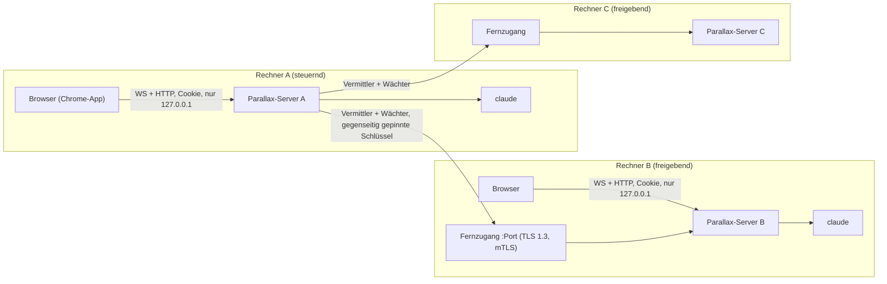

# WP-75 – Mehrere Rechner: Sessions eines anderen Rechners steuern (Plan)

Branch `feature/multi-host`, Stand `main` `bfac588`. **Nur Plan, nichts umgesetzt.** Umsetzung erst nach Freigabe
durch den Nutzer. Erste Fassung 16.11.2026; **überarbeitet im Gespräch mit dem Nutzer am 18.11.2026** (neutrale
Beschreibung, Rollen exklusiv, 1 : n, Kopplung per Code, Kryptografie, Verbindungsprotokoll, Seitenleiste, Versionen,
README). Ergänzt `docs/plan.md` „Mehrere Rechner“ und den gleichnamigen Backlog-Punkt.

## 0. Ausgangslage und Anforderungen

**Szenario:** Zwei oder mehr Windows-Rechner im selben Netz. Auf jedem laufen ein eigenes Parallax und ein eigenes
`claude` mit eigenem Login und eigenen Einstellungen. Von einem Rechner aus sollen die Sessions der anderen gesteuert
werden. Diese Beschreibung bleibt bewusst neutral: Sie nennt keine Rechnerarten, Modelle oder Netzdetails, weder hier
noch in Code, Tests, UI oder Beispieldaten.

**Begriffe**

| Begriff | Bedeutung |
|---|---|
| steuernder Rechner | zeigt und steuert seine eigenen Sessions und die freigegebener Rechner |
| freigebender Rechner | gibt seine Sessions für genau einen steuernden Rechner frei |
| Kopplung | dauerhaftes, gegenseitiges Vertrauen zwischen einem steuernden und einem freigebenden Rechner |
| Fernzugang | eigener Listener des freigebenden Rechners, nur für den steuernden Rechner |
| Vermittler | Teil des steuernden Servers, der Fenster-Verbindungen zum freigebenden Rechner durchreicht |
| Wächter | dauerhafte Hintergrundverbindung des steuernden Servers je freigebendem Rechner |

Im Code heißen die Seiten `hosts` (Liste der freigebenden Rechner auf dem steuernden) und `remoteAccess` (Fernzugang
auf dem freigebenden).

**Anforderungen des Nutzers**

| # | Anforderung |
|---|---|
| A1 | Der steuernde Rechner zeigt und steuert seine eigenen Sessions und die **mehrerer** freigebender Rechner in **einer** Oberfläche. |
| A2 | Der freigebende Rechner zeigt in seinem eigenen Fenster nur seine eigenen Sessions. |
| A3 | Beide Ansichten auf die freigegebenen Sessions sind **synchron**; der Nutzer kann jederzeit zwischen den Rechnern wechseln. |
| A4 | **Entwürfe** im Eingabefeld wandern zwischen den Rechnern mit. |
| A5 | Profile und Einstellungen des freigebenden Rechners werden in v1 **dort** gepflegt; der steuernde Rechner wählt sie nur aus. Neue Sessions auf dem freigebenden Rechner lassen sich vom steuernden aus starten, mit jedem dort eingerichteten Profil. |
| A6 | Anhänge und eingefügte Texte funktionieren auch für freigegebene Sessions. |
| A7 | Keine Zusatzsoftware (kein SSH, kein VPN): Der freigebende Rechner öffnet selbst einen Port im Netz. Adressen dürfen sich ändern. |
| A8 | Nur der gekoppelte Rechner kommt herein; Mitlesen und Fälschen sind ausgeschlossen; die Kopplung lässt sich jederzeit aufheben. Kryptografie auf **höchstem Niveau** (Nutzer: „sehr wichtig“). |
| A9 | Benachrichtigungen kommen dort an, wo der Nutzer gerade arbeitet. |
| A10 | Ein Rechner **steuert entweder andere oder wird gesteuert**, nie beides. Ein steuernder Rechner bindet mehrere freigebende ein, ein freigebender Rechner hat **genau einen** steuernden. |
| A11 | Freigeben ist **ab Werk aus** und muss aktiv eingeschaltet werden. |
| A12 | Der freigebende Rechner zeigt, ob der steuernde gerade verbunden ist, und **welche Rechner versucht haben, sich zu verbinden** (mit IP-Adresse), auch abgelehnte. |
| A13 | Nur **gleiche Versionen** arbeiten zusammen; **kein Update aus der Ferne**. |

**Nicht in v1**
- Profile und Einstellungen des freigebenden Rechners vom steuernden aus bearbeiten.
- „Im Editor öffnen“ und „Im Explorer zeigen“ für freigegebene Sessions (sie würden sich unsichtbar auf dem anderen
  Rechner öffnen).
- Erreichbarkeit von außerhalb des Netzes; Verbindungsaufbau vom freigebenden zum steuernden Rechner.
- Mehrere steuernde Rechner an einem freigebenden.
- Gleichlauf von UI-Kleinkram je Fenster: Breite der Seitenleiste, Gruppierung und eingeklappte Gruppen, gewählte
  Session.
- Gleichlauf von Anhängen, die im Eingabefeld liegen, aber noch nicht gesendet sind (heute nur im Speicher des
  Fensters).

## 1. Was schon vorbereitet ist (Stand `main` `bfac588`)

**Web-Client: kann mehrere Hosts**
- Session-Schlüssel `hostId:entryId` (`@shared/common`: `makeSessionKey`, `parseSessionKey`). Auf dem Draht steht nur
  `entryId`.
- Der Client-Store hält `hosts: Record<HostId, HostRecord>` mit Summaries, Status und `HostState` je Host
  (`src/web/state/store.ts`); die Listen-Selektoren laufen über alle Hosts (`src/web/state/hooks.ts`).
- Die Verbindungsliste nimmt n Hosts auf (`registerConnection` in `src/web/state/connection.ts`). Den `buildId`-
  Vergleich mit Reload macht nur der Heimat-Host. Der Transport ist austauschbar (`src/web/state/transport.ts`).
- `sendCommand(sessionKey, …)` schickt einen Befehl an den Host der Session.
- Lokale Aktionen hängen schon an „Host ist lokal“: Anhänge (`features/composer/Composer.tsx`, `canAttach`), Editor
  und Explorer (`shell/navigation/session-actions.tsx`), Öffnen mit Umschalt in Strg+K
  (`shell/navigation/QuickSwitcher.tsx`).
- `HostState` trägt je Host Profile, Default-Profil und Einstellungen (`@shared/model` `hostStateSchema`).
- Die Gruppierung der Seitenleiste nach Verzeichnis kennt den Host schon: Gruppenschlüssel `hostId|pfad`
  (`groupSessions` in `src/web/lib/session-order.ts`).
- `hello` meldet `protocolVersion`, `buildId` und `serverVersion` (`@shared/protocol`).

**Server: weiß nichts von Hosts**
- Mehrere Fenster an einem Server sind ein normaler, getesteter Fall: SyncHub mit Seq, Ringpuffer und Idempotenz; bei
  Entscheidungen gewinnt der erste Klick, die anderen Fenster bekommen `decision.resolved`; Präsenz und
  Benachrichtigungs-Routing je Fenster (Architektur A.9, ADR-129).
- `lastSeenAt`, Titel, Anheften und die Aufgabenliste liegen schon im Server.

**Was fehlt**
1. Der Server lauscht nur auf `127.0.0.1` (ADR-023). Die Anmeldung kennt nur Cookie und Launcher-Token.
2. Der Client kennt eine WebSocket-URL. Datei-, Blob- und Upload-URLs zeigen immer auf den eigenen Origin.
3. „Neue Session“ legt fest lokal an: `makeSessionKey(LOCAL_HOST_ID, …)` in `shell/NewSessionForm.tsx`; die zuletzt
   verwendeten Verzeichnisse (`recentProjects`, `shell/new-session/recent-projects.ts`) stammen aus den Sessions
   **aller** Hosts.
4. Die Seitenleiste kennt nur `flat | grouped` (`shell/navigation/sidebar-view.ts`); Gruppen lassen sich nicht
   einklappen.
5. Entwürfe liegen im `localStorage` des Browsers (`features/composer/state/drafts.ts`).
6. Das Benachrichtigungs-Routing setzt voraus, dass der native Toast auf dem Rechner des Nutzers erscheint.
7. Drei Stellen lesen Einstellungen vom Host der Session statt vom lokalen Host: `state/hook-display.ts`,
   `state/transcript-view.ts`, `notifications/delivery.ts`. Für freigegebene Sessions würde die Oberfläche damit die
   Darstellung des anderen Rechners übernehmen. Alle anderen Aufrufer lesen schon den lokalen Host.

## 2. Architektur und Grundentscheidungen

1. **Auf jedem Rechner läuft ein vollständiger Parallax-Server** mit eigenem `claude`, eigenen Profilen, eigener
   Registry und eigenen Einstellungen. Er bleibt die Quelle der Wahrheit für seine Sessions.
2. **Rollen schließen sich aus (A10).** Einstellung „Mehrere Rechner“: **Aus** (Default), **Freigeben** oder
   **Andere steuern**. Der Server erzwingt das: Freigeben lässt sich nicht einschalten, solange Rechner eingebunden
   sind, und umgekehrt. Damit ist das Weiterreichen fremder Sessions über mehrere Stufen strukturell ausgeschlossen.
3. **1 : n.** Ein steuernder Rechner bindet beliebig viele freigebende ein; ein freigebender Rechner hat genau eine
   Kopplung.
4. **Der steuernde Server ist der Vermittler.** Der Browser verbindet sich nie direkt mit einem anderen Rechner.
   - Das Sicherheitsmodell des Browsers bleibt unverändert: nur `127.0.0.1`, Same-Origin, SameSite-Cookie,
     Default-deny (ADR-018, ADR-023). CSP und Origin-Prüfung ändern sich nicht.
   - Schlüssel für die Kopplungen liegen im steuernden Server, nie im Browser.
5. **Durchleitung je Fenster (1 : 1).** Jede WebSocket-Verbindung eines Fensters zu einem freigebenden Rechner ist eine
   eigene Verbindung des Vermittlers dorthin; die Frames werden unverändert durchgereicht.
   - Für den freigebenden Server ist das Fenster des steuernden Rechners ein Fenster wie sein eigenes: eigene
     `clientId`, eigene Präsenz, Resync, Idempotenz.
   - Daraus folgt A3 ohne neue Mechanik: Verlauf, Status, Warteschlange, Entscheidungen, Titel, Anheften und „Seit du
     zuletzt hier warst“ sind auf beiden Seiten gleich. Das Protokoll bleibt dasselbe, der Server host-agnostisch.
6. **Fernzugang:** ein zweiter, eng begrenzter Listener nur für Server-zu-Server-Verkehr, ab Werk aus (A11). ADR-023
   gilt für den Browser-Pfad unverändert.
7. **Nur in eine Richtung.** Der steuernde Rechner verbindet sich zum freigebenden, nie umgekehrt. Der freigebende
   weiß nichts von den Sessions des steuernden (A2).
8. **Inhalte eines anderen Rechners lösen keine lokalen Aktionen aus.** Links öffnet der Rechner, an dem der Nutzer
   sitzt (lokales `link.open`, nur http(s)); Pfade des anderen Rechners werden nie für einen lokalen Dateizugriff
   verwendet; Editor und Explorer sind für freigegebene Sessions ausgeblendet; durchgereichte Antworten bekommen die
   Header-Regeln des steuernden Rechners (ADR-142).
9. **Nur gleiche Versionen (A13).** Weicht die Parallax-Version oder die Protokollversion ab, gilt der Rechner als
   „inkompatibel“; kein Reload, keine Reconnect-Schleife, kein Update aus der Ferne.
10. **Entwürfe liegen im Server** (A4), für alle Hosts; davon profitieren auch zwei Fenster am selben Rechner.
11. **Benachrichtigungen folgen dem Nutzer** (A9) über die Wächter-Verbindung (§4.6).

## 3. Sicherheitsmodell

### 3.1 Grundsätze
- **Höchstes Niveau, keine eigene Kryptografie.** Nur Node `crypto`/`tls` (OpenSSL) und Standardkonstruktionen:
  TLS 1.3 (RFC 8446), Exporter-Kanalbindung (RFC 5705/9266), HKDF (RFC 5869), HMAC-SHA-256.
- **Gegenseitige Anmeldung per Schlüssel, kein Bearer-Token.** Es gibt kein Geheimnis, das bei jeder Verbindung über
  die Leitung geht und woanders wiederverwendet werden könnte.
- **Vertrauen entsteht nur durch die Kopplung** am freigebenden Rechner (Knopfdruck vor Ort) und den dort angezeigten
  Code; Namen, Adressen und Zertifikatsfelder zählen nicht.
- **Geheimnisse:** Zufall nur aus `crypto.randomBytes`/`generateKeyPair`; Vergleiche mit `timingSafeEqual`;
  Geheimnisse, Codes und private Schlüssel nie im Log, nie im Browser, nie in Fehlermeldungen.

### 3.2 Bedrohungen und Gegenmaßnahmen

| Bedrohung | Gegenmaßnahme |
|---|---|
| Jemand im Netz erreicht den Port des freigebenden Rechners. | Ohne gepinnten Client-Schlüssel nur die Kopplungsroute. Die braucht einen Kopplungscode (128 Bit, 10 min, einmalig, nur nach „Rechner koppeln“ vor Ort); nach 3 Fehlversuchen einer Adresse (20 insgesamt) ist der Code verbraucht; Rate-Limit je Adresse und gesamt. Jeder Versuch steht mit Adresse im Verbindungsprotokoll (§3.7). |
| Mitlesen oder Verändern im Netz, auch später mit Quantenrechnern („jetzt speichern, später entschlüsseln“) | Nur TLS 1.3, nur AEAD-Suiten, Schlüsseltausch hybrid `X25519MLKEM768` ohne Rückfallstufe (§3.3). |
| Mann in der Mitte bei der Kopplung | Der Code wird an die konkrete TLS-Verbindung gebunden (Exporter); beide Seiten beweisen ihn per HMAC über Exporter und beide öffentlichen Schlüssel. Ein Mann in der Mitte hat zwei verschiedene TLS-Verbindungen und damit verschiedene Exporter → Abbruch. Offline-Raten am mitgeschnittenen HMAC ist bei 128 Bit aussichtslos (§3.5). |
| Mann in der Mitte nach der Kopplung | Beide Seiten pinnen den öffentlichen Schlüssel der anderen (SHA-256 über SPKI); jede Abweichung bricht den Handshake ab, bevor Daten fließen. |
| Diebstahl eines privaten Schlüssels (Kopie des Datenordners, Sicherung) | Private Schlüssel nur DPAPI-verschlüsselt (Windows-Konto, CurrentUser) im `PARALLAX_HOME`, Datei nur für den Nutzer (`homeAccess`). Ohne DPAPI kein Freigeben und kein Koppeln. Ein Schlüsselpaar je Kopplung; Aufheben löscht den Pin sofort. |
| Ein Browser im Netz oder auf dem freigebenden Rechner benutzt den Fernzugang (CSRF, DNS-Rebinding) | Der Listener verlangt mTLS, lehnt jede Anfrage mit `Origin`- oder `Sec-Fetch-*`-Header ab, setzt und liest keine Cookies und liefert keine Weboberfläche. |
| Ein kompromittierter freigebender Rechner greift den steuernden an | Der Browser prüft jede Nachricht mit zod (wie heute); Grundsatz 8 (keine lokalen Aktionen); durchgereichte Datei-Antworten bekommen lokale Header (Sandbox-CSP, `nosniff`, `content-disposition`) aus einer Allowlist von Inhaltstypen; Größenlimits für Frames und Downloads. |
| Freigabe bleibt versehentlich offen | Ab Werk aus; sichtbarer Zustand in den Einstellungen und in der Kopfzeile, solange verbunden; Verbindungsprotokoll; „Kopplung aufheben“ und „Freigeben aus“ trennen sofort. |
| Überlastung | Höchstens n Verbindungen des gekoppelten Rechners (Fenster + Wächter), Handshake- und Kopplungs-Rate-Limits je Adresse und gesamt; die Hub-Limits gelten wie heute. |

### 3.3 Transport
- `minVersion`/`maxVersion` `TLSv1.3`; Suiten nur `TLS_AES_256_GCM_SHA384` und `TLS_CHACHA20_POLY1305_SHA256`.
- Schlüsseltausch nur `X25519MLKEM768` (hybrid post-quanten-sicher). Beide Seiten haben dieselbe Version (A13), eine
  Rückfallstufe ist nicht nötig. Kann das OpenSSL von Node 26 die Gruppe nicht, entscheidet der Nutzer nach der
  Vorstudie (Vorschlag dann: nur `X25519`, Vermerk und Wiedervorlage).
- Signaturverfahren auf das gewählte Schlüsselverfahren beschränkt (`sigalgs`).
- Keine Session-Resumption, keine Tickets, kein 0-RTT.
- mTLS: Der freigebende Server fordert ein Client-Zertifikat an (`requestCert`) und prüft den Pin selbst, bevor eine
  Anfrage verarbeitet wird; ohne passenden Pin ist nur `POST /remote/v1/pair` erreichbar. Der steuernde Server prüft
  den Pin des freigebenden in `checkServerIdentity`/eigener Prüfung; Name und Adresse im Zertifikat zählen nicht.

### 3.4 Schlüssel und Zertifikate
- **Freigebender Rechner:** ein Identitätsschlüssel, erzeugt beim ersten Einschalten von „Freigeben“.
- **Steuernder Rechner:** ein eigenes Schlüsselpaar **je Kopplung**, erzeugt beim Koppeln. Kopplungen sind damit
  voneinander unabhängig.
- **Verfahren:** Ed25519 oder ECDSA P-384, die Vorstudie entscheidet (Unterstützung in TLS 1.3/OpenSSL und bei der
  Zertifikats-Erzeugung).
- **Zertifikat nur als Hülle:** selbstsigniert, lange gültig; geprüft wird nur der Pin auf den öffentlichen Schlüssel.
  Erzeugung ohne neue Abhängigkeit, wenn möglich: PowerShell `New-SelfSignedCertificate` (mit Export und Entfernen aus
  dem Speicher) oder ein kleiner, getesteter DER-Baustein mit `crypto.sign`; Ausweichweg eine Abhängigkeit (nur nach
  Freigabe und Mindestalter 14 Tage). PowerShell-Aufrufe wie die übrigen: absolute `.exe`, `windowsHide`, Werte über
  Umgebungsvariablen, nie im Skripttext.
- **Speicher:** private Schlüssel per DPAPI (`ProtectedData`, CurrentUser) verschlüsselt; Zugriff über einen Port
  „Schlüsselspeicher“, damit Tests ohne DPAPI laufen. Ist DPAPI nicht nutzbar (z. B. eingeschränkte PowerShell),
  verweigern Freigeben und Koppeln mit klarer Meldung, statt Schlüssel ungeschützt abzulegen.
- **Erneuern:** „Schlüssel erneuern“ auf dem freigebenden Rechner hebt die Kopplung auf; danach ist eine neue
  Kopplung nötig.

### 3.5 Kopplung
1. Der Nutzer wählt auf dem freigebenden Rechner „Mehrere Rechner → Freigeben“ und drückt „Rechner koppeln“. Besteht
   schon eine Kopplung, fragt Parallax „Ersetzt die Kopplung mit <Name>“; die alte wird erst beim erfolgreichen
   Koppeln aufgehoben und sofort getrennt.
2. Der freigebende Rechner zeigt **Rechnername, erkannte IPv4-Adressen, Port** und einen **Kopplungscode** mit
   Countdown (10 min): 128 Bit, Crockford-Base32 (26 Zeichen + Prüfzeichen), in Gruppen. Die Eingabe ist tolerant
   gegenüber Leerzeichen, Bindestrichen, Groß-/Kleinschreibung und Verwechslern (O/0, I/L/1).
3. Auf dem steuernden Rechner unter „Mehrere Rechner → Rechner hinzufügen“: Rechnername oder Adresse, Port, Code und
   ein Anzeigename.
4. Der steuernde Server erzeugt das Schlüsselpaar der Kopplung und baut TLS 1.3 mit diesem Client-Zertifikat auf.
   Beide Seiten berechnen
   - `ekm = exportKeyingMaterial(32, 'EXPORTER-parallax-pair-v1')`,
   - `k = HKDF-SHA256(ikm = code, salt = 'parallax-pair-v1', info = 'pairing key', 32)`.
5. Der freigebende Server sendet `macB = HMAC(k, 'responder' ‖ ekm ‖ spkiB ‖ spkiA)`. Der steuernde prüft (konstante
   Zeit) und sendet erst dann `macA = HMAC(k, 'initiator' ‖ ekm ‖ spkiA ‖ spkiB)` samt Anzeigename.
6. Der freigebende Server prüft `macA`, verbraucht den Code, speichert `spkiA` als Pin samt Name, Zeit und Adresse und
   bestätigt. Der steuernde speichert `spkiB` als Pin in `hosts.json` und verbindet sich.
7. Jeder Fehlschlag (falscher Code, abgelaufen, gebremst, MAC falsch) bricht ab, ohne dass etwas gespeichert wird, und
   steht im Verbindungsprotokoll.

Die genaue Nachrichtenfolge, Kodierungen (Längenpräfixe), Fehlerfälle und das Bedrohungsmodell legt die
**Krypto-Spezifikation in WP-76** fest; sie wird **vor der Umsetzung unabhängig geprüft**.

Ändert sich später die Adresse des freigebenden Rechners, passt der Nutzer sie auf dem steuernden an; das Vertrauen
hängt nur am Pin.

### 3.6 Kopplung aufheben
- **Freigebender Rechner:** „Kopplung aufheben“ löscht den Pin und schließt sofort alle Verbindungen des gekoppelten
  Rechners. Da es genau eine Kopplung gibt, ist das zugleich „alle widerrufen“. „Freigeben aus“ schließt den Listener
  und trennt ebenfalls sofort; die Kopplung bleibt dabei erhalten.
- **Steuernder Rechner:** „Rechner entfernen“ löscht Pin und Schlüssel und meldet sich, so weit erreichbar, beim
  freigebenden Rechner ab (`DELETE /remote/v1/peer/self`).
- Der steuernde Rechner zeigt bei aufgehobener Kopplung „Kopplung aufgehoben“ mit „Neu koppeln“.

### 3.7 Verbindungsprotokoll (A12)
- Der freigebende Server protokolliert jedes Ereignis am Fernzugang: Kopplung geglückt / fehlgeschlagen / gebremst,
  unbekannter oder aufgehobener Schlüssel, TLS-Abbruch (z. B. Port-Scanner), Version passt nicht, verbunden, getrennt.
- Je Eintrag: Zeit, Adresse (IP und Port), Art, angegebener Name (als „ungeprüft“ markiert, falls nicht gekoppelt).
  Gleiche Adresse und Art innerhalb einer Minute werden zu einer Zeile mit Zähler zusammengefasst.
- Ablage `<home>/remote/events.json` (`schemaVersion: 1`, Ringpuffer, etwa 500 Einträge oder 30 Tage); zusätzlich im
  Server-Log.
- Kein Reverse-DNS: Namen aus dem Netz sind nicht vertrauenswürdig und kosten Zeit.
- Ereignisse gibt es nur, solange „Freigeben“ an ist; sonst ist der Port zu.

## 4. Komponenten und Abläufe

### 4.1 Einstellung „Mehrere Rechner“ (beide Seiten)
- `settings.multiHost = {role: 'off' | 'share' | 'control', port: 4713, bindAddress: '0.0.0.0'}` (Defaults,
  additiv; Port und Adresse gelten nur für `share`).
- Rollenwechsel:
  - nach `off`: Listener zu bzw. Verbindungen zu den Rechnern getrennt; Kopplungen bleiben erhalten;
  - zwischen `share` und `control`: nur, wenn die alte Rolle keine Kopplung mehr hat; die UI bietet „Kopplung
    aufheben“ bzw. „alle Rechner entfernen“ mit Rückfrage an. Sonst `REMOTE_ROLE_CONFLICT`.
- UI: neuer Abschnitt „Mehrere Rechner“ in den Einstellungen mit der Rollenwahl; darunter je nach Rolle §4.2 oder §4.3.

### 4.2 Freigebender Rechner: Fernzugang
**Prüfungen beim Einschalten** (in der App, Ergebnis im Abschnitt): Port frei, Schlüssel und Zertifikat erzeugbar,
DPAPI nutzbar, erkannte Adressen, Hinweis zur Windows-Firewall (eingehende Regel für `node.exe` vorhanden, sonst fragt
Windows beim ersten Lauschen nach; je nach Rechner braucht die Freigabe Admin-Rechte). `pnpm preflight` bekommt
dieselben Prüfungen zusätzlich; Release-Installationen haben kein `pnpm`.

**Listener:** eigene HTTPS-Instanz im selben Prozess mit den Parametern aus §3.3. Nur diese Routen, alles andere 404:

| Route | Zweck | Anmeldung |
|---|---|---|
| `POST /remote/v1/pair` | Kopplung (§3.5) | Kopplungscode + Kanalbindung |
| `GET /remote/v1/health` | Parallax-Version, Protokollversion, `buildId`, Rechnername | mTLS (Pin) |
| `GET /remote/v1/ws` | WebSocket → `hub.attach` als normaler Client, markiert als „über Fernzugang“ | mTLS (Pin) |
| `GET /remote/v1/blob/:blobId` | Bilder und Blobs | mTLS (Pin) |
| `GET`/`HEAD /remote/v1/file` | Datei-Viewer (gleiche Regeln wie `/api/file`) | mTLS (Pin) |
| `POST /remote/v1/attachments` | Anhänge hochladen | mTLS (Pin) |
| `DELETE /remote/v1/peer/self` | steuernder Rechner hebt die Kopplung selbst auf | mTLS (Pin) |

**Ablage** unter `<home>/remote/`: Identitätsschlüssel (DPAPI) und Zertifikat; `peer.json` (`schemaVersion: 1`,
höchstens ein Eintrag: Name, Pin, `createdAt`, `lastSeenAt`, `lastAddress`); `events.json` (§3.7).

**`HostState.remoteAccess`** (nur hier): lauscht ja/nein, Adressen, Port, Ergebnis der Prüfungen, gekoppelter Rechner
(Name, verbunden ja/nein, zuletzt gesehen, letzte Adresse) oder keiner, Anzahl ungelesener abgelehnter Versuche.

**UI** im Abschnitt „Mehrere Rechner“ bei Rolle „Freigeben“:
- Zustand und Prüfungen, Port;
- „Rechner koppeln“ (Code mit Countdown, Rechnername, Adressen, Port);
- gekoppelter Rechner mit „verbunden“ / „zuletzt verbunden …“ und „Kopplung aufheben“; „Schlüssel erneuern“;
- Verbindungsprotokoll mit Filter „nur abgelehnte“.

In der Kopfzeile ein dezentes Symbol, solange der steuernde Rechner verbunden ist, und ein Hinweis bei neuen
abgelehnten Versuchen, bis der Nutzer das Protokoll angesehen hat.

### 4.3 Steuernder Rechner: Rechnerliste und Vermittler
- **Rechnerliste** `<home>/hosts.json` (`schemaVersion: 1`): `hostId` (Slug, z. B. `rechner-b`), Name, Farbe,
  Adresse, Port, Pin des freigebenden Rechners, Referenz auf den eigenen Schlüssel der Kopplung (DPAPI), `addedAt`.
- **Host-Befehle** über die lokale WS-Verbindung: `hosts.add {address, port, code, name}`,
  `hosts.update {hostId, name?, color?, address?, port?}`, `hosts.remove {hostId}`, `hosts.reconnect {hostId}`.
- **`HostState.remoteHosts[]`** (nur hier, ohne Schlüssel): `hostId`, Name, Farbe, Adresse, Port, Status
  (`connected | connecting | unreachable | incompatible | revoked`), Parallax-Version, Protokollversion, letzter
  Fehler.
- **Durchleitung** unter dem eigenen Origin, mit denselben Cookie-, Origin- und Host-Prüfungen wie alle Routen:
  - `GET /api/hosts/:hostId/ws` → je Browser-Verbindung eine Verbindung `wss://…/remote/v1/ws`; Frames unverändert,
    mit Größenlimit. Ist der Rechner nicht erreichbar oder lehnt er ab, schließt die Browser-Verbindung mit einem
    eigenen Close-Code; der Client zeigt den Status und versucht es mit Backoff erneut.
  - `GET /api/hosts/:hostId/blob/:blobId`, `GET`/`HEAD /api/hosts/:hostId/file`,
    `POST /api/hosts/:hostId/attachments`: streamend durchgereicht, mit Limits; die Antwort-Header setzt der steuernde
    Server selbst (Grundsatz 8).
- **Client der Gegenseite:** `ws` und `https.request` mit eigenem Agent: Client-Zertifikat der Kopplung, Prüfung des
  Pins, Parameter aus §3.3.
- **Wächter:** je Rechner eine dauerhafte Verbindung (`clientHello.kind: 'relay'`), nur Summaries, keine
  Session-Abos; liefert Status und Version für `remoteHosts` und die Benachrichtigungen (§4.6).

### 4.4 Web: mehrere Rechner
- **Start:** zuerst die lokale Verbindung wie heute, dann je Eintrag in `remoteHosts` eine `ManagedHostConnection` auf
  `/api/hosts/<id>/ws`, ohne `buildId`-Reload. Rechner lassen sich zur Laufzeit hinzufügen und entfernen.
- **Seitenleiste:**
  - Default wie heute flach nach Status; freigegebene Sessions tragen ein Badge (Kurzname, Farbe des Rechners). Die
    Kopfzeile der Session nennt den Rechner.
  - Der Umschalter „gruppiert/flach“ wird ein Menü **„Gruppieren nach“** mit den Häkchen **Rechner** und
    **Verzeichnis**: keins = flach; Rechner = je Rechner ein Block, darin nach Status; Verzeichnis = je Verzeichnis ein
    Block wie heute (gleicher Pfad auf zwei Rechnern = zwei Blöcke, Badge im Kopf); beide = Rechner, darin die
    Verzeichnisse.
  - „Rechner“ im Menü und das Badge erscheinen nur, wenn Rechner eingebunden sind. Der alte Wert `grouped` wird zu
    „Verzeichnis“.
  - Rechner-Gruppen in **fester Reihenfolge**: dieser Rechner zuerst, dann die Rechnerliste. Der Kopf zeigt Name,
    Farbe, Verbindungsstatus, Anzahl und Anzahl wartend.
  - **Rechner- und Verzeichnis-Gruppen sind einklappbar**; der Zustand wird je Fenster im `localStorage` gemerkt
    (Schlüssel = Gruppenschlüssel; verschwundene Gruppen werden beim Lesen verworfen). Eingeklappte Köpfe zeigen
    Anzahl und wartend; liegt die gewählte Session darin, ist der Kopf markiert.
  - Tastatur: Alt+1…9 zählt nur sichtbare Zeilen; Alt+N und „Wartet auf dich (n)“ zählen alles und klappen die Gruppe
    der Ziel-Session auf; Köpfe per Pfeiltasten erreichbar, Links/Rechts klappt (Baum), `aria-expanded`.
  - Code: `SidebarMode` → `{byHost, byFolder}` (`shell/navigation/sidebar-view.ts`), zweistufige Gruppierung und
    abgeflachte Reihenfolge (`lib/session-order.ts`), Menü und Köpfe (`shell/Sidebar.tsx`).
- **„Wartet auf dich“ und Strg+K** zeigen alle Rechner, wie heute nach Status sortiert.
- **Neue Session:**
  - zuerst den Rechner wählen; vorausgewählt ist der zuletzt benutzte;
  - Ordner-Browser, Profile und Default-Profil kommen von diesem Rechner (die Ordner-Befehle laufen schon als
    Host-Befehle über dessen Verbindung);
  - die **zuletzt verwendeten Verzeichnisse** zeigen nur die des gewählten Rechners; ein Rechnerwechsel leert ein
    Verzeichnis, das vom anderen Rechner stammt;
  - `NewSessionForm` baut den Schlüssel mit dem gewählten Rechner; „Neue Session hier“ im Kopf einer
    Verzeichnis-Gruppe übergibt den Rechner.
- **Rechnerabhängige URLs:** ein Helfer in `src/web/lib` übersetzt `/api/file`, `/api/blob/…` und `/api/attachments`
  für andere Rechner in `/api/hosts/<id>/…`. Betroffen: `features/files/state/file-source.ts`,
  `features/decisions/state/plan-data.ts`, `features/transcript/state/blob-source.ts`,
  `features/composer/lib/upload.ts`.
- **Einschränkungen für freigegebene Sessions:** Editor, Explorer und Öffnen mit Umschalt bleiben ausgeblendet
  (vorhandene Abfragen, jede einzeln prüfen); Anhänge sind erlaubt (`canAttach` hängt an „Rechner unterstützt
  Anhänge“, nicht mehr an „lokal“); `link.open` geht immer an den lokalen Server.
- **Welche Einstellungen gelten:** Darstellung immer vom eigenen Rechner (Sprache, Theme, Verlaufsansicht,
  Hook-Anzeige, Benachrichtigungen, Töne); vom Rechner der Session nur, was die Engine dort betrifft (Profile,
  Modelle). Umzustellen sind die drei Stellen aus §1, Punkt 7.
- **Einstellungen:** Abschnitt „Mehrere Rechner“ (§4.1–4.3). Für Profile und Einstellungen eines freigebenden
  Rechners gibt es keine Abschnitte (A5), nur den Hinweis „auf <Name> pflegen“.
- **Status:** Verbindungsanzeige je Rechner; Sessions eines nicht erreichbaren oder inkompatiblen Rechners werden grau
  und nehmen keine Befehle an; bei aufgehobener Kopplung „Kopplung aufgehoben“ mit „Neu koppeln“.
- i18n: neuer Namensraum `hosts` (`shell/hosts/i18n/{en,de}.ts`).

### 4.5 Entwürfe synchron (alle Hosts)
- **Speicher im Server:** je Eintrag `draft = {text, pastes[], rev, updatedAt, clientId}`, eigener Store
  `<home>/drafts/` (`schemaVersion: 1`); Limits über `LIMITS` (Text und Paste-Größe wie im Composer, dazu eine
  Obergrenze für den ganzen Entwurf).
- **Protokoll:** Befehl `session.setDraft {entryId, text, pastes, baseRev}`, vom Client etwa 400 ms nach dem Tippen;
  Änderung als Op über `applySessionOp` an alle Fenster der Session.
- **Konflikte:** Der letzte Schreiber gewinnt, in der Reihenfolge, in der der Server die Befehle annimmt. Ein Fenster
  übernimmt einen fremden Entwurf nur, solange es selbst seit der letzten Bestätigung nichts geändert hat; eigene
  Echos erkennt es an `clientId` und `rev`.
- **Senden löscht den Entwurf im Server** und damit überall.
- **`localStorage` bleibt Zwischenspeicher** für Reload und Verbindungsabbruch (nach dem Wiederverbinden wird ein
  neuerer lokaler Stand nachgesendet); beim ersten Start nach dem Update übernimmt der Server einmalig vorhandene
  lokale Entwürfe, wenn er selbst keinen hat.
- Noch nicht gesendete Anhänge wandern nicht mit (§0).

### 4.6 Benachrichtigungen (A9)
Schon heute: Fenster des steuernden Rechners sind für den freigebenden Server normale Clients. Hat eines den Fokus,
bekommt es die In-App-Meldung; war es das zuletzt fokussierte, bekommt es die Web Notification (A.9).

Offen sind zwei Fälle:
1. **Der freigebende Server würde nativ toasten** (zuständiges Fenster darf keine Web Notifications, oder kein Fenster
   offen); dieser Toast erschiene unbemerkt auf dem anderen Rechner.
2. **Auf dem steuernden Rechner ist kein Fenster offen;** er erfährt von Ereignissen des anderen Rechners nichts.

**Lösung über den Wächter** (§4.3):
- Wo der freigebende Server heute den nativen Toast wählen würde, entscheidet der zuletzt fokussierte Client: War es
  ein Fenster über den Fernzugang, oder war nie ein eigenes Fenster fokussiert, während der Wächter verbunden ist, geht
  `notify{delivery:'system'}` an den Wächter. Sonst bleibt alles wie heute. Da es höchstens einen steuernden Rechner
  gibt, gibt es höchstens einen Wächter.
- Der steuernde Server zeigt dann seinen nativen Toast: Texte in seiner Sprache; Entfernen bei „beantwortet/gesehen“
  wie heute; ein Klick mit `openOnClick` öffnet die Session dort. Der Protokoll-Link bekommt dafür den Rechner:
  `parallax://session/<hostId>/<entryId>`; die alte Form bleibt gültig.
- **Filter:** „Nicht stören“, Ereignisauswahl und Mindestdauer wertet heute der Server der Session aus. Für Meldungen,
  die auf dem steuernden Rechner erscheinen, gelten zusätzlich dessen Filter (im Client für In-App- und Web-Meldungen,
  im steuernden Server für den Toast des Wächters). Damit wirkt „Nicht stören“ am steuernden Rechner auch für
  freigegebene Sessions.

### 4.7 Versionen und Updates (A13)
- Dieses Vorhaben bringt `PROTOCOL_VERSION` von 4 auf 5.
- **Zusammenarbeit nur bei gleicher Parallax-Version** (`serverVersion` aus `hello` bzw. `/remote/v1/health`) **und**
  gleicher Protokollversion. Der Fernzugang prüft das beim Verbindungsaufbau und lehnt sonst mit eigenem Code ab
  (Eintrag im Verbindungsprotokoll); der steuernde Rechner prüft ebenfalls.
- Weicht die Version ab: Status `incompatible`, Sessions grau, Hinweis „Parallax auf <Name> auf <Version>
  aktualisieren“; der freigebende Rechner zeigt „Der gekoppelte Rechner hat Parallax <Version>“. Erneut versucht wird
  auf „Erneut verbinden“, nach einem Neustart der Gegenseite oder alle 5 min. Kein Reload, keine Schleife.
- **Kein Update aus der Ferne.** Jeder Rechner aktualisiert sich selbst über „Jetzt aktualisieren“ (WP-87…89). Nach
  einem Update ist die Verbindung unterbrochen, bis alle beteiligten Rechner dieselbe Version haben.

### 4.8 Betrieb
- Parallax läuft auf jedem Rechner wie heute: Installation aus dem Release, Autostart bei der Anmeldung,
  Chrome-App-Fenster bei Bedarf.
- Abmelden oder Neustart des freigebenden Rechners beendet seinen Server; nach der nächsten Anmeldung startet er von
  selbst, und der steuernde Rechner verbindet sich wieder.
- Ändert sich die Adresse des freigebenden Rechners, passt der Nutzer sie auf dem steuernden an (oder verwendet den
  Rechnernamen).

### 4.9 README
- Neuer Abschnitt **„Mehrere Rechner“** (eigene Überschrift nach „Starten“, vor „Andere Registry“): Rollen,
  Freigeben, Koppeln per Code, Kopplung aufheben, Verbindungsprotokoll, Firewall-Abfrage, gleiche Version auf allen
  Rechnern, Sicherheit in Kürze. Dazu ein Satz in der Einleitung.
- **Die Screenshots zeigen das Feature nicht:** Die Showcase-Demos (`src/web/playground/showcase/`, erzeugt von
  `scripts/screenshots.ts`) bleiben bei einem Rechner. Ein Test im Showcase sichert „kein Rechner-Badge, keine Option
  ‚Rechner‘“. Die Bilder werden nur neu erzeugt, wenn sich die Seitenleiste sichtbar ändert (Menü „Gruppieren nach“),
  und dann angesehen.

## 5. Contracts v5 (Überblick; Detail-Spezifikation in WP-76)

| Bereich | Änderung |
|---|---|
| `@shared/protocol` | `PROTOCOL_VERSION` 5. Host-Befehle `hosts.add/update/remove/reconnect`; `remoteAccess.pair` → `{code, expiresAt, hostName, addresses, port}`, `remoteAccess.unpair`, `remoteAccess.renewKey`, `remoteAccess.events {onlyRejected?}`, `remoteAccess.eventsSeen`. Session-Befehl `session.setDraft`, Op `draft`. `clientHello.kind` (`window`/`relay`, Default `window`). |
| `@shared/model` | `settings.multiHost` (Default `role: 'off'`). `HostState.remoteHosts[]` und `HostState.remoteAccess` (Defaults leer). `SessionDetail.draft` (Default `null`), optional `SessionSummary.hasDraft`. Ereignis-Schema des Verbindungsprotokolls. |
| `@shared/http` | `/api/hosts/:hostId/{ws,blob/:blobId,file,attachments}`, `REMOTE_PATHS` (`/remote/v1/…`), Close-Codes der Durchleitung und des Fernzugangs, Format und Parser des Kopplungscodes (rein, ohne Node-APIs), Exporter-Label. |
| `@shared/errors` | `HOST_UNREACHABLE`, `HOST_INCOMPATIBLE`, `HOST_REVOKED`, `PAIRING_INVALID`, `PAIRING_EXPIRED`, `PAIRING_RATE_LIMITED`, `REMOTE_ACCESS_FAILED`, `REMOTE_ROLE_CONFLICT`, `REMOTE_KEYSTORE_UNAVAILABLE`, `DRAFT_TOO_LARGE` (Texte en/de). |
| `@shared/common` | `LIMITS` für Entwürfe und das Verbindungsprotokoll; Gültigkeit und Fehlversuche des Kopplungscodes; Default-Port des Fernzugangs. |
| Server-Ports | neu `src/server/remote/ports.ts` (Fernzugang, Kopplung, Peer-Store, Verbindungsprotokoll), `src/server/hosts/ports.ts` (Rechnerliste, Vermittler, Wächter), Port „Schlüsselspeicher“ (DPAPI; Ort legt WP-76 fest), Draft-Store als Port der Engine. |
| Persistierte Schemas | `remote/peer.json`, `remote/events.json`, `hosts.json`, `drafts/`, jeweils `schemaVersion: 1`; neue Felder in bestehenden Schemas nur mit Default (`settings.multiHost`). |
| Abhängigkeiten | `ws` direkt (heute transitiv über `@fastify/websocket`, keine neue Paketversion). Nur im Ausweichfall eine Bibliothek für Zertifikate (§3.4). Beides braucht die Freigabe des Koordinators, neue Versionen das Mindestalter von 14 Tagen. |

## 6. Arbeitspakete

| WP | Inhalt | Besitz-Pfade (Kern) | Größe | Hängt ab von |
|---|---|---|---|---|
| WP-76 | **Vorstudie, Krypto-Spezifikation, Contracts v5:** Spikes (`X25519MLKEM768` in Node 26; Ed25519 vs. P-384; Zertifikat ohne Abhängigkeit; DPAPI per PowerShell inkl. eingeschränkter PowerShell; mTLS mit Pin in Fastify und `ws`; `exportKeyingMaterial` auf beiden Seiten; WS-Durchleitung). Krypto-Spezifikation mit Bedrohungsmodell, **unabhängiges Review vor der Umsetzung**. Danach Contracts nach §5, Ports, Samples, ADRs, Preflight-Prüfungen. | `src/shared/**`, `**/ports.ts`, `scripts/preflight*`, Doku | M | – |
| WP-77 | **Entwürfe synchron:** Draft-Store, `session.setDraft`, Op, Senden löscht; Composer auf Server-Entwürfe, `localStorage` als Zwischenspeicher, einmalige Übernahme. Nutzt schon mit einem Rechner. | `src/server/sessions/**` (Draft), `src/web/features/composer/state/**` | M | WP-76 |
| WP-78 | **Freigeben:** Rolle, Prüfungen, Schlüssel und Zertifikat, Listener mit TLS-Parametern und Routen-Allowlist, Kopplung mit Kanalbindung und Rate-Limit, Peer-Store, Aufheben trennt sofort, Verbindungsprotokoll, Versionsprüfung, `HostState.remoteAccess`; UI-Teil „Freigeben“ und Kopfzeilen-Symbol. | neu `src/server/remote/**`, Abschnitt in `src/web/features/preferences/**` | L | WP-76 |
| WP-79 | **Andere steuern:** Rolle, `hosts.json`, Schlüssel je Kopplung (DPAPI), Host-Befehle, Kopplung als Client, WS- und HTTP-Durchleitung mit lokaler Header-Politik und Limits, Status und Version in `remoteHosts`, Wächter (ohne Toast-Teil). | neu `src/server/hosts/**`, Routen in `src/server/http/**` | L | WP-76 |
| WP-80 | **Web für mehrere Rechner:** Verbindungen je Rechner, Badge und Farbe, „Gruppieren nach“ mit Einklappen, Neue Session je Rechner inkl. zuletzt verwendeter Verzeichnisse, rechnerabhängige URLs, Einschränkungen, `link.open` lokal, UI-Teil „Andere steuern“, Status und Versionshinweise, Einstellungsquellen, Showcase-Test „ohne Feature“. | `src/web/state/**`, `src/web/shell/**`, `src/web/lib/**`, betroffene Stellen in `features/**` | L | WP-76 (Test gegen FakeHost), WP-79 für E2E |
| WP-81 | **Benachrichtigungen über Rechner:** Routing-Erweiterung für den Wächter, nativer Toast auf dem steuernden Rechner, Protokoll-Link mit Rechner. | `src/server/sessions/**` (Routing), `src/server/hosts/**` (Toast), `src/server/launcher/**` (Link) | M | WP-78, WP-79 |
| WP-82 | **Integration und Abschluss:** Verdrahtung (`main.ts`, `app/**`), E2E mit drei Servern, Security-Review (Krypto, Fernzugang, Kopplung, Vermittler, Web), Fix-Runde, README (§4.9), Changelog, Live-Checkliste. | `src/server/main.ts`, `src/server/app/**`, `e2e/**`, `README.md`, Doku | M | alle |

- WP-77, WP-78 und WP-79 können nach WP-76 parallel laufen: keine gemeinsamen Dateien, je Paket gezielte Tests. Volle
  Checks macht der Koordinator nacheinander (ADR-154).
- Reihenfolge, falls nacheinander: 76 → 77 → 78 → 79 → 80 → 81 → 82. WP-77 bringt schon allein Nutzen.
- Merge nach `main` erst nach WP-82: grüne Checks, E2E, Reviews, Fix-Runde. Die Live-Prüfung auf zwei Rechnern macht
  der Nutzer (§7).

## 7. Teststrategie

**Je WP (Vitest)**
- TLS: nur 1.3; fremde Suites, Gruppen und Signaturverfahren abgelehnt; keine Resumption.
- Pinning: falscher Schlüssel → Abbruch, bevor Daten fließen (beide Richtungen); ohne Pin nur `pair`.
- Kopplung: Code einmalig, Ablauf, 3 Fehlversuche, Rate-Limit; MITM-Simulation (zwei TLS-Verbindungen) scheitert;
  Replay eines mitgeschnittenen Ablaufs scheitert; nichts wird bei Fehlschlag gespeichert; Ersetzen der Kopplung.
- Code-Parser: Prüfzeichen, Toleranz bei Eingabe, Ablehnung falscher Längen.
- Schlüsselspeicher: DPAPI-Rundlauf; fehlendes DPAPI → `REMOTE_KEYSTORE_UNAVAILABLE`, nichts Unverschlüsseltes auf der
  Platte.
- Fernzugang: lehnt `Origin`/`Sec-Fetch-*`, Cookies und unbekannte Routen ab.
- Aufheben trennt laufende Verbindungen sofort; Rollenkonflikte.
- Verbindungsprotokoll: alle Ereignisarten, Zusammenfassung mit Zähler, Ringpuffer, „gesehen“.
- Durchleitung: Frame-Limits, Close-Codes; lokale Header-Politik auch bei manipulierten Headern der Gegenseite.
- Statuswechsel `connected → unreachable → connected`; `incompatible` (Parallax- und Protokollversion) ohne Schleife.
- Entwürfe: Konfliktregeln, Echo, Senden löscht, Übernahme aus `localStorage`.
- Routing-Matrix der Benachrichtigungen mit Wächter.
- Web: Badge, „Gruppieren nach“ (vier Ansichten, Migration von `grouped`), Einklappen und Tastatur, Rechnerwahl und
  Verzeichnisse je Rechner, URL-Übersetzung, ausgeblendete Aktionen, Einstellungsquelle, Showcase ohne Feature.

**E2E (FakeBackend, ein Rechner)**

Drei eigene Server: „A“ (steuernd, Home A) und „B“, „C“ (freigebend, Home B/C, Fernzugang auf `127.0.0.1`, eigene
Ports, Test-Schlüsselspeicher).
1. Kopplung A–B und A–C über den Code; falscher Code wird abgelehnt und steht in B's Verbindungsprotokoll.
2. Sessions von B und C erscheinen auf A mit Badge; „Gruppieren nach Rechner und Verzeichnis“, Einklappen, Alt+N.
3. Neue Session auf B von A aus mit einem Profil von B; zuletzt verwendete Verzeichnisse je Rechner.
4. Ein Prompt von A wird auf B beantwortet; im zweiten Browser-Kontext direkt auf B wird eine Plan-Entscheidung
   freigegeben, auf A ist sie sofort erledigt.
5. Entwurf auf A erscheint im Fenster von B und umgekehrt; Senden löscht ihn auf beiden Seiten.
6. Datei-Viewer und Anhang für eine Session von B; Editor und Explorer fehlen.
7. B neu starten → A verbindet sich wieder; B zeigt „verbunden“.
8. Kopplung auf B aufheben → A zeigt „Kopplung aufgehoben“; zweiter steuernder Rechner koppelt mit B → der erste wird
   getrennt.
9. Abweichende Version (Test-Schalter) → Hinweis auf beiden Seiten, kein Reload.
10. Rollenkonflikt: B kann nicht „Andere steuern“, solange gekoppelt.
11. Benachrichtigung geht an A, wenn dort zuletzt gearbeitet wurde.

**Live (Nutzer, Checkliste in WP-82)**
1. Freigeben auf dem zweiten Rechner einschalten, Prüfungen ansehen, Firewall-Abfrage.
2. Koppeln per Code.
3. Eine echte Session auf dem zweiten Rechner vom ersten aus, neue Session mit einem dortigen Profil.
4. Zwischen den Rechnern wechseln; Entwurf mitnehmen.
5. Verbindungsprotokoll mit einem absichtlich falschen Code.
6. Benachrichtigungen.
7. Zweiten Rechner neu starten; ein Rechner aktualisiert → Versionshinweis.

Kein Live-`claude` in den automatischen Tests.

## 8. Offene Punkte (später oder in WP-76 zu entscheiden)
- Ergebnisse der Spikes (§6, WP-76): Schlüsselverfahren, Zertifikats-Erzeugung, ML-KEM in Node 26, DPAPI unter
  eingeschränkter PowerShell.
- Farben der Rechner: feste Palette aus den Design-Tokens, Vorschlag je Rechner automatisch, änderbar.
- Profile und Einstellungen des freigebenden Rechners vom steuernden aus bearbeiten (später, A5).
- Kopplungscode als QR-Code: nicht nötig.

## 9. ADR-Entwürfe (angenommen erst mit der Freigabe von WP-76)

ADR-205…211 sind vorgemerkt; was darüber hinausgeht, bekommt beim Annehmen die nächsten freien Nummern (Stand: ab 224).

- **ADR-205 – Vermittler im lokalen Server, je Fenster eine Verbindung.** Der Browser verbindet sich nie mit anderen
  Rechnern. Der lokale Server reicht jede WS-Verbindung 1 : 1 durch, HTTP streamend. Begründung: Das Sicherheitsmodell
  des Browsers bleibt unverändert, Protokoll und Server bleiben host-agnostisch, Synchronität und Präsenz ergeben sich
  aus dem vorhandenen Mehrfenster-Modell.
- **ADR-206 – Fernzugang als zweiter Listener mit mTLS und gegenseitig gepinnten Schlüsseln.** Nur
  Server-zu-Server, nur TLS 1.3 mit AEAD-Suiten und hybridem Schlüsseltausch `X25519MLKEM768`, keine Resumption; kein
  Bearer-Token; private Schlüssel per DPAPI, ohne DPAPI kein Fernzugang; Routen-Allowlist, Browser-Anfragen
  abgewiesen, ab Werk aus. ADR-023 gilt unverändert für den Browser-Pfad.
- **ADR-207 – Kopplung per Code mit Kanalbindung.** 128 Bit, 10 min, einmalig, 3 Fehlversuche; Beweis beider Seiten
  per HMAC über TLS-Exporter und beide öffentlichen Schlüssel; danach Pin. Keine eigene Kryptografie, kein
  Fingerabdruck zum Abtippen; Adressänderungen brechen das Vertrauen nicht.
- **ADR-208 – Inhalte anderer Rechner lösen keine lokalen Aktionen aus.** Links öffnet der lokale Server, Pfade des
  anderen Rechners werden nie lokal verwendet, Editor und Explorer sind für freigegebene Sessions aus, die
  Header-Politik ist lokal.
- **ADR-209 – Nur gleiche Versionen arbeiten zusammen, kein Update aus der Ferne.** Gleiche Parallax- und
  Protokollversion; sonst `incompatible` ohne Reload und ohne Schleife; jeder Rechner aktualisiert sich selbst.
  Ersetzt den Entwurf „nur die Protokollversion zählt“ (16.11.2026).
- **ADR-210 – Entwürfe im Server, letzter Schreiber gewinnt.** `localStorage` bleibt Zwischenspeicher; Senden löscht
  den Entwurf überall.
- **ADR-211 – Benachrichtigungen folgen dem Nutzer über Rechner.** Wächter-Verbindung je freigebendem Rechner;
  Routing-Erweiterung auf dem freigebenden; nativer Toast auf dem steuernden; Protokoll-Link mit Rechner.
- **ADR-(224) – Rollen exklusiv, 1 : n.** Ein Rechner ist aus, freigebend oder steuernd; ein freigebender hat genau
  eine Kopplung, ein steuernder beliebig viele. Begründung: kein Weiterreichen über mehrere Stufen, einfaches
  Vertrauens- und Benachrichtigungsmodell.
- **ADR-(225) – Verbindungsprotokoll mit abgelehnten Versuchen.** Der freigebende Rechner zeigt jeden Versuch mit
  Adresse, persistent und zusammengefasst, ohne Reverse-DNS.
- **ADR-(226) – Seitenleiste: Gruppierung wählbar, Gruppen einklappbar.** „Gruppieren nach“ Rechner und/oder
  Verzeichnis (Verzeichnisse innerhalb der Rechner), Rechner in fester Reihenfolge, Zustand je Fenster. Ersetzt den
  Umschalter `flat | grouped` (WP-35).
